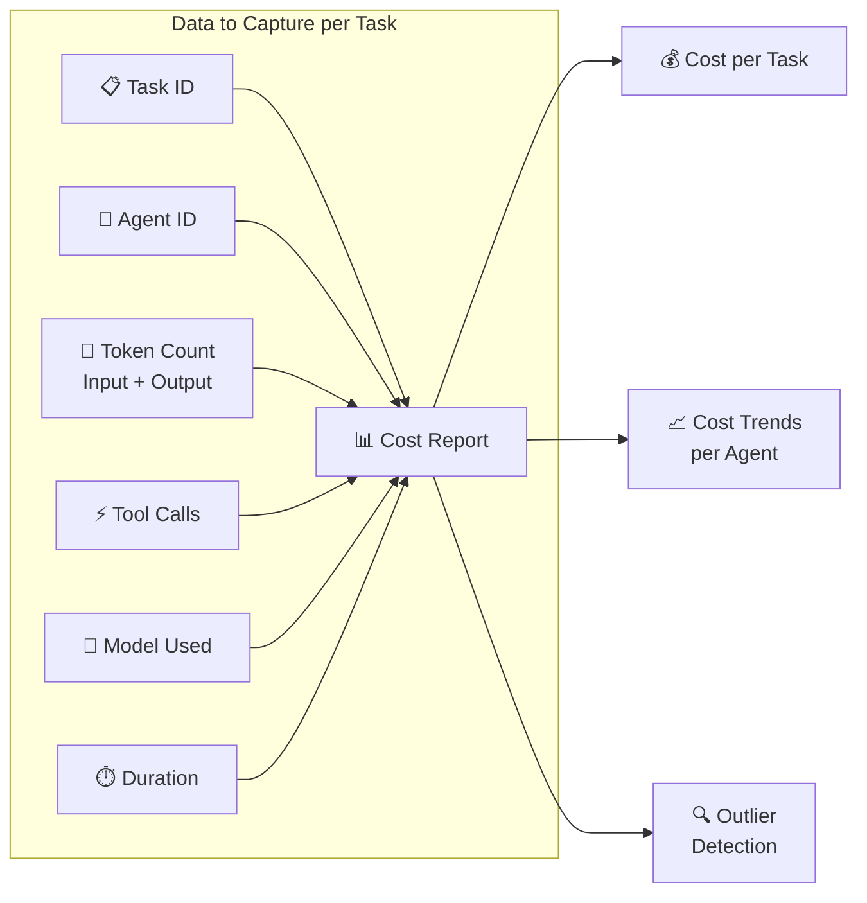

Most teams track AI agent costs the same way they track electricity: monthly, in aggregate, from the provider dashboard. The bill goes up, you look at the number, you try to remember if you deployed anything new last month.

That's not cost tracking. That's cost discovery. And it always happens after the damage is done.

Per-task cost tracking is different. It tells you exactly what each piece of work costs, which agents are expensive, and why.

## Why Aggregate Spend Is Useless

Your LLM provider shows you total tokens used. Maybe a daily chart. That's it.

This tells you nothing about which of your 8 agents is responsible for the spike. It tells you nothing about whether your research agent costs $0.04 per task or $0.40. It doesn't show you that your summarization agent's costs doubled last week because someone added a 50,000-token context window to the prompt.

To make cost decisions — which model to use, whether to add caching, whether a new agent design is actually better than the old one — you need cost at the task level.

## What Per-Task Cost Tracking Looks Like

For every agent run, you want to record:

- Task ID
- Agent ID
- Input token count
- Output token count
- Total tokens used
- Model used
- Number of tool calls (each call adds latency and sometimes cost)
- Total cost in dollars
- Task duration

With this data, you can answer:

- Which agent is most expensive per task?
- Has cost changed for Agent X over the last 30 days?
- What's the cost difference between using GPT-4 and Claude for this task type?
- Is this new prompt cheaper or more expensive than the old one?



## Step 1: Instrument Your Agents

If you're using an LLM SDK directly, most providers return token usage in the completion response. Capture it.

```
response = client.messages.create(...)
input_tokens = response.usage.input_tokens
output_tokens = response.usage.output_tokens
cost = calculate_cost(input_tokens, output_tokens, model)
```

Log this alongside the task ID and agent ID. If you're running OpenClaw-compatible agents through AgentCenter, cost tracking is built into the platform — you don't write this code yourself. The [agent monitoring](/features/agent-monitoring) dashboard shows per-task cost alongside status and duration.

## Step 2: Build a Cost Baseline Per Agent

Run 50-100 tasks for each agent and compute:

- Average cost per task
- P95 cost per task (the expensive outliers)
- Cost distribution (is it tight or wildly variable?)

A tight distribution (P95 = 1.5x average) means the agent's cost is predictable. You can budget for it. A wide distribution (P95 = 10x average) means there are edge cases you don't understand yet.

## Step 3: Set Cost Alerts Per Task, Not Per Month

Once you have a baseline, set an alert: if any single task costs more than 3x the baseline, flag it.

This catches:

- Runaway retry loops (agent keeps retrying expensive tool calls)
- Unusually large inputs (someone submitted a 200-page document to an agent designed for 2-page briefs)
- Prompt changes that accidentally added huge context
- Model changes that increased token consumption

Monthly billing alerts are too slow. Task-level alerts catch problems within minutes.

## Step 4: Use Cost Data to Make Model Decisions

This is the payoff. Once you have per-task cost data, you can run real comparisons.

Example: You're considering switching your summarization agent from GPT-4 to Claude Haiku to reduce costs. Run 100 tasks with each model. Compare:

- Cost per task (Haiku will likely be lower)
- Quality score from review gate (Haiku might be slightly lower)
- Decide if the cost savings are worth the quality tradeoff

Without per-task data, you're guessing. With it, you're making a decision with real numbers.

## Common Mistakes

**Tracking tokens instead of cost.** Token counts are useful for debugging. Cost is what matters for decisions. The conversion rate between tokens and cost varies by model and provider. Track both, but cost is the primary metric.

**Ignoring tool call costs.** Agents that use tools (web search, code execution, database queries) incur costs outside of token usage. If your agent makes 20 search calls per task, those calls add up. Track them separately.

**Not attributing costs to projects.** If you're running multiple projects, you want cost broken down by project, not just by agent. Different teams or clients should have separate cost views.

**Forgetting retry costs.** If your agent retries a failed call, that retry costs tokens. Make sure your cost tracking captures the total cost of a task, including retries — not just the successful call.

## Bottom Line

Per-task cost tracking takes an afternoon to set up and changes how you make model and prompt decisions permanently. You stop guessing which agents are expensive. You start knowing.

The teams I've seen do this well treat per-task cost the same way they treat unit tests: not optional, built in from the start, and checked regularly.

_The best time to set this up is before your agents start failing. [Try AgentCenter free for 7 days](/pricing) — cancel anytime._
