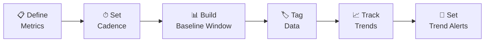

Most teams check if their agents are running. They track error counts, task completion rates, and token spend. What they skip is output trend tracking: measuring whether agent output quality is improving, degrading, or drifting from one week to the next.

Output quality can drift in a direction your dashboards don't show. The agent runs without errors. The task completes. But the outputs it delivers this week are subtly different from what they looked like a month ago. Not broken — just worse. And by the time that shows up in customer feedback or a stakeholder complaint, you've lost weeks of signal you could have acted on.

This is the problem output trend tracking solves.

## What Output Trend Tracking Actually Means

A baseline is a snapshot. It tells you what "normal" looked like on the day you measured it. A trend is a sequence of snapshots that shows which direction you're moving.

Trend tracking for AI agents means measuring quality indicators at regular intervals and comparing them period over period. Not just "did this week's average cost go up" but "has reviewer rejection rate been climbing for three consecutive weeks?"

The metrics that matter most for trend tracking are different from the ones most teams monitor:

- **Reviewer rejection rate**: the share of agent outputs flagged or sent back for revisions. This is the most direct proxy for quality.
- **Retry rate**: how often agents need to re-attempt a step. Rising retries usually point to prompt drift, context issues, or upstream instability.
- **Cost per useful output**: not just cost per task, but cost per task that passed review. A rising number here means quality is falling even if per-task cost looks flat.
- **Task completion time drift**: a slow creep in how long agents take often signals context window saturation or a dependency getting slower.

## How to Set This Up in 6 Steps

### 1. Define your trend metrics

Pick 3 to 5 metrics you'll track consistently. More than that and you won't review them weekly. Fewer and you'll miss important signals. Reviewer rejection rate, retry rate, and cost per useful output are usually the right starting set. Add task duration if your agents run long-running tasks.

### 2. Set the collection cadence

Weekly works for most agents. Pull a summary every Monday covering the prior seven days. For high-volume agents processing thousands of tasks daily, daily tracking is worth the setup. For low-volume critical agents, weekly is fine.

### 3. Build a baseline window, not a baseline point

Don't use day one as your baseline. Use the first two to three weeks of stable production as your reference range, an average with a reasonable variance band. That way a normal fluctuation doesn't trigger an alert every other week.

### 4. Tag your data by agent, task type, and period

When pulling data from AgentCenter's [agent monitoring](/features/agent-monitoring) views, filter by agent and pull weekly stats. Tag each data point by agent name, task category, and date window. This lets you slice later when something looks off — was the spike in rejections across all task types or just one?

### 5. Visualize week over week, not just current vs. baseline

A chart showing the last 12 weeks of reviewer rejection rates tells you far more than a single number compared to a static baseline. Direction matters. A metric that's been creeping up for three weeks signals something the weekly snapshot hides entirely.

### 6. Set trend-based alerts, not just threshold alerts

A threshold alert fires when a metric exceeds a fixed number. A trend alert fires based on direction. "Alert if reviewer rejection rate increases for three consecutive weeks" catches drift earlier than "alert if rejection rate exceeds 15%." Set both, but the trend alert is what you'll thank yourself for later.

## A Real Example in AgentCenter

Say you're running a content drafting agent that produces articles. In AgentCenter, human reviewers approve or reject each deliverable submitted through the review workflow.

You set up a recurring weekly task in AgentCenter to log the following every Monday:

- Outputs submitted by the agent in the prior week
- Outputs approved on first review
- Outputs rejected or returned for revisions
- Total token spend for the week
- Average task duration

You calculate the rejection rate as rejected divided by total submitted. You log this to a shared sheet or internal tracking tool. After four weeks, you have a trend line.

In week six, the rejection rate bumps from 12% to 19%. One week is not a trend. In week seven, it holds at 18%. Week eight, it hits 21%. That's the signal. You dig in using the activity feed in AgentCenter and trace the spike back to a prompt change deployed in week five. That change quietly broke the agent's output structure for a specific content category.

Without trend tracking, you'd see a slightly elevated rejection rate on any given review day and move on. With trend tracking, you see a pattern and can trace it to a specific week and a specific change.

## Common Mistakes

**Tracking baselines but not trends.** A baseline tells you what normal was. It doesn't tell you if you've left normal behind. Most teams set a baseline on launch day and never look back.

**Looking only at averages.** A weekly average can look fine while a subset of task types degrades silently. Track rejection rates per task category, not just overall. Aggregates hide the outliers that are usually worth investigating.

**Trend tracking without root cause investigation.** Seeing a three-week climb in retry rate is useful. Knowing it's because an upstream API started returning stale data is what lets you actually fix it. Build a habit of investigating trend changes, not just logging them.

**Treating cost and quality trends as separate.** A rising cost per task isn't always a problem. A rising cost per useful output almost always is. Combine your cost data with your quality data. The [agent monitoring](/features/agent-monitoring) views in AgentCenter show both in context.

**Waiting until the trend is undeniable.** By week four of a declining trend, the problem has usually been compounding for weeks. Set up your trend alerts at the three-week mark. Catching it early means a smaller fix.

## Bottom Line

A single metric today tells you today's performance. A trend line tells you if you're heading toward a problem or away from one. For AI agents in production, the failures that matter most are the ones that build slowly. Trend tracking is how you see them coming.

---

*The best time to set this up is before your agents start failing. [Try AgentCenter free for 7 days](/pricing) — cancel anytime.*
