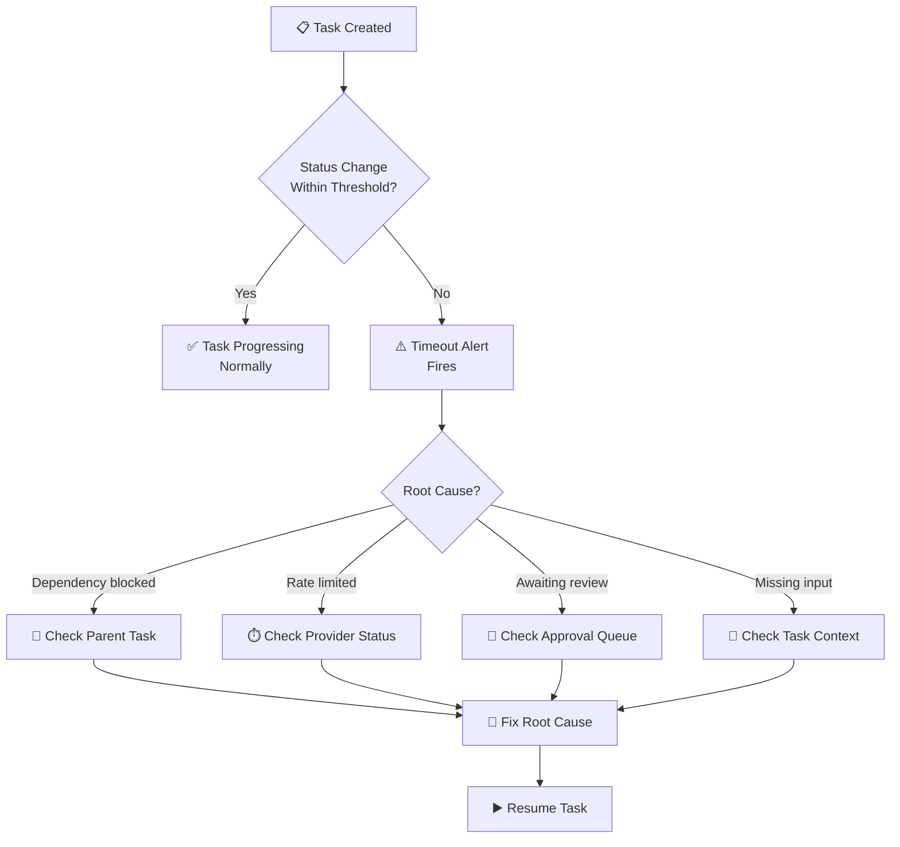

A blocked agent task is not the same as a failed one. Failed tasks throw errors. Blocked tasks sit there looking fine while everything downstream waits on them.

Most teams discover a blocked task when someone asks why a deliverable hasn't landed. By then, the task has been stuck for hours — sometimes days. The agent isn't crashing. The dashboard shows it running. But it hasn't moved.

This is how you track blocked AI agent tasks before they become incidents.

## What "Blocked" Means in Practice

Blocked means the task can't proceed. The most common reasons:

- **Waiting on a dependency**: a parent task hasn't finished, so the child can't start
- **Waiting on human review**: an approval gate hasn't been cleared
- **Rate limited**: the agent's LLM provider is throttled and the task is retrying silently
- **Missing input**: the task was created with incomplete context the agent can't fill in
- **Timed out then stalled**: the task exceeded a timeout but no recovery workflow fired

None of these surface as errors. The task just sits. Most monitoring tools look for crashes and high latency — not for tasks that have stopped making progress.

## Step 1: Define What Blocked Means for Your Fleet

Before you can track blocked tasks, agree on what the word means. A practical definition:

A task is blocked if it has not changed status or produced output within a window you define — for example, 30 minutes for short tasks, 4 hours for long-running ones.

Write this down. Make it specific per task type. A daily report agent that takes 2 hours is not blocked at 45 minutes. A quick data extraction task that hasn't moved in 20 minutes probably is.

In [AgentCenter's agent monitoring](/features/agent-monitoring), you can set task-level timeouts. When a task exceeds your threshold without a status change, it fires an alert instead of waiting silently.

## Step 2: Surface Stalled Work on the Kanban Board

Your [AgentCenter Kanban board](/features/task-orchestration) gives you a column view across all tasks in a project. The issue with the default view: "In Progress" includes both tasks that are actively running and tasks that are stuck mid-execution.

To tell them apart:

1. Sort by "Last Updated" ascending
2. Tasks that haven't been updated recently bubble to the top
3. Filter by "In Progress" and review anything older than your blocked threshold

This works. A task assigned 3 hours ago to an agent that normally completes in 20 minutes needs a click. The last status update timestamp is your first signal.

## Step 3: Use Task Dependencies to Trace Upstream Blockers

If you've configured task dependencies in AgentCenter, a blocked child task shows its parent's status directly. This is the fastest way to understand why something is stuck.

When a task is in "Waiting" state because a dependency hasn't completed, you'll see:

- The parent task ID and current status
- How long the child has been waiting
- Whether the parent is itself blocked or just slow

If the parent has been "In Progress" longer than expected, trace it up one more level. Most cascading blockages have a single root task that's the actual problem.

## Step 4: Set Timeout Alerts for Tasks That Stall

The most reliable way to catch blocked tasks is to set timeouts that fire when tasks stop progressing.

In AgentCenter:

1. Go to the task settings for the relevant agent
2. Set a "max duration without status change" threshold
3. Choose what happens when the threshold fires: alert, auto-escalate, or pause

For agents running unattended overnight, a 2-hour window catches most blockages before morning. For critical pipelines, 30 minutes is appropriate.

Pair alerts with the activity feed. When a task fires a timeout alert, the feed shows where the task was when it stopped — which call it made last, what it was waiting for.

## Step 5: Build a Daily Blocked Task Check

Timeout alerts catch problems as they happen. A daily check catches chronic patterns — agents that regularly stall at the same step, dependencies that consistently slow down downstream work.

Each morning:

1. Pull the last 24 hours of task activity in AgentCenter
2. Filter for tasks that exceeded 2x their average completion time
3. Check if any stalled at the same dependency or the same approval gate

If 3 tasks stalled at the same point yesterday, they'll probably stall there again today. That's a pattern worth fixing, not monitoring.

## Common Mistakes

**Treating "In Progress" as "fine."** In Progress means the task was started. It doesn't mean it's moving. Check when the last status change happened before assuming it's healthy.

**Not distinguishing between types of blocked.** A task waiting on human review is different from a task throttled by rate limits. The fix is different. Don't merge them into a single "blocked" alert bucket.

**Using the same timeout for every task.** A research agent and a classification agent don't run at the same speed. Uniform timeouts will either miss slow-moving blockages or flood you with false alerts.

**Ignoring blocked tasks that resolve themselves.** If a task was blocked for 4 hours and then completed on its own, that still needs investigation. Rate limit pressure, dependency delays, and review backlogs compound — a task that quietly waited once will wait longer next time.

## Bottom Line

Blocked tasks are invisible failures. They don't generate error logs. They don't show red on your dashboard. They sit there while your pipeline waits.

The fix is straightforward: define what blocked means for your fleet, set timeout alerts in AgentCenter, use task dependencies to trace upstream causes, and review stalled work daily. The sooner you catch a blocked task, the cheaper it is to fix.

---

*The best time to set this up is before your agents start failing. [Try AgentCenter free for 7 days](/pricing) — cancel anytime.*
