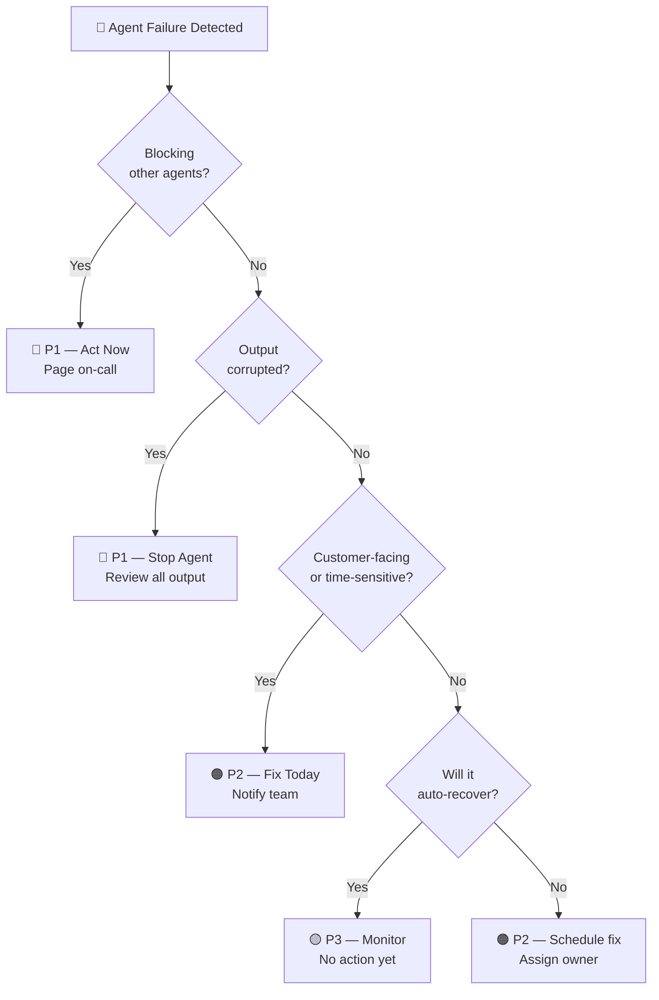

You have 12 agents running. Three just reported failures. You have no idea which one to look at first.

That's the real problem. Without a triage system, you end up investigating in the wrong order. You spend an hour on the agent that auto-recovers while the one that was silently corrupting data keeps running. Or you page the whole team for a rate-limit retry that would have resolved itself in four minutes.

Triage is what separates a team that handles agent failures calmly from a team that's constantly firefighting.

## What Triage Means for AI Agents

Triage is the practice of sorting failures by impact so you respond to the right one first. The goal isn't to fix everything at once. It's to know, within 60 seconds of an alert, whether you need to drop everything or add it to your queue.

A good triage system answers four questions fast:

1. What type of failure is this?
2. How many tasks or agents does it affect?
3. Can it recover on its own?
4. Who owns it right now?

## Step 1: Identify the Failure Type

Not every failure looks the same. There are four types you'll hit repeatedly:

**Crashed:** The agent stopped running entirely. Error logged, no output, downstream tasks are stuck. This one is obvious.

**Stuck or looping:** The agent is still technically running but not making progress. No crash, no error message. These are the sneaky ones, and they're often worse than crashes because nothing flags them automatically.

**Wrong output:** The agent completed successfully but produced incorrect, incomplete, or off-format results. Often detected downstream, sometimes much later.

**Rate-limited:** The agent hit an API quota and is queued, retrying, or silently backing off.

Each type has a different urgency profile. A crash is loud and easy to catch. A stuck agent can hold up an entire pipeline for hours before anyone notices. Wrong output can be the most damaging because it keeps going until someone checks the actual result.

## Step 2: Measure the Blast Radius

Once you know the failure type, check how many other things it's touching.

A single agent failing on one isolated task is low priority unless it's customer-facing. That same agent failing while three others are waiting on its output is high priority regardless of what the task is.

Ask these four questions:

- Is this agent part of a multi-agent pipeline?
- Are there tasks queued behind it, waiting for output?
- Is this agent customer-facing or internal?
- Is there a hard deadline on this task (a scheduled report, a real-time decision)?

Blast radius determines urgency more than failure type does.

## Step 3: Check the Recovery Path

Some failures fix themselves. Others need someone to step in immediately.

| Recovery type | What it means | Action needed |
|---|---|---|
| Auto-restart | Agent retried and recovered | Monitor only |
| Rate-limit retry | Waiting on quota reset | Track ETA, watch for cascade |
| Manual restart | Crash with no auto-recovery | Someone triggers restart |
| Prompt or logic fix | Wrong output, needs code change | Dev work required |
| Rollback | Failure corrupted state or downstream data | Stop and restore now |

Rollback cases are always P1, full stop. Everything else depends on the blast radius and recovery path together.

## Step 4: Use a Priority Matrix

Here's a simple decision tree to run through when a failure hits. Adjust the thresholds to your team's tolerance.

**P1:** Drop everything. Agent is blocking others, corrupting data, or causing visible failures for users. Page someone now.

**P2:** Handle today. Agent is down but not cascading. Customer-facing or time-sensitive enough that it can't wait until tomorrow.

**P3:** Add to queue. Auto-recovering or non-critical. Watch the retry count. If it's still P3 by end of day, schedule it.

## Step 5: Assign Ownership Immediately

A failure with no owner stays unresolved. The moment you classify a failure as P1 or P2, assign it to a specific person before you do anything else.

In AgentCenter, every task and agent has its own thread. You can @mention the person responsible directly from the [task board](/features/task-orchestration) and log what you know so far. That creates a paper trail and kills the "I thought you were handling it" problem at the start.

Don't leave it in a general Slack channel and hope someone picks it up. Assign it. Name the person. Set an expectation.

## How AgentCenter Makes Triage Faster

The [agent monitoring dashboard](/features/agent-monitoring) shows real-time status across your entire fleet. When something breaks, you can see at a glance which agents are affected and whether the failure is spreading.

The activity feed shows the sequence of events before the failure. What was the agent doing? What input did it receive? When did it stop making progress? This moves triage from "I have no idea what happened" to "here's exactly where it went wrong" in about 30 seconds.

For multi-agent pipelines, the [workflow view](/features/multi-agent-workflows) maps which tasks are blocked downstream of a failed agent. That's your blast radius, calculated automatically.

## Common Mistakes

**Treating everything as P1.** When every failure is critical, none of them are. Your team chases alerts that didn't need immediate attention, burns out, and misses the actual P1 buried in the noise.

**Ignoring stuck agents.** Stuck agents don't throw errors. If your monitoring only watches for crashes, you'll miss the agent that's been spinning for two hours with no output. Set a progress timeout in addition to a crash alert.

**No ownership defined.** Triage without assignment is just classification. You've identified the problem and then left it floating. If nobody owns it, it doesn't get fixed. The handoff needs to happen in the same breath as the classification.

**Debugging in priority order of loudness.** The agent generating the most log lines and retries isn't necessarily the most important one. Always check blast radius before you start digging.

## Bottom Line

Most agent failures don't need immediate attention. A handful do, and those are the ones that will compound if you get to them 30 minutes late. A triage system doesn't need to be complicated. It needs to answer: how bad is this, how many things does it touch, and who's handling it. Start there.

---

*The best time to set this up is before your agents start failing. [Try AgentCenter free for 7 days](/pricing) — cancel anytime.*
