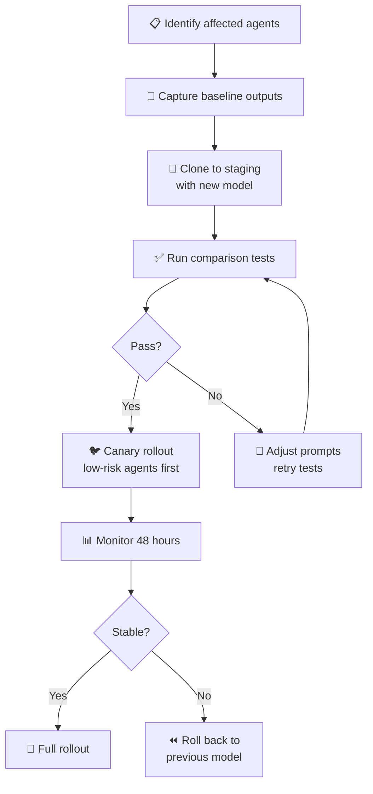

Your LLM provider just shipped a new model. Your first thought is probably "upgrade everything." Your second thought, if you've been burned before, is "wait, which agents will break?"

Both are correct. New models are often genuinely better. They also change in ways that break agents quietly, and you won't get a diff or deprecation warning to tip you off.

## Why LLM Upgrades Are Riskier Than They Look

Upgrading a library version changes a defined API surface. Upgrading an LLM version is different. The model might:

- Format output differently on the same prompt
- Follow instructions more literally (or less)
- Handle edge cases in ways your prompts didn't anticipate
- Respond differently to system prompts that worked fine before

You won't see a compiler error. Some agents will get better. Others will produce slightly wrong outputs without failing visibly. That's the failure mode you need to plan for.

## The Upgrade Process

Here's a repeatable process for upgrading agents to a new LLM version without surprises.

### 1. Identify Which Agents Use the Model Being Upgraded

Start by listing every agent that uses the model. If you're running more than a handful of agents, you probably don't have this list in your head. Pull it from your [agent dashboard](/features/agent-dashboard).

Filter by provider and model version. You're looking for every affected agent, including the ones that "don't matter much." Those are often the ones that break quietly.

### 2. Capture Baseline Outputs Before You Touch Anything

Pick 20 to 50 representative tasks for each agent and record the current outputs. These are your ground truth.

You want a mix of:
- Normal cases that always work
- Edge cases that occasionally fail
- Cases that historically required prompt tuning

If you skip this step, you'll have no way to tell whether changes after the upgrade are improvements or regressions.

### 3. Set Up Staging With the New Model

Create a copy of each affected agent in a staging environment configured with the new model version. Keep prompts identical. Change nothing else.

In AgentCenter, you can duplicate agent configurations and point them at a separate project with the new model version. This lets you run your baseline task set against both environments side by side. See the [agent monitoring view](/features/agent-monitoring) for how this looks in practice.

### 4. Compare Outputs Systematically

Run the same representative tasks against both the old and new model versions. Look for:

- Output format changes (JSON structure, field names, length)
- Semantic drift (different conclusions on the same input)
- Instruction-following differences
- New failure modes you haven't seen before

Don't just check whether the agent "seems fine." Diff the actual outputs.

For high-volume agents, sample intelligently. Running 500 tasks takes time. Running 30 representative ones tells you most of what you need to know.

### 5. Adjust Prompts If Needed

New models often need prompt adjustments. That's expected. What you're looking for is whether the adjustments are minor (acceptable) or major (a warning sign that this upgrade creates ongoing maintenance work).

If you need to rewrite more than 20% of a prompt to get comparable behavior, pause. That agent might need more time in staging before it's ready for production.

### 6. Roll Out in Waves

Don't flip all your agents to the new model at once. Roll out in waves:

- **Wave 1:** Low-risk agents (ones that don't touch customer-facing output)
- **Wave 2:** Medium-risk agents, with close monitoring
- **Wave 3:** High-risk or high-volume agents, only after Wave 2 is stable

Use the task monitoring view in AgentCenter to watch error rates, latency, and output quality in real time during the rollout.

### 7. Monitor for 48 Hours

Most issues after a model upgrade surface in the first 48 hours. Set up alerts for:

- Error rate spikes
- Latency increases above your baseline
- Output quality drops (if you have automated validation)

If you see any of those, roll back fast. Keeping the previous model version configured and ready makes rollback a 2-minute task rather than an emergency.

## A Real Example: Upgrading a Content Review Agent

Say you have a content review agent that checks every blog draft before it reaches an editor. It looks for tone, brand voice, and factual consistency.

Your provider releases a new model version. You start with baselines: capture 30 real drafts and their current review outputs.

In staging, the new model gives more detailed feedback. That sounds good. But it also flags things as "inconsistent" that the old model accepted. The upgrade improves coverage but increases false positives.

You adjust the prompt to tell the model to be more conservative on brand voice checks. After that, outputs match closely enough to move forward. You roll it to production agents first, watch it for two days, then apply the same upgrade to the full fleet.

The key was having those 30 baseline examples. Without them, you'd have been comparing feelings instead of outputs.

## Common Mistakes

**Upgrading all agents at the same time.** If something breaks, you won't know which agent caused it. Roll out sequentially.

**Skipping low-risk agents.** They break quietly. Nobody notices for weeks. Then someone does an audit and finds that a background agent has been producing garbage for a month.

**Not capturing baselines first.** Without baselines, you're comparing vibes, not outputs. That's how regressions slip through.

**Treating a model upgrade like an infra change.** Infra changes have defined failure modes. LLM upgrades introduce probabilistic shifts that only show up in real outputs.

## Bottom Line

LLM upgrades are worth doing. New models are usually better. But "usually better" is not a rollout plan.

The process is: baseline first, staging second, canary rollout third, full rollout only after you've seen stable numbers for 48 hours. Run the same process every time, and model upgrades become routine instead of risky.

---

*The best time to build this process is before the next model drops. [Try AgentCenter free for 7 days](/pricing) — cancel anytime.*
