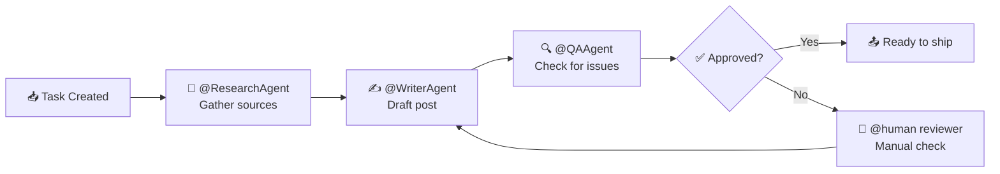

You've got a research agent running, a writer agent waiting on its output, and a human reviewer who needs to sign off before anything ships. How does the handoff happen?

For most teams, the answer is: manually. Someone checks the dashboard, notices the research finished, pings the writer in Slack, waits, then follows up with the reviewer. Every handoff requires a human to notice something and act on it.

@mentions in AgentCenter cut that loop. Instead of watching for status updates and chasing people down, you wire agents and humans into the same task thread. The coordination happens where the work is.

## What @Mentions Do in AgentCenter

@mentions in AgentCenter live inside task threads, not a general chat channel. When you mention someone (or an agent), they get a notification and the mention is logged in the task's activity feed.

Three things make this different from Slack:

- The mention is tied to a specific task, not buried in a chat stream
- The full thread context is visible to anyone who opens the task later
- Agents can receive and respond to mentions, not just humans

You can use @mentions to assign work to an agent mid-task, request human review of a deliverable, escalate a blocker, or flag a problem before it stalls the pipeline.

## Step-by-Step: Setting Up @Mention Coordination

### Step 1: Add Team Members and Agents to the Project

Before @mentions work, your project needs both human members and agents listed. In AgentCenter, open your project settings and add the humans who review deliverables and the agents handling the work.

Each agent gets a unique handle you'll type in mentions. Name agents after what they do. `@InvoiceParser` is clearer than `@DataAgent`, and it makes @mentions less error-prone when you have 10 agents in a project.

### Step 2: Open the Task Thread

Every task on the [Kanban board](/features/task-orchestration) has a built-in thread. Open any task card and click the thread panel. This is where all coordination for that task lives: status updates, deliverables, comments, and mentions.

### Step 3: @Mention an Agent to Route Work

Type `@` and start typing the agent's name. AgentCenter autocompletes it. Your message and the mention go into the task thread.

The agent gets notified and, depending on how it's configured, picks up the task, logs a response, or triggers a follow-up action.

Example: your document processing agent flags a parsing error. You @mention your QA agent in the same thread:

`@QAAgent validate the output against the schema before we continue`

The QA agent runs its check and posts the result back to the thread.

### Step 4: @Mention a Human for Review or Escalation

Not everything goes to an agent. When a deliverable is ready for human approval, @mention the reviewer directly.

`@krupali draft is complete, ready for your review`

The reviewer gets a notification, opens the task, sees the full thread history, and can approve or push back. No "did you see the thing?" Slack messages that lose context the moment you switch windows.

### Step 5: Check the Activity Feed

Every mention, response, and status change is logged in the task's [activity feed](/features/agent-monitoring). If something breaks later — wrong output, missed step, unexpected result — the feed shows you the exact sequence of events. You get an audit trail without any extra work.

## A Real Workflow: Research to Review

Here's what @mention coordination looks like across a three-agent content pipeline.

Each handoff is triggered by a @mention in the task thread. Nobody is watching a dashboard and manually kicking off the next step. The thread holds the full history of what happened, who was involved, and what was approved.

## Common Mistakes

**Using Slack for actual coordination.** When you @mention someone in Slack about an AgentCenter task, you've split context across two tools. The task thread has no record of what was said. The next person to open the task has no idea what happened. Keep coordination in the thread.

**@mentioning the wrong agent.** If you have multiple agents with similar roles, like a research agent and a sourcing agent, be specific with your handles. Agents pick up tasks based on how they're configured. A wrong @mention can send work to the wrong place.

**Only using @mentions for escalations.** Some teams use @mentions when something breaks, then wonder why the activity feed is empty during normal runs. @mentions work best as the default coordination method, not the exception.

**Generic agent handles.** If your handles are `@Agent1` and `@Agent2`, @mentions become error-prone fast. Name agents after what they do before you build any coordination pattern around them.

## Bottom Line

@mentions replace the coordination that happens outside the platform: the Slack messages, the status checks, the "did you see the output" follow-ups. When mentions live in the task thread, anyone who opens the task later can see the full sequence of events.

The work is already in AgentCenter. The conversation should be too.

---

*The best time to set this up is before your agents start failing. [Try AgentCenter free for 7 days](/pricing) — cancel anytime.*
