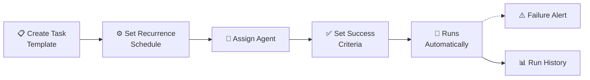

Some agents don't wait for someone to tell them to run. A price monitoring agent needs to check every hour. A nightly report agent needs to fire at 2am. A sync agent needs to run every 15 minutes whether or not anyone's at a keyboard.

Manual triggers don't work for this. You'll forget. The person who remembers leaves the company. It works fine until the day it matters and you were in a meeting.

That's what recurring tasks are for.

## What a Recurring Task Actually Is

A recurring task re-creates itself on a schedule. You configure it once — the agent, the inputs, the frequency — and it keeps firing without anyone touching it.

It's different from a cron job in one important way: the agent is the executor. You're not running a shell script on a timer. You're telling an AI agent to pick up a specific task at a specific interval and produce a specific output.

That distinction matters because the task has structure. It has a status. It has output. It can fail, get retried, or go to a review queue. You can see its history. You can compare the output from Monday's run to Tuesday's.

A cron job that silently fails is invisible. A recurring task that fails shows up in your [AgentCenter dashboard](/features/agent-monitoring).

## When to Use Recurring Tasks

Not every agent workflow needs a schedule. A one-off analysis, a triggered action, a response to an external event — those don't fit here.

Use recurring tasks when the agent has to run regardless of whether anyone asks it to. Good candidates:

- **Monitoring agents** — check a feed, a metric, a competitor page, or a data source
- **Sync agents** — pull from an API and write to a database on a fixed interval
- **Report agents** — generate a daily, weekly, or hourly summary
- **Cleanup agents** — expire stale records, archive old tasks, clear queues
- **Validation agents** — verify a pipeline produced expected output before downstream work starts

A useful test: if this agent didn't run for 24 hours, would something break? If yes, it probably needs a recurring task.

## How to Set Up a Recurring Task in AgentCenter

Recurring task automation is available on Pro and Scale plans. Setup takes about 5 minutes.

**Step 1: Create a task template**

In your AgentCenter project, create a new task. Fill in the title, description, and any fixed input fields the agent needs on every run. This becomes the template each scheduled run copies.

**Step 2: Turn on recurrence**

Open the task settings and find the Recurrence section. Set the interval — hourly, every N hours, daily at a specific time, or a custom cron expression. AgentCenter shows a plain-English label so you can confirm the schedule before saving.

**Step 3: Assign the agent**

Pick the agent that handles this task type. Each new run routes to that agent automatically. If the agent is offline when a run triggers, the task waits in queue rather than silently skipping.

**Step 4: Set success criteria**

Define what a successful run looks like. You can require a minimum output length, a specific field to be present, or link the task to an approval step if the output needs human sign-off before the next run starts. This is the step most teams skip — and the one that catches the most problems.

**Step 5: Save and monitor**

Once saved, the first run fires at the next scheduled time. Every run creates a new task card visible in the [Kanban board](/features/task-orchestration). You can see the full run history, compare outputs side by side, and get alerted if a run fails or produces output outside the expected range.

## A Real Example: Nightly Content Audit Agent

One team runs 3 content publishing agents. Every night at midnight, a fourth agent — the auditor — checks the previous day's output and flags anything below a quality threshold.

Without a recurring task, someone had to kick off the auditor manually. It ran about 60% of nights. The other 40%, bad output sat unreviewed for days before anyone noticed.

After setting up a recurring task, the auditor runs every night at midnight, compares output against the quality rubric, and creates a review task if anything fails. The human sees it in the morning. No one has to remember to start it.

Looking at 4 weeks of run history also revealed something they hadn't noticed: quality failures clustered on Monday nights, right after weekend publishing sessions. That pattern was invisible when the auditor ran inconsistently.

## Common Mistakes

**Running too frequently.** A recurring task that fires every 5 minutes for a task that takes 4 minutes to complete will overlap itself. Either the second run starts before the first finishes, or you build a backlog of queued runs. Check your agent's average runtime before setting the interval.

**No failure handling.** If a run fails, what happens next? Does the schedule continue or pause? Does anyone get notified? Most teams configure a recurring task and never touch the failure path. At minimum, set an alert and decide whether failures should halt the schedule.

**Using the same task for variable inputs.** Recurring tasks work best when inputs are fixed or generated at runtime. If you're manually editing the input fields before each run, you're not using a recurring task — you're just creating tasks manually on a schedule. Parameterize the inputs or have the agent fetch them at the start of each run.

**Skipping the run history.** The value of recurring tasks isn't just automation — it's the history. Agents change behavior over time. Prompts drift. Data sources shift. Looking at the last 30 runs of a monitoring agent is how you catch that before it causes a real problem.

## Bottom Line

Recurring tasks turn always-on agent workflows from "someone has to remember" into actual infrastructure. The setup in AgentCenter takes about 5 minutes. The value compounds over time as the output becomes comparable, reviewable, and auditable across runs.

If you have agents that need to run on a schedule, stop keeping them on manual triggers.

---

*The best time to set this up is before your agents start failing. [Try AgentCenter free for 7 days](/pricing) — cancel anytime.*
