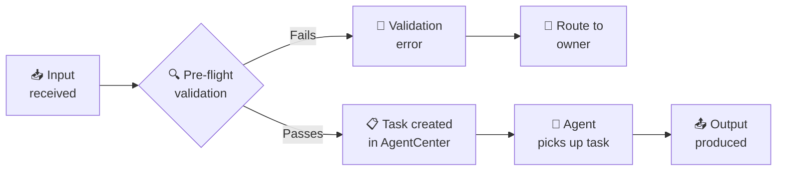

Most agent failures don't start in the agent. They start with the input.

A customer ID that's actually a UUID from a test environment. An empty email field that slipped through a form. A date string formatted as "July 2026" instead of ISO 8601. A task that references a document deleted three weeks ago.

Your agent processes all of it. The output comes back looking complete. You don't find the problem until a stakeholder asks why the follow-up email went to the wrong person — if they say anything at all.

Input validation for AI agents is the step most teams skip because they're watching the output. But the output is downstream of the input. Fix the input before the agent sees it, and you prevent a class of failures that no dashboard metric will catch.

## Why Agent Input Validation Differs From Code Validation

In traditional software, input validation checks types and constraints. Is this field a string? Is this number positive? Does this match a regex?

Agent input validation has to go further. You're checking whether the data the agent needs to do its job actually exists, makes sense, and is current.

A research agent that writes a customer summary needs a real customer record, a valid account history, and a task description that matches what the customer actually asked about. If any of those are wrong or missing, the agent still runs. The output still lands. The failure is invisible until someone reads it.

That's the core problem. Code that gets a null pointer throws an exception. Agents that get bad inputs produce bad outputs and call the task complete.

## Step 1: Write Down What Your Agent Actually Needs

Before you can validate inputs, you need a spec. Most teams don't have one.

For each agent, document:

- **Required fields** — the inputs the agent cannot run without
- **Format rules** — date formats, ID patterns, string lengths
- **Reference requirements** — external IDs that must exist (customer IDs, document references, project codes)
- **Freshness limits** — inputs where staleness causes wrong output (prices, inventory counts, status flags)
- **Size constraints** — maximum document length, maximum number of records in a batch

Write this as a structured spec. Not a comment buried in a prompt file. A document the on-call engineer can read when the agent starts failing at midnight.

## Step 2: Run Validation Before the Task Is Created

The right place to catch bad inputs is before the task enters your queue — not when the agent picks it up.

If a task with bad inputs reaches the agent, you've already wasted queue capacity and potentially triggered downstream steps. Validate before creation.



The validation step sits between your input source and your task queue. Tasks that fail validation don't get created. The agent never sees them.

## Step 3: Use Three Distinct Check Layers

Not all input failures look the same. Separate your checks into three layers so each failure routes to the right place.

**Layer 1 — Structure checks**

Verify required fields are present. Check types and formats. This layer should be fast and cheap — run it first, fail early.

```
required: customer_id, task_type, due_date
customer_id: non-empty string
due_date: ISO 8601, must be in the future
```

**Layer 2 — Reference validity**

Query external systems to confirm that referenced IDs actually exist. This catches deleted records, cross-environment copy-paste errors, and stale handoffs between teams.

Before a writing agent receives a task referencing brief ID 4821, check that document 4821 exists and is accessible. If it's been archived or the ID was mistyped, block the task now.

**Layer 3 — Freshness checks**

For time-sensitive data, validate that the input isn't stale. Define a maximum age per field type.

A pricing agent working from a rate sheet that's 72 hours old will quote wrong numbers. A freshness check flags this before the task runs.

## Step 4: Categorize Failures So the Right Person Handles Them

When validation fails, the error needs to go somewhere useful.

| Failure type | Example | Response |
|---|---|---|
| Missing required field | No customer ID in task | Route to data team |
| Bad format | Date as "next Tuesday" | Auto-fix if possible, else reject |
| Invalid reference | Document ID not found | Block and @mention requester |
| Stale data | Rate sheet older than 24h | Refresh data, requeue |
| Ambiguous input | Task points to two conflicting briefs | Block, request clarification |

In [AgentCenter](/features/agent-monitoring), you can set this up using @mentions in task threads to route failures to the right owner, or use approval workflows to hold tasks that need human clarification before proceeding.

## Real Example: Fixing a Content Agent's Reference Problem

One team running content agents hit a pattern they couldn't explain: agent outputs kept missing key details from the brief. The agent wasn't failing — it was completing tasks and marking them done.

The root cause was reference staleness. The agent was receiving tasks that pointed to brief documents that had been updated after the task was created. The agent read the old version. The output reflected old instructions.

Their fix: a reference validity check that runs before any content task is created. The check verifies:

1. The brief document exists
2. It hasn't been modified in the last 6 hours (catching mid-task updates)
3. The agent account has read access to it

If any check fails, the task creation is blocked and the requester gets an @mention with the specific reason.

They saw a significant drop in revision cycles within two weeks. The agent hadn't changed. The inputs had.

## Common Mistakes

**Confusing output validation with input validation.** Output validation catches problems after the agent runs. Input validation prevents them. Do both. Skipping input validation because output validation exists is like checking your work after you've already sent the email.

**Putting validation logic in the prompt.** "If the customer ID is blank, ask the user for it" is not input validation. It is hoping the agent follows instructions. Sometimes it will. Build the check before the agent sees the input, not inside the agent's behavior.

**Applying the same checks to every agent.** A research agent and a data extraction agent have different input requirements. Build per-agent validation specs, not a shared generic check that misses what each agent actually needs.

**Running heavy checks in the wrong layer.** Structure checks should be fast, with no external calls. Reference lookups belong in layer 2. If your layer 1 checks are hitting a database on every request, your validation is slow when you need it to be instant.

## How This Connects to AgentCenter

AgentCenter doesn't run your validation code. That step happens in your application before task creation. But the integration is straightforward:

1. Your system triggers a task
2. Pre-flight validation runs against the agent's input spec
3. If it passes, create the task via the AgentCenter API
4. If it fails, log the error and notify the right person with an @mention or task comment

Use [task orchestration](/features/task-orchestration) to set up task templates that enforce required input fields. A task submitted without required fields fails at creation, not mid-run. That's the behavior you want.

Track validation failure rates alongside your normal agent metrics. A spike in validation failures often signals an upstream data problem before any agent error surfaces.

## Bottom Line

Input validation is cheaper than output correction. A blocked task costs nothing. A completed task with wrong inputs costs review time, stakeholder explanation, and sometimes trust that takes weeks to rebuild.

Every agent has an input contract. The question is whether your team wrote it down and enforces it before work starts — or discovers it one failed output at a time.

---

*The best time to set this up is before your agents start failing. [Try AgentCenter free for 7 days](/pricing) — cancel anytime.*
