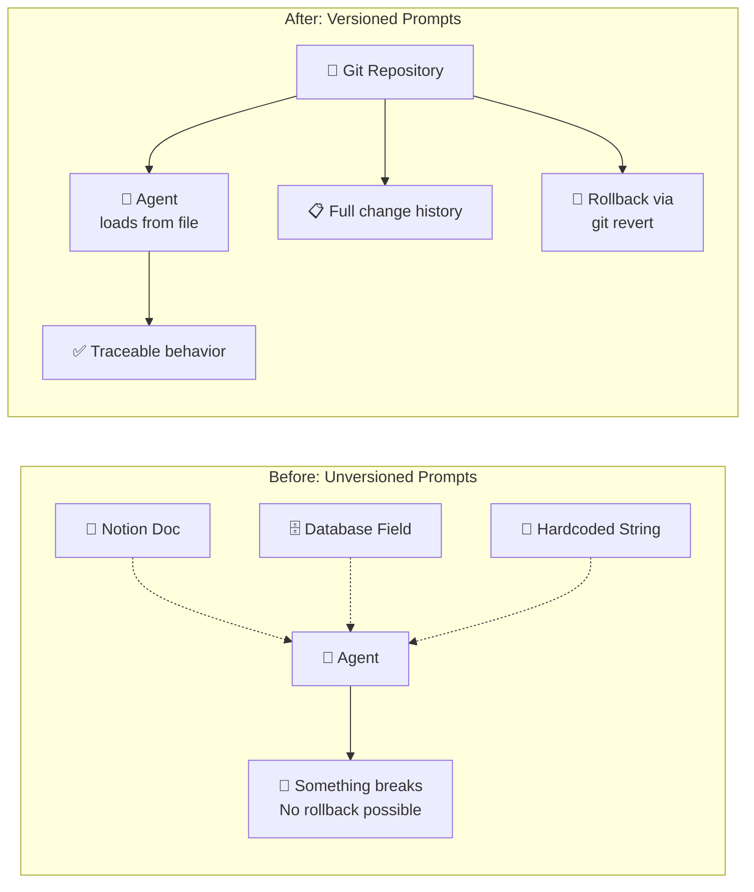

I got paged at 11pm because an agent started producing outputs that didn't match the expected format. The outputs looked fine at first glance. A downstream parser caught it three hours later.

When we investigated, we found that someone had "just tweaked the prompt a bit" that afternoon to make it "flow better." That small tweak changed how the agent formatted dates. The parser expected ISO 8601. The agent started using "Month DD, YYYY" format. Everything downstream broke.

There was no record of the change. No diff. No rollback target.

That's why you version prompts like code.

## Why Prompts Are Code

Prompts define agent behavior. A prompt change has the same effect on an agent as a code change has on a service. It changes what the agent does, how it formats output, what decisions it makes, what it pays attention to.

Unlike code, prompts often live in:

- A database field someone edits through a web UI
- A Python string in a config file
- A Notion doc that "the team" updates
- An environment variable

None of these have the version control discipline you'd apply to code. That means you have zero history, zero diffs, zero rollback capability.

## Step 1: Move Prompts to Source Control

Every prompt that affects agent behavior belongs in your code repository. Full stop.

Create a directory structure like:

```
prompts/
  research-agent/
    system.txt
    task-template.txt
  summarization-agent/
    system.txt
  review-agent/
    system.txt
```

Plain text files, checked into Git. Every change is a commit. Every commit has a message, an author, and a timestamp.



## Step 2: Add Prompt Metadata

Every prompt file should have a header with:

```
# Agent: Research Agent - System Prompt
# Version: 1.4.2
# Last modified: 2026-03-15
# Modified by: Dharmik Jagodana
# Change: Added specific date format requirement (ISO 8601)
```

This is redundant with git history, but it makes the metadata visible without running `git log`. Anyone reading the prompt file immediately knows when it was last changed and why.

## Step 3: Review Prompt Changes Like Code Changes

Prompt changes should go through a pull request, just like code changes.

This sounds like overhead. It's actually fast (30 minutes for a review) and catches a disproportionate number of problems. Prompt changes that seem minor often have non-obvious effects. A second set of eyes catches them.

The PR template for a prompt change should require:

- What changed (describe the diff)
- Why it was changed
- What outputs you tested before and after
- What the rollback plan is if this breaks something

## Step 4: Tag Agent Configurations

When you deploy an agent, record which prompt version it's using. This is the configuration snapshot that lets you answer: "what prompt was Agent X running when task #4729 succeeded on Tuesday?"

In AgentCenter, every task is associated with the agent configuration that ran it. That includes the prompt version. If you need to compare outputs from two different time periods, you can pull the configuration for each run and see exactly what changed.

## Step 5: Test Before Merging

Before merging a prompt change, run it against your test cases. This doesn't require a fancy eval framework. A set of 20 representative inputs with expected outputs is enough to catch major regressions.

Run the old prompt on those inputs. Run the new prompt. Compare. If the new prompt produces markedly different outputs on your test cases, that's a signal to investigate before pushing to production.

## Common Mistakes

**Using "latest" in agent configurations.** If your agent config points to "the latest prompt" without pinning a version, a prompt merge can change agent behavior in production without a deployment. Pin the version.

**Not testing across edge cases.** Your test cases should include the edge cases that have caused problems before. If you've had one incident where a prompt change broke date formatting, add date formatting to your test suite.

**Treating prompts as "not code."** The "I just tweaked the wording a bit" mindset is what causes 2am incidents. Wording is behavior. Treat it accordingly.

## Bottom Line

Prompt versioning is not bureaucracy. It's the minimum operational discipline needed to run agents reliably. The setup takes an afternoon. The payoff is: when something breaks, you know what changed and you can roll it back in 10 minutes instead of 3 hours.

_The best time to set this up is before your agents start failing. [Try AgentCenter free for 7 days](/pricing) — cancel anytime._
