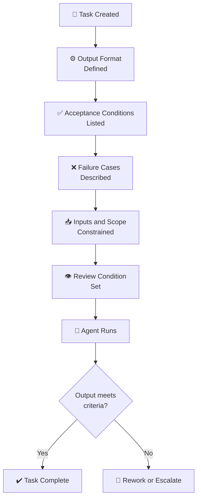

The task I gave my agent read: "Draft a weekly summary report." That's it.

The agent produced something. Whether it was what I wanted, I couldn't tell without spending 20 minutes reviewing it. By the time I had three agents running, I was spending more time reviewing their output than I would have spent doing the tasks myself.

The problem wasn't the agents. The problem was me. I never told them what "done" looked like.

## What Acceptance Criteria Mean for Agent Tasks

Acceptance criteria are the conditions a task output must meet before it's considered complete. For software engineers, this is familiar territory: user stories have acceptance criteria, and tests are expressions of them.

For AI agents, acceptance criteria serve the same function. They tell the agent what to produce, what format it should be in, and which edge cases to handle. Without them, the agent guesses. Sometimes it guesses right. Often it doesn't.

The difference between a good task and a bad one isn't length. It's specificity about outcomes.

## How to Write Acceptance Criteria for Agent Tasks

Here's a 5-step process that works for most agent task types.

**1. State the output format explicitly**

Don't say "summarize the feedback." Say "produce a bullet list of 5 to 10 items, each starting with the category name in bold, followed by a one-sentence description."

Agents follow formatting instructions well when they're specific. "Write a report" is not specific. "Write a 300 to 500 word Markdown report with three sections: Summary, Key Findings, and Recommended Actions" is.

**2. Define the acceptance conditions**

List the things that must be true for the output to be considered correct. Examples:
- The report must include all tickets from the last 7 days.
- No item should appear more than once.
- All monetary values must be rounded to two decimal places.

These become implicit test conditions. When reviewing outputs, you're checking these boxes.

**3. Describe what failure looks like**

This one is underused. If your agent produces something wrong, what does it look like? "If no tickets are found, the output should say 'No items this week' rather than leaving the section blank." That single instruction prevents an entire category of subtle failures.

**4. Specify what inputs the agent should use**

Agents often have access to more context than you intended. If your agent should only use data from a specific date range, say so. If it should ignore internal test accounts, list the filter. Ambiguous scope leads to unpredictable output.

**5. Include a review condition**

Decide up front whether human review is required and what to check for. "Flag any item where the sentiment score differs from the assigned label by more than 0.3." This is especially useful for agents doing classification or summarization.

## Real Example in AgentCenter

In AgentCenter, each task on the Kanban board has a description field and a deliverable section. Use both.

Put context and goal in the description. Put acceptance criteria in the deliverable section. This makes it easy for the agent to reference what it needs to produce, and easy for a reviewer to check the output against what was expected.

For example, a task titled "Analyze support tickets for week of May 19" might have a deliverable like:

- Markdown table with columns: Ticket ID, Category, Sentiment (Positive/Neutral/Negative), Summary (one sentence)
- Cover all tickets with status "Closed" from May 19 through May 25
- If a category has fewer than 3 tickets, group them under "Other"
- Flag any ticket where the sentiment is "Negative" and priority is "High"

With the [agent monitoring dashboard](/features/agent-monitoring), you can track whether the agent completed the task and what it produced. If the output doesn't match the criteria, you have a record of exactly what the agent received and what it returned. That makes the review much faster.

For tasks that go to external systems or customer-facing surfaces, AgentCenter's [approval workflows](/features/task-orchestration) let you require a human sign-off before the output leaves the system. The acceptance criteria you write become the checklist that the reviewer works from.

## Common Mistakes

**Confusing instructions with criteria.** "Use formal language" is an instruction. "Each section must have a heading formatted as H2" is a criterion. Both are useful, but they're different things. Instructions tell the agent how to work; criteria define whether the work is done.

**Writing criteria only for the happy path.** Most tasks have edge cases. What happens if there's no data? What if the input is malformed? Handle these in the criteria, not after the first failure. A "no data" condition that's unspecified usually results in a silent empty output that looks like a success.

**Too many criteria.** If you have 15 acceptance conditions for a simple task, you've probably drawn the task boundaries wrong. Complex criteria often mean the task should be split. A well-scoped task usually needs 3 to 7 conditions. More than that, and you're writing a spec, not a task.

**Skipping the review step.** For any task that touches external systems or produces output shown to customers, "who reviews this and what do they check for?" should be part of the task definition. Leaving it implicit means it doesn't happen.

**Writing criteria in prose.** Keep them as a list. Prose acceptance criteria get interpreted as guidelines. A list gets checked. There's a practical difference in how agents and reviewers treat them.

## Bottom Line

Acceptance criteria are one of the cheapest ways to improve agent output quality. You write them once when creating the task, and they pay off every time the agent runs. Vague tasks produce unpredictable outputs. Specific ones produce checkable ones.

If you're not sure where to start, pick your most frequently failing agent task and write down what a good output would look like. That list is your first set of acceptance criteria. Do that for five tasks, and you'll have a pattern you can reuse everywhere.

---

*The best time to set this up is before your agents start failing. [Try AgentCenter free for 7 days](/pricing) — cancel anytime.*
