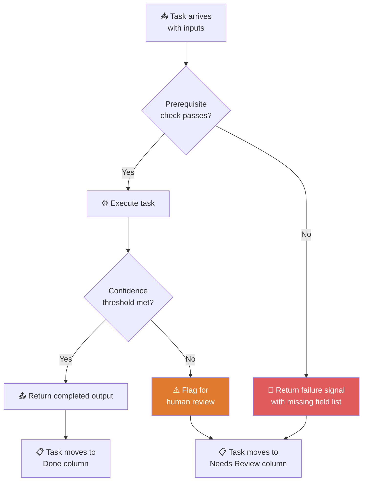

You have an agent that summarizes customer feedback. The input data arrives malformed, half the fields empty. The agent runs anyway. It produces a summary. The summary looks fine. You ship it to the stakeholder. Three days later, someone notices it was summarizing phantom data.

The agent never told you it couldn't do its job. You never thought to ask.

This is the most common failure mode in production agent work: not crashes, not errors, not timeouts. It's agents that quietly produce wrong output when they should have stopped and said something.

## What Graceful Failure Means for Agent Prompts

A prompt that fails gracefully instructs the agent to recognize when it can't complete its task correctly and signal that explicitly, rather than try anyway with incomplete information.

Most prompts don't do this. They tell the agent what to do in the success case and leave failure handling up to the model's default behavior. The model's default is to produce something. That "something" is often wrong.

You don't want an agent that always produces output. You want an agent that only produces output when it can do so correctly.



## Step-by-Step: Writing Prompts With Built-In Failure Handling

### 1. Add an explicit prerequisite check

Before your agent processes anything, it should verify it has what it needs. Add this to the top of your prompt, before the task description:

```
Before beginning, check that you have:
- [Required input A]: must be present and non-empty
- [Required input B]: must match expected format
- [Required input C]: must contain at least one valid entry

If any of these are missing or malformed, return:
{"status": "insufficient_input", "missing": ["field_name"], "received": "brief description of what arrived"}
and stop. Do not attempt the task.
```

The key is "and stop." Without that, models treat the check as advisory and attempt the task anyway.

### 2. Give the agent explicit failure vocabulary

Agents don't know they're failing. They produce output. You have to tell them what failure looks like and how to express it in a form you can catch downstream.

Add a failure schema to your prompt:

```
If you cannot complete this task reliably, return exactly this structure:
{
  "status": "cannot_complete",
  "reason": "one sentence explaining what's wrong",
  "partial_output": null
}

Do not include this structure in successful completions. Status "cannot_complete" means stop. Do not attempt to provide a partial answer alongside it.
```

Keeping failure output structurally distinct from successful output matters. If your failure output looks like your success output, your validation layer won't catch it.

### 3. Set confidence thresholds for ambiguous tasks

Some tasks have clear right/wrong answers. Others involve interpretation where the agent might be partially right. For those, define what low confidence looks like:

```
If more than 20% of your classifications feel uncertain or require assumptions to complete, return:
{"status": "low_confidence", "uncertain_items": [...], "reason": "describe the ambiguity"}

Do not return a mixed output where some items are confident and others are guessed. All or nothing.
```

This is especially useful for classification, extraction, and analysis tasks where partial accuracy is worse than no answer.

### 4. Put failure instructions near the top

Models pay less attention to instructions buried at the end of long prompts. Most prompt engineers write the task description first, then add failure handling at the bottom as an afterthought.

Flip it. Put failure handling before the task description. The agent reads top-to-bottom. The prerequisites and failure instructions should land before it starts processing the task.

### 5. Test the failure path deliberately

Most teams test agents with good inputs. Very few test with bad inputs on purpose. Before any significant prompt change, run test cases for common failure scenarios:

- Empty required fields
- Malformed data (wrong format, wrong type)
- Out-of-scope requests ("Summarize this audio file" when the agent expects text)
- Contradictory inputs

If the agent produces a plausible-looking output for any of these, your failure handling isn't working.

## Real Example: Catching Failures in AgentCenter

Say you have a contract review agent that extracts key terms from uploaded documents. When a document is corrupted or in an unexpected format, you want the agent to report it clearly rather than guess at the structure.

With graceful failure prompts in place, the setup in AgentCenter looks like this:

1. The agent runs the task and checks inputs against prerequisites
2. If the document fails the check, the output contains `"status": "cannot_complete"` with a reason
3. Your [task orchestration](/features/task-orchestration) workflow watches for that status field in the output
4. Any task with `cannot_complete` moves to a "Needs Review" column automatically instead of "Done"
5. The responsible engineer gets @mentioned to inspect the document

This way, [agent monitoring](/features/agent-monitoring) shows two distinct outcomes: tasks that succeeded and tasks that correctly self-reported issues. You're not hunting for silent failures after the fact. The agent reports them as they happen.

## Common Mistakes

**Confusing retry logic with graceful failure.** Retry logic handles transient errors: API timeouts, rate limits, network blips. Graceful failure handles semantic errors: missing context, malformed inputs, impossible tasks. A corrupted document should fail gracefully, not retry five times and eventually produce garbage.

**Making failure output look like success.** If your failure output uses the same structure as successful output, your validation layer won't catch it. Use a clearly different format or a `status` field that's always present.

**Writing "if you're unsure, do your best."** This is the most common prompt mistake. "Do your best" tells the agent to produce something no matter what. Delete it. Replace it with explicit failure vocabulary.

**Assuming the model will ask for clarification.** Language models don't ask questions unless you instruct them to. They produce output. If you want the agent to request missing information instead of proceeding, you have to say so explicitly in the prompt.

## Bottom Line

Agents that signal what they can't do are easier to run in production than agents that silently produce wrong answers. Five extra lines in your prompt (the prerequisite check, the failure schema, the confidence threshold) prevent the debugging sessions where you're not sure if the agent ran correctly or just appeared to.

A clear failure is information you can act on. A silent wrong answer is a problem you haven't found yet.

---

*The best time to set this up is before your agents start failing. [Try AgentCenter free for 7 days](/pricing) — no lock-in.*
