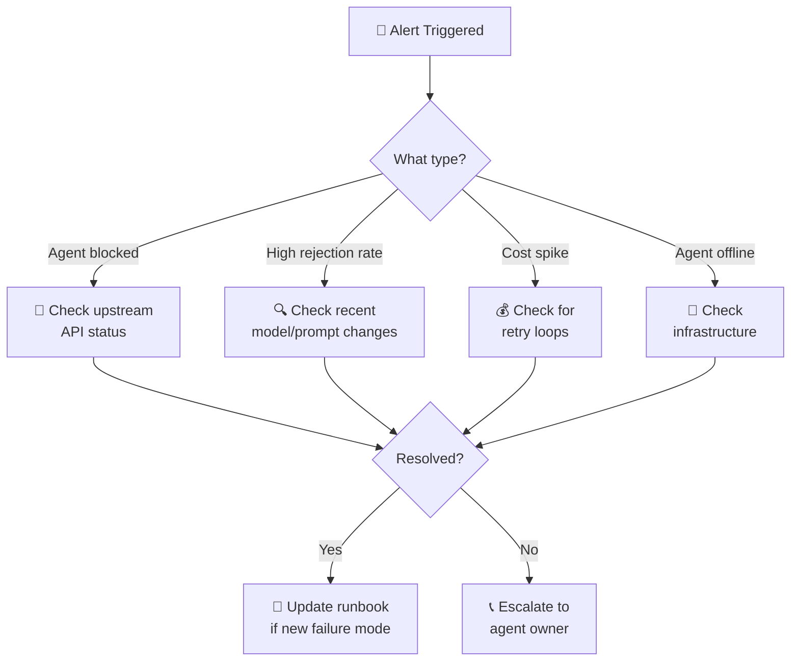

Most agent runbooks are written by engineers right after something breaks, in a rush, with way too much detail about what they personally investigated and not enough about what the next person needs to do. A week later, nobody can find it. A month later, nobody remembers it exists.

Here's how to write one that actually gets used.

## What a Runbook Is (and Isn't)

A runbook is not documentation. It's not a design doc or an explanation of how the agent works. It's a decision guide for whoever is on call when the agent breaks.

It answers: what do I check first? What do the common failures look like? What steps do I take to fix them? What do I escalate if I can't fix it?

Short. Actionable. Written for someone who is stressed and wants answers fast.

## The Runbook Template

Every agent runbook should have these sections:

### 1. Agent Identity and Purpose

Two sentences: what this agent does and what it's responsible for.

Example:  
"The ProductCatalog agent processes new product submissions and generates SEO-optimized descriptions. It runs continuously and is the upstream dependency for the PublishingAgent pipeline."

If you can't write it in two sentences, your agent has too many responsibilities.

### 2. Normal Behavior Baseline

Numbers. Not vague descriptions.

- Expected task duration: 30-90 seconds per item
- Expected cost per task: $0.02-0.05
- Expected throughput: 200 items/hour
- Normal status: "working" during business hours, "idle" overnight

This section is what lets you recognize when something is wrong. Without a baseline, "slow" means nothing.

### 3. Common Failure Modes

List 3-5 things that actually break. Not theoretical failures — actual failures you've seen.

| Symptom                           | Likely Cause                   | First Check                         |
| --------------------------------- | ------------------------------ | ----------------------------------- |
| Agent status: blocked for 10+ min | Upstream API rate limit        | Check API quota dashboard           |
| Task duration 3x normal           | Input document unusually large | Check input size in task history    |
| Quality rejection rate above 30%  | Prompt drift or model update   | Check provider model changelog      |
| Agent offline, no heartbeat       | Container crashed              | Check infrastructure logs           |
| Cost per task spiked 5x           | Retry loop on bad input        | Check error logs for last 100 tasks |

### 4. Step-by-Step Remediation

For each common failure mode, write the exact steps to fix it. Not "investigate the issue." Actual steps.

Example for "high rejection rate":

1. Open AgentCenter dashboard, check the agent's task history for last 48 hours
2. Find the rejection rate trend — when did it start?
3. Check if model version changed in agent config (compare current run vs last good run)
4. If model version changed, pin it to the last known-good version in agent settings
5. Rerun 5 rejected tasks manually to confirm fix
6. If rejection rate stays high, escalate to [Name]

### 5. Escalation Path

Who do you call if you can't fix it? Be specific.

- Primary: Slack @[name] — knows the agent inside out
- Secondary: Email [email] — for anything involving data or compliance
- Provider issues: [LLM provider status page URL]

No vague "contact the team." A name, a channel, a way to reach them.

### 6. Recovery Validation

How do you know the agent is healthy again? What does "recovered" look like?

Example:

- Rejection rate drops below 15%
- Task duration within normal baseline
- 10 consecutive tasks complete without error

## What Makes Runbooks Actually Get Used

**Keep them short.** If your runbook is 12 pages, it won't be read under pressure. Two pages is better. Five is the max.

**Put them where alerts point.** If your alert fires in PagerDuty, the runbook link should be in the alert body. Not in Confluence three clicks deep.

**Update them after every incident.** Every incident reveals something the runbook got wrong or missed. The person who resolves the incident updates the runbook before closing the ticket. This takes 5 minutes and makes the next incident faster to resolve.

**Review them quarterly.** Agents change. Runbooks go stale. Set a quarterly reminder to walk through each runbook and check if the steps still make sense.

## Using AgentCenter for Runbook Context

AgentCenter's task history gives you the live data your runbook needs to reference. When an on-call engineer follows the steps in the runbook, they can pull up the [agent dashboard](/features/agent-dashboard) and see the exact status, cost trend, and task history the runbook refers to.

Runbooks work best when they're written alongside the monitoring setup, not separately. If the runbook says "check task duration trends" — make sure the dashboard actually shows task duration trends before you put that in the runbook.

## Bottom Line

A good runbook is a gift to future-you at 2am. Short, specific, accurate, and easy to find. Write it during calm periods, update it after incidents, and put the link where alerts fire.

_The best time to set this up is before your agents start failing. [Try AgentCenter free for 7 days](/pricing) — cancel anytime._
