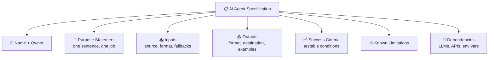

Most agent problems start before the first line of code. Someone builds an agent, ships it, and two months later nobody agrees on what it's supposed to do. Is it outputting the right thing? Nobody's sure. The original requirements lived in a Slack thread.

An AI agent specification fixes this. It's a short document you write before building that captures the agent's purpose, inputs, outputs, and success criteria. It takes 30 minutes to write. It saves weeks of confusion.

## What an AI Agent Specification Is

An agent spec is not a prompt. It's not a README. It's a one-page document that answers three questions:

1. What problem does this agent solve?
2. What does it take in, and what does it produce?
3. How will you know it's working?

Everything else — the prompt, the tools, the deployment config — should trace back to those three answers. When something breaks, the spec tells you where to look. When someone new joins the team, the spec tells them what the agent is supposed to do.

## How to Write an AI Agent Specification

Here's the structure that works. Fill in each section before you write any code.

### 1. Agent Name and Owner

Give the agent a name that describes what it does, not how it works. "Invoice Parser" beats "GPT-4 Turbo Pipeline v2". Assign one owner. If nobody owns it, nobody fixes it when it breaks.

### 2. Purpose Statement

One sentence. What job does this agent do, and for whom?

Good example: "This agent reads incoming invoice PDFs and extracts line-item data into a structured JSON format for the billing team."

If you can't write the purpose in one sentence, the scope is too broad. Split the agent first.

### 3. Inputs

List every input the agent needs. For each one, specify:

- What it is (file, string, structured data, API response)
- Where it comes from (another agent, a user upload, a database query)
- What happens if it's missing or malformed

Agents that skip input documentation break silently when an upstream format changes. You won't know why for days.

### 4. Outputs

List what the agent produces. For each output:

- Format (JSON, Markdown, a file, an API call)
- Where it goes (saved to disk, posted to a webhook, handed to another agent)
- What a correct output looks like vs a broken one

This is the hardest section. Most people skip it. Don't. Outputs are what your users see, and they need the most detail.

### 5. Success Criteria

Write 3–5 conditions that define "working correctly." These need to be testable, not vague.

Bad: "The output looks right."
Good: "Extracted total matches the PDF total within $0.01. No required field is null. Response delivered within 30 seconds."

These become your test cases. They also become the benchmark for [agent monitoring](/features/agent-monitoring) — if you know what good looks like, you can alert on deviations.

### 6. Known Limitations

What won't this agent handle well? Write it down now, before someone discovers it in production.

Example: "Doesn't handle PDFs with scanned images. Fails on invoices with more than 50 line items. Won't process files larger than 10MB."

Documenting limitations isn't admitting failure. It's preventing surprises.

### 7. Dependencies

What does the agent rely on? LLM provider, external APIs, file paths, environment variables. If any of those go down, the agent goes down too. List them explicitly.

---

Here's how those seven components fit together:

## Real Example: Using the Spec in AgentCenter

Once the spec exists, it becomes the anchor for everything else in your workflow.

When you create a task for the agent in [AgentCenter's task board](/features/task-orchestration), paste the purpose statement into the task description. Link the spec document in the task thread. When the agent delivers its output, your reviewer knows exactly what "good" looks like — because you wrote it down in the outputs section.

When the agent fails, the spec tells you where to start debugging. Did the input arrive in the expected format? Did the output match the specified structure? Which success criterion broke?

The spec also drives monitoring setup. If you know what a correct output looks like, you can configure alerts for deviations without guessing. Without a spec, you're creating alerts against an undefined target.

## Common Mistakes

**Writing the spec after the agent is built.** This is the most common one. Someone ships the agent, then writes the spec to match what was actually built rather than what was needed. The spec becomes a description, not a design. Write it first.

**Skipping the outputs section.** Most people document inputs carefully and write one vague line about outputs. That's backwards. Your users care about outputs. Write at least two concrete examples — one for a good result and one for a bad one.

**No success criteria.** "It works when it looks right" is not a criterion. If you can't write something you could actually test, you don't yet understand what the agent is supposed to do.

**Making it too long.** A spec that runs five pages won't get read. Keep it to one page. If you need more space, the agent scope is too big — consider splitting it into two smaller, well-defined agents.

**Not updating it.** The spec isn't a tombstone. When the agent changes, update the spec. An outdated spec is worse than no spec — it actively misleads anyone who reads it.

## Bottom Line

You don't need a spec for every throwaway script. But any agent running in production for more than a week deserves one. The first time someone asks "what is this agent supposed to do?" and you can point to a document instead of digging through chat history, the 30-minute investment pays off.

Start with the purpose statement. If you can't write that in one sentence, that's the real problem to solve first.

---

*The best time to set this up is before your agents start failing. [Try AgentCenter free for 7 days](/pricing) — cancel anytime.*
