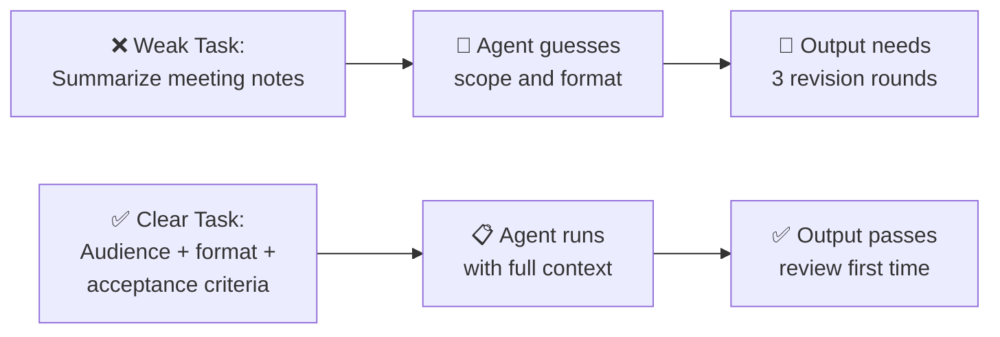

You handed your agent a task. It ran. The output was close — not quite right. You tweaked the description, ran it again. Still off. Forty minutes later you were debugging what should have been a 5-minute job.

The problem wasn't the agent. The problem was the task description.

Good agents fail on vague task specs just as reliably as bad agents do. Writing a clear task description isn't busywork — it's the primary factor that determines whether your agent produces useful output on the first run.

## What Makes a Task Description Work

A task description is a spec, not a one-liner. It tells the agent:

- What the output should look like
- What context it has to work with
- What constraints apply
- What to do when something is ambiguous

Agents don't fill gaps well. When information is missing, they guess. When multiple interpretations are valid, they pick one without flagging it. The results look plausible until you need them to actually be right.

The goal is to make the happy path obvious and the edge cases explicit.

## Step 1: Name the Output First

Start with what you want the agent to produce — not what you want it to do.

**Weak:** "Research competitors and write a report."

**Strong:** "Produce a 3-paragraph competitive summary for each company, covering: what they sell, who they target, and how they price. Format: one H2 per company, bullet points inside each."

The first version is a workflow. The second is a spec. The agent knows what done looks like before it starts.

## Step 2: Provide the Context It Needs

Every task runs in a context. The agent doesn't know what you know. Before assigning, ask: what background would a contractor need to do this well?

This usually includes:
- Who the audience is
- What happens with the output downstream
- Any decisions already made
- Where to find source material

"Summarize this support thread" is ambiguous. Summarize it for who? To decide what? An agent writing an executive summary will produce something completely different from one producing a fix verification checklist.

## Step 3: Set Scope and Constraints

Agents scope out or scope in. Without explicit limits, they stay too shallow or go too deep.

Specify:
- Length or detail level
- What to include and what to skip
- Format (markdown, bullets, table, prose)
- Time or token bounds if relevant

If you're using AgentCenter's [task orchestration](/features/task-orchestration) to coordinate work across multiple agents, scope constraints matter even more. An agent that runs long can block downstream tasks waiting on its output.

## Step 4: Define "Good Enough"

This is the part most people skip. What does the output need to achieve to count as done? What would make you reject it?

Add an acceptance condition. One sentence works:

"This task is done when every company in the input list has a summary and all summaries follow the defined format."

This gives the agent a self-check before submitting, and gives you a clear pass/fail when reviewing output in AgentCenter's [deliverable review panel](/features/agent-monitoring).

## Step 5: Handle Ambiguity Explicitly

Tell the agent what to do when it hits an edge case. Agents without instructions for unclear situations either guess silently or halt and block.

Examples:
- "If a company has no public pricing, mark it as 'pricing undisclosed' and move on."
- "If the meeting notes are incomplete, flag the gap and summarize what's available."
- "If a source is behind a login, skip it and note that in the output."

Each of those decisions becomes visible in your AgentCenter activity feed. Without explicit handling, you're guessing at what the agent did when something went sideways.

## Before and After

Here's what the difference looks like in practice.

**Weak version:** "Summarize the design review meeting notes from Monday."

**Better version:** "Produce a 1-page summary of the design review meeting from Monday's transcript (attached). Audience: engineering leads. Include: decisions made, open questions, and next actions with owners. Skip: discussion that didn't reach a conclusion. Format: three sections with H2 headings. Done when: all 3 sections are present and next actions each include a named owner."

The second version will produce useful output on the first run, almost every time.

## Common Mistakes

**Writing tasks for yourself, not the agent.** You have context the agent doesn't. What's obvious to you is invisible to it.

**Combining multiple tasks into one description.** "Research, summarize, and draft the email" is three tasks. Break them apart. Each agent run should produce one type of output.

**Skipping the format spec.** "A summary" means different things to different people — and to different agents. Specify structure, length, and medium.

**Not saying what to skip.** Telling the agent what's out of scope is as important as what's in scope. "Ignore prior meeting notes from before Q2" eliminates a whole category of wrong output.

**Treating task descriptions as permanent.** What works for one agent may not work for another. Update descriptions when output quality drifts. Keep them in version control alongside your prompts.

## Bottom Line

The fastest way to improve agent output quality isn't to change the model or tune the system prompt. It's to write better task descriptions. Most output problems trace back to missing context, undefined scope, or no acceptance condition.

Build a template for your common task types. Review it when agents underperform.

---

*The best time to set this up is before your agents start failing. [Try AgentCenter free for 7 days](/pricing) — cancel anytime.*
