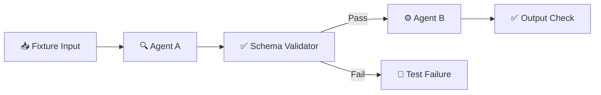

You test each agent in isolation. Each one passes. You wire them together, deploy the pipeline, and it breaks at the second handoff. The research agent returns JSON with a `source_urls` field. The summarizer expects `sources`. Two different keys. Pipeline stops. No error. Just nothing.

That's the integration problem. Unit tests for individual agents won't catch it. You need integration tests that check how agents talk to each other.

## What Integration Testing Means for Multi-Agent Systems

For individual agents, testing is about correctness: does the agent produce the right output for a given input? For multi-agent pipelines, testing is about compatibility: does the output from one agent satisfy the input expectations of the next?

Integration tests verify three things:

- **Handoff schema compatibility** — the output format from Agent A matches what Agent B expects as input
- **Error propagation** — a failure in Agent A surfaces correctly downstream rather than silently producing empty or garbage output in Agent B
- **End-to-end completion** — the full pipeline runs from start to finish given realistic input, and the final output meets your acceptance criteria

## Step 1: Map Every Handoff in Your Pipeline

Before you can write tests, you need a clear picture of what flows between agents.

For each agent-to-agent handoff, document what fields the upstream agent outputs, which of those fields the downstream agent uses, and what happens if a field is null, empty, or missing. A simple table works: upstream agent, downstream agent, fields passed. If you can't fill out that table, your agents don't have well-defined contracts yet.

## Step 2: Define Interface Contracts

An interface contract is a formal schema for what an agent produces and what it accepts. For most teams, this means JSON Schema or a typed dict in Python.

Write one schema per agent output:

```json
{
  "type": "object",
  "required": ["summary", "sources", "confidence_score"],
  "properties": {
    "summary": { "type": "string", "minLength": 10 },
    "sources": { "type": "array", "items": { "type": "string" } },
    "confidence_score": { "type": "number", "minimum": 0, "maximum": 1 }
  }
}
```

This becomes your handoff spec. If an agent output doesn't match it, your integration test fails before it reaches production.

## Step 3: Build Realistic Test Fixtures

The biggest mistake teams make with multi-agent testing is using toy inputs. An agent that works on a simple 10-word prompt will fail on a 3,000-word document with special characters, empty fields, and ambiguous instructions.

Build fixtures from production traffic. Take 5 to 10 real inputs from your agent logs, anonymize them if needed, and use those as your test cases. Include a normal happy-path input, an edge case with missing optional fields, an input that historically caused problems, and an input near your context limit.

Test against fixtures, not synthetic examples.

## Step 4: Test Each Handoff in Isolation

Run tests that feed Agent A a fixture and validate the output schema before passing it to Agent B. This catches integration failures without needing the entire pipeline to run.



A schema violation here tells you exactly which agent produced bad output and which field broke. Without this step, you'd be tracing a full pipeline to find a typo in one key name.

## Step 5: Run End-to-End Tests in a Staging Project

Handoff tests catch format problems. End-to-end tests catch pipeline logic problems: cases where each agent produces valid output but the final result is wrong.

In [AgentCenter](/features/agent-monitoring), create a dedicated staging project that mirrors your production pipeline. Assign the same agents with the same task configurations, pointed at test credentials and sandboxed data.

Run your fixture set through the full pipeline. Check whether all tasks complete without timing out, whether the final output meets your acceptance criteria, and whether cost stays within expected bounds per run.

The [task board in AgentCenter](/features/task-orchestration) shows you exactly where a pipeline stops and what each agent produced at each stage. You don't need to grep through logs to find the broken handoff.

## Step 6: Set Up Recurring Test Runs

A test suite you run once before launch and never again is not a test suite. Agents drift. Prompts change. Upstream APIs evolve.

Set up a recurring task in AgentCenter to run your integration test suite on a fixed schedule — weekly or after any agent update. If a run fails, the task board shows which agent failed and what it produced.

This turns your test suite from a one-time gate into an ongoing signal for pipeline health.

## Common Mistakes

**Testing only the happy path.** Your agents will receive malformed inputs, empty results from upstream APIs, and truncated context. Test those cases now, not after a production failure.

**No timeout assertions.** An agent that hangs for 8 minutes instead of failing fast causes cascading delays. Set a max expected runtime per agent and fail the test if it exceeds that.

**Skipping intermediate output validation.** Teams often check the final output and assume the middle of the pipeline is fine. Validate at every handoff, not just at the end.

**Using production credentials in tests.** A test that accidentally modifies real data, sends real emails, or calls paid APIs is not a test. Use sandboxed accounts and test data.

**Not re-running tests after prompt changes.** Prompts define agent behavior. Changing a prompt without re-running integration tests is the same as pushing code without running tests.

## Bottom Line

Unit tests tell you each agent can run. Integration tests tell you the pipeline can run. You need both, and most teams skip the second one.

Start with a schema for each handoff, build fixtures from real traffic, and run the full pipeline in a staging project before anything touches production. That one layer of testing catches more real failures than any amount of individual agent validation.

---

*The best time to set this up is before your agents start failing. [Try AgentCenter free for 7 days](/pricing) — cancel anytime.*
