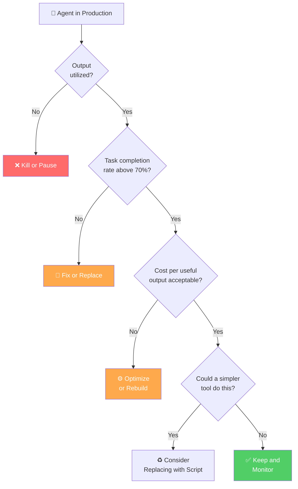

Three months after we hit 14 agents in production, someone asked a simple question in standup: "Which of these are we actually glad we built?"

Nobody answered quickly. That was the problem.

We had agents running every day. Some were clearly useful. Others, we weren't sure. A few felt like they should be useful, but we'd stopped checking on them weeks ago. The honest answer was: we didn't know. And "I think it's working" is not a production status.

That conversation started what turned into a deliberate audit. Here's what we found and what we changed.

## The Problem With "Set and Forget"

Agents don't announce when they've become useless. They keep running, consuming tokens, submitting outputs nobody reads, and silently degrading as the data they work with changes around them.

We'd fallen into the classic pattern: add agents when there's a new problem, never remove them when the problem changes. After three months, we had:

- 3 agents running correctly and producing results people actually used
- 4 agents running correctly but whose outputs were being ignored
- 5 agents with problems: stuck frequently, running slowly, or producing noisy results
- 2 agents nobody could clearly explain the purpose of anymore

That last group was the embarrassing one. Not because the agents were broken. Because we'd lost track of why they existed.

## The Four Questions We Used

We needed a way to evaluate agents that wasn't just "is it running?" The answer to that was almost always yes. The real questions were: Is it producing something useful? Does anyone act on it? What does it cost to run?

We settled on four criteria:

**Output utilization:** Does a human or another agent consume the output? If the deliverable sits unread in a queue for two weeks, the agent isn't doing useful work.

**Task completion rate:** What percentage of runs finish successfully? An agent completing 40% of its tasks isn't reliable enough to depend on.

**Cost per useful output:** Not cost per run. Cost per output that got used. An agent that costs $0.30 per run but whose output gets ignored costs $0.30 for nothing.

**Replaceability:** Could a simpler solution do this? Some agents we'd built were doing things a scheduled script could handle in 10 lines. Agents add complexity; they need to earn it.

## What the Audit Revealed

Going through all 14 agents with this framework took about two hours. It would have taken longer without [agent monitoring data](/features/agent-monitoring) to pull completion rates and run costs from.

The four agents with ignored outputs were the most interesting. Two of them weren't actually broken. The agent was submitting correct deliverables, but the review step had been abandoned. Nobody had a clear owner for approving those outputs. Classic process failure dressed up as an agent problem.

The other two had outputs too noisy to act on. They were completing tasks but producing results that required too much human filtering to be useful. We killed both and moved the filtering logic into a different agent with more context.

The five agents with completion problems split into two groups. Three had fixable issues: one was hitting rate limits we'd never accounted for, one had a prompt that had drifted from what the task actually needed, and one was working on a dataset with a changed schema. All three got fixed.

The other two had deeper problems. One was scoped too wide for a single run — fixing it would have required an architectural change we didn't want to make. We retired it. The other was an experiment that had never graduated from prototype status. Same result.

End state: 14 agents down to 8. Every remaining agent has a named owner, a clear success metric, and monitored output utilization.

## The Habit That Came Out of It

The two-hour audit matters less than what came after it. We now do a 20-minute monthly check-in using [agent activity logs and task completion rates](/features/agent-monitoring) for every agent in the fleet.

If an agent's outputs haven't been touched in two weeks, someone has to explain why or we pause the agent. Not kill it necessarily. Sometimes an agent is waiting on seasonal data or a downstream project. But "running and unchecked" is not an acceptable state.

Three questions we now ask before building any new agent:

1. Who is the named human that will review its outputs?
2. What metric tells us it's working?
3. What do we do if it starts producing noisy results?

These sound obvious. We weren't asking them before.

## Who This Matters Most For

If you've been running agents for more than two months and haven't done a deliberate audit, you probably have at least one agent in each of those categories: running fine but unread, running fine but working on stale context, and broken in a way nobody has noticed yet.

Teams that added agents quickly are the most at risk. It's easy to add an agent. It's easy to forget to remove one. The fleet grows and the signal-to-noise ratio inside it drops.

This matters less if you have two or three tightly scoped agents you check every day. It matters a lot if you have six or more, added over time, with distributed ownership across the team.

## The Honest Part

AgentCenter tells you whether an agent ran, how long it took, what it cost, and whether its output got reviewed. It doesn't tell you whether the output was good or whether the agent is earning its keep. That judgment still requires a human.

The [dashboard](/features/agent-dashboard) makes the audit faster. You don't have to dig through logs to find completion rates or track down who last opened a deliverable. But the decision about which agents actually matter? That's still yours to make.

---

*The dashboard won't fix a broken agent. But it will tell you which one is broken at 3am. [Try AgentCenter free](/pricing).*
