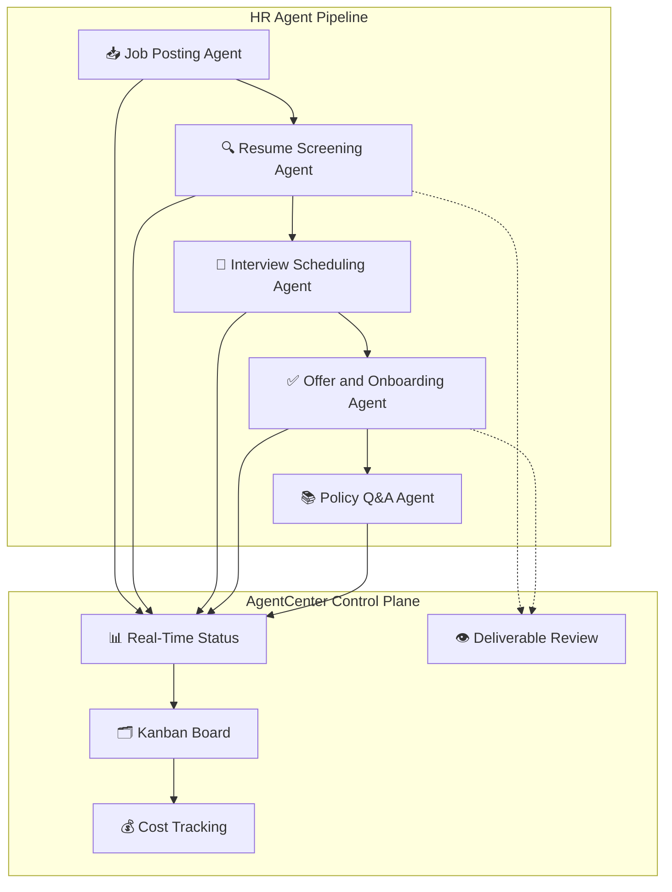

HR automation teams often run agents that touch some of the highest-stakes workflows in a company: screening candidates, scheduling interviews, onboarding new hires, answering policy questions. Get it wrong and you're not just fixing a bug — you're apologizing to a candidate or re-onboarding someone who got the wrong checklist on day one.

Most teams running **AI agents for HR automation** start with one or two agents and expand fast. By the time they have 10 or 12 agents running across different parts of the hiring and onboarding pipeline, the visibility problem hits hard. You don't know which agent stalled, which output was never reviewed, or which integration broke overnight.

## AI Agent Management for HR Automation Teams

Before picking a control plane, it helps to name the exact failures that show up without one.

**Silent failures at the worst moment.** A resume screening agent stops producing output. No error message, no alert. You find out three days later when the hiring manager asks why the candidate shortlist is empty. By then, applications have piled up unreviewed and your time-to-hire just got worse.

**Duplicate or missed calendar actions.** An interview scheduling agent double-books a slot because it didn't know the previous agent already created an event. Or it skips a candidate entirely because the context passed between agents was incomplete. HR coordinators spend hours manually reconciling what the agents should have handled automatically.

**Onboarding agents that send half-finished task lists.** The onboarding agent runs before the provisioning agent finishes. The new hire gets a checklist referencing tools they don't have access to yet. It looks careless, even though the agents ran. They just didn't run in the right order.

None of these are prompt bugs. They're coordination failures. And coordination failures are invisible until they cause damage.

## How AgentCenter Fits Into the HR Agent Pipeline

**Real-time agent status.** Every agent in your HR pipeline shows its current state: online, working, idle, or blocked. If the screening agent goes quiet, you see it in [AgentCenter's agent dashboard](/features/agent-dashboard) right away, not three days later when someone notices the shortlist is empty. You can catch a stalled agent in minutes.

**Kanban board for hiring pipeline visibility.** Map your hiring stages as board columns: Job Posted, Screening, Interview, Offer, Onboarding. Each agent-driven task sits in the right column. You can see whether the screening agent is working through this week's batch or whether something is piling up. [Task orchestration](/features/task-orchestration) makes it easy to track where each candidate or task sits in the pipeline without building a custom dashboard.

**Deliverable review and approval workflows.** Before a screening summary goes to the hiring manager, a human reviews it. AgentCenter's approval workflow puts that gate in place without you writing a custom tool. The agent submits its output, the HR coordinator sees it, approves or returns it with comments, and only then does it move forward. This matters most for outputs that carry compliance risk or that feed decisions that are hard to reverse.

**@Mentions and task threads.** When the scheduling agent fails to sync with your calendar integration, you tag the engineer who owns that integration directly from the task thread. No context-switching to Slack, no forwarding screenshots. The whole exchange stays attached to the task, so whoever looks at it next has full context.

**Cost tracking per agent.** HR teams often mix lightweight and expensive agents. A policy Q&A bot calling GPT-4 for every employee question can cost 10x more than expected if it's handling low-value queries all day. With [agent monitoring](/features/agent-monitoring), you see cost per agent per period and can decide whether to tune the prompt, switch to a cheaper model, or add a pre-filter. You can make that call with data instead of guessing.

## The Numbers

A mid-size HR automation team typically runs 8-15 agents: job posting, resume screening, interview scheduling, offer generation, onboarding, policy Q&A, and maybe an HR analytics agent pulling data from your HRIS. That fits within the Pro plan at $29/month (15 agents).

Larger orgs with multiple hiring pipelines, regional HR teams, or separate agent sets for different roles might need Scale at $79/month (50 agents).

What AgentCenter replaces: a spreadsheet tracking which agents ran last, Slack threads asking "did the Thursday screening batch finish?", and the manual checks HR coordinators do because they don't trust the agents to run cleanly without someone watching.

## Before vs After AgentCenter

| | Without AgentCenter | With AgentCenter |
|---|---|---|
| **Visibility** | No way to know which agents are running vs stalled without checking manually | Real-time status for every agent in the pipeline |
| **Task handoffs** | Context gaps between agents cause missed or duplicated actions | Kanban board tracks each task through the full pipeline |
| **Error detection** | Silent failures surface days later when someone notices missing output | Idle and blocked agent states visible within minutes |
| **Cost tracking** | Monthly API bill with no breakdown by agent or function | Per-agent cost visible in the dashboard |
| **Time spent debugging** | Hours tracing logs to find which agent failed and when | Task thread shows the failure point with timestamps |

## Where to Start

Set up the deliverable review workflow for your resume screening agent first. That's the output with the highest stakes — it feeds directly into hiring decisions, and it's where quality issues are most expensive to catch late. Start with a simple gate: HR coordinator reviews the screening summary before it goes to the hiring manager.

Once that's in place, you have a template for adding review gates to other agents in the pipeline. The onboarding agent is usually the next one worth gating.

See [pricing](/pricing) — the Pro plan covers most HR automation teams and comes with a 7-day free trial.

---

*HR automation teams that add a control plane early spend less time firefighting later. [Start your 7-day free trial](/pricing).*
