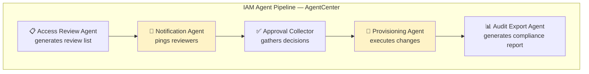

If you run an identity engineering team, you probably have somewhere between 6 and 15 AI agents running at any given time. An access review agent. A SCIM provisioning validator. An orphaned account scanner. A SOX compliance checker. Maybe an MFA enforcement auditor.

Most of them run on schedules. Some are event-triggered. And most of the time, nobody on the team can say with confidence which ones are running, which ones finished cleanly, or which ones stopped halfway through without saying anything.

That's the problem with managing AI agents for identity and access management — it's not that the agents fail badly. It's that they fail quietly.

## What Breaks Without a Control Plane

IAM has no tolerance for partial state. A user account that's half-provisioned is worse than one that's never provisioned. An access review that didn't notify the right approvers is an audit finding waiting to happen.

Three patterns come up again and again for teams that manage identity workflows without a control plane:

**Silent provisioning failures.** Your SCIM agent encounters a new attribute mapping that wasn't in the schema. It throws a validation error internally, marks the task as complete in its own logs, and moves on. The account sits in a half-provisioned state for three days until the user calls the helpdesk.

**Missed access review handoffs.** The access review agent finishes generating its review list. The handoff to the notification agent times out. Reviewers never get pinged. The review window closes. Auditors notice.

**Runaway scan costs.** Your orphaned account scanner runs against an enterprise tenant with 80,000 users. It burns through 2.4 million tokens in 40 minutes. Nobody knew it was happening. The cost shows up on next month's LLM bill.

Any one of these is recoverable. All three in the same week, while you're trying to reconstruct what each agent did from logs scattered across three systems — that's what burns hours.

## How Identity Engineering Teams Use AgentCenter

### Kanban Board — Access Review Stage Tracking

IAM teams have natural pipeline stages: generate review list, notify reviewers, collect approvals, execute changes, export for audit. That maps directly to a Kanban board in AgentCenter.

Each column is a stage. Each card is a task. Your access review agent creates cards as it generates review packages, moves them to "Notified" when the notification agent picks them up, and flags them "Blocked" if a reviewer response times out.

A human can see the whole pipeline at a glance. No more "did the review agent finish?" messages in Slack at 4pm on a Friday. See the [task orchestration feature](/features/task-orchestration) for how task handoffs work between agents.

### Real-Time Agent Status — Catch Blocking Failures Fast

When your SCIM provisioning agent hits a schema validation error, AgentCenter shows it as "Blocked" on the [agent monitoring dashboard](/features/agent-monitoring) immediately. Not three days later.

You click into the task, see the exact error message, and either fix the attribute mapping and retry, or route it to a human for manual review. The account never sits in an unknown state.

This matters for SOX-in-scope systems. Auditors want a clear record of what happened when provisioning failed. AgentCenter gives you that record automatically as part of the task history.

### Cost Tracking Per Agent — Know Before You Get the Bill

Every task run in AgentCenter tracks token usage per agent, per task. You can see your orphaned account scanner spending 2.4 million tokens on Tuesday morning before the run finishes.

You can set a soft budget for that agent. When it hits 80%, you get an alert. You pause the run, scope it to a smaller tenant subset, and restart. That's the difference between a $200 spike and a $2,000 surprise.

### @Mentions and Task Threads — Human-in-the-Loop Without Email

Some access decisions need a human. A privileged role under review, a contractor account flagged for termination but the manager is disputing it, a service account nobody can identify the owner of.

Your agent can @mention the right engineer directly in the task thread. They see the context, post a decision, and the agent picks up the response and continues. The decision is recorded in the task — not buried in an email thread or a Slack DM.

## The Numbers

Most identity engineering teams run 6 to 15 agents depending on the directory size they manage. A team managing a single corporate IdP might run 6 steady-state agents. A team managing multi-tenant SSO for a SaaS product might run 15 or more.

The [Pro plan at $29/mo](/pricing) covers up to 15 agents across 15 projects. That fits most IAM teams. If you're running fully automated access governance across 10 or more enterprise tenants, Scale at $79/mo gets you 50 agents.

What AgentCenter replaces: Slack alerts for agent status, a shared spreadsheet tracking which access reviews are open, and a set of CloudWatch or Datadog log queries you run manually every time something looks off.

## Before vs After

| | Without AgentCenter | With AgentCenter |
|---|---|---|
| Visibility | Manual log queries per agent | Real-time status on a single dashboard |
| Task handoffs | Silent — you find out when something downstream breaks | Visible — "Blocked" status appears immediately |
| Error detection | Days later when a user calls the helpdesk | Immediate, with the error message attached to the task |
| Cost tracking | Monthly LLM bill surprise | Per-agent, per-task usage visible in real time |
| Time spent debugging | 2 to 4 hours reconstructing agent activity from scattered logs | Minutes — full task history in one place |

## Where to Start

Set up the Kanban board first.

Map your access review pipeline to columns: Generate, Notify, Collect, Execute, Audit. Connect your access review agent so it creates and moves cards as it progresses through each stage.

You'll have full visibility into one of your most compliance-critical workflows in an afternoon. The rest builds from there — you'll want real-time status once you can see the pipeline, and you'll want cost tracking once you can see individual agents running.

---

*Identity engineering teams that add a control plane early spend less time firefighting later. [Start your 7-day free trial](/pricing).*
