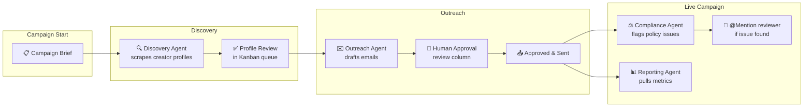

Influencer marketing teams move fast. A new campaign brief lands on Monday, and by Thursday you're running research, outreach, compliance reviews, and performance pulls simultaneously. When you start using AI agents to handle that volume, the speed is great — right up until you have 12 agents running across 3 campaigns with no clear way to see which one last ran, which is stuck, or which one posted a compliance flag nobody picked up.

That's the wall.

## Where AI Agent Management for Influencer Marketing Breaks Down

The problem isn't building the agents. It's keeping track of them once they're running. Teams typically hit three specific failure modes:

**Discovery agents run silently and go stale.** You configure an agent to scrape TikTok and Instagram for micro-influencers in a specific niche. It runs. Two weeks later the account manager finally pulls the output and finds outdated profiles, a banned account, and three creators who've shifted content categories entirely. The agent ran fine — nobody was watching it.

**Outreach agents draft without a review gate.** An agent generates personalized pitch emails based on creator data. That's genuinely useful. But without a formal step for a human to read each draft before it sends, you're either creating a bottleneck nobody knows how to resolve or you're auto-sending with the wrong brand voice. One draft with the wrong product name goes out and you're spending the next two hours doing damage control.

**Reporting agents fail silently when APIs break.** Your campaign performance agent pulls metrics from Instagram, TikTok, and YouTube APIs. When one of those APIs returns an error or hits a rate limit, the report just stops updating. The team doesn't notice until someone questions the numbers in a weekly review meeting.

None of these are code failures. They're operations failures. The agents work; the problem is no one is managing them.

## How AgentCenter Handles AI Agent Coordination for This Team

### Real-Time Agent Status

AgentCenter shows every agent's current state: online, working, idle, or blocked. For an influencer marketing team, that means you open the [agent dashboard](/features/agent-dashboard) on Tuesday morning and immediately see that your TikTok discovery agent is still "working" — which it shouldn't be, it should have finished overnight. Something's looping, and you caught it before your account manager pulled empty results at noon.

### Kanban-Based Task Management with Review Gates

Every task your agents generate shows up on a [Kanban board](/features/task-orchestration): To Do, In Progress, Under Review, Done. When your outreach agent finishes drafting a set of emails, those drafts land in the Review column as individual tasks. A human reads them, leaves comments if needed, and moves approved ones to Done. Nothing goes out without sign-off.

That's not a workflow you have to build yourself. It's how AgentCenter structures tasks by default. You just assign the right person to the Review column and they do their job.

### @Mentions and Task Threads for Escalations

When your compliance agent reviews a creator's recent posts and spots a potential FTC disclosure issue, it creates a task documenting the problem and @mentions your legal reviewer directly. No Slack message asking "hey did you see that thing?", no email chain. One thread, one task, one person responsible.

The same thing happens when your reporting agent hits a dead API. It posts to a task thread with the error. The relevant engineer sees the @mention and fixes the connection. Nobody finds out in a meeting three days later.

### Cost and Error Monitoring Per Agent

The [agent monitoring](/features/agent-monitoring) view shows cost per run, error rate, and output volume for each agent over time. If your reporting agent suddenly costs 4x what it did last week, something changed in the data pipeline — and you'll see it before the next billing cycle.

For teams running agents across 4–6 brand campaigns simultaneously, this visibility matters. Without it, you get one LLM bill at the end of the month with no way to tie costs to specific campaigns or clients.

## The Numbers for Influencer Marketing Teams

A mid-size team running 3–5 active campaigns typically needs 8–15 agents: discovery agents by vertical or platform, outreach drafters per brand, compliance reviewers, performance reporting agents, and a brief or contract generation agent.

The [Pro plan at $29/month](/pricing) fits most teams here — 15 agents, 15 projects. Starter works if you're a solo manager running one campaign with fewer than 5 agents. If you're at an agency managing 10+ client accounts simultaneously, Scale at $79/month gives you 50 agents and room to grow.

What it replaces: spreadsheet logs for agent runs, Slack pings to check if something finished, Google Docs folders of outreach drafts waiting for review, and month-end LLM bills with no per-campaign breakdown.

## Before vs After AgentCenter

| | Without AgentCenter | With AgentCenter |
|---|---|---|
| **Visibility** | No way to know if an agent ran without checking logs | Real-time status per agent: online, working, idle, blocked |
| **Task handoffs** | Outreach drafts emailed around for manual review | Drafts land in the Review column; approved before moving to Done |
| **Error detection** | API failures go unnoticed until someone questions bad data | Blocked agents surface immediately; @mention fires to the right person |
| **Cost tracking** | Monthly LLM bill with no breakdown by campaign or client | Cost per run visible per agent and per project |
| **Debugging time** | "Which agent sent that?" followed by log diving | Task thread shows exactly what ran, when, with what output |

## Where to Start

Set up the Kanban board for your outreach agent first. That's the highest-risk point in the workflow — a draft that goes out wrong can damage a creator relationship or create a compliance headache. Get the agent creating tasks in AgentCenter, configure the Review column, and assign someone to approvals.

Once that's working, the monitoring and cost views follow naturally. You'll already be checking the board, and you'll start noticing patterns: which agents idle at odd hours, which campaigns are burning more budget than expected, which compliance flags cluster around certain creator types.

Start with the review gate. The visibility comes with it.

---

*Influencer marketing teams that add a control plane early spend less time firefighting later. [Start your 7-day free trial](/pricing).*
