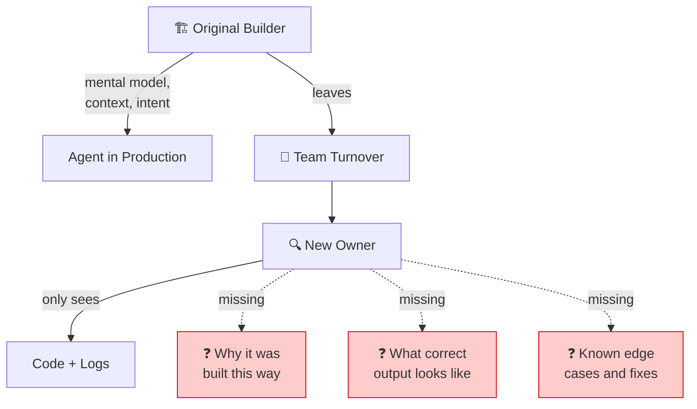

Marcus left the company on a Friday. He was the one who'd built most of the agents. Six of them, running in production. A content drafting agent, two data-extraction agents, a reporting agent, and two others that showed up in the dashboard as "working" but whose task descriptions said things like "v2 test" and "pipeline final."

Nobody knew what "pipeline final" actually did. Nobody had asked.

By Tuesday, we were inheriting agents we'd never touched, didn't understand, and couldn't explain to anyone outside the team. That's when we learned what inheriting agents in production actually costs.

## What You Actually Inherit

When someone hands off an agent — or just leaves and you're stuck with it — you don't get the mental model. You get the code and the logs.

You get the prompt file. You don't get the 15 iterations of prompt tweaking that led to that exact wording. You get the output format. You don't get why it was designed that way, what edge cases the original builder hit, or what the downstream consumer actually expects.

The agent looks fine. It runs. It produces output. But you have no idea whether the output is correct, because you don't know what "correct" was supposed to mean.

This is the invisible problem with inherited agents: you can see that they're running, but you can't tell if they're working.

## Three Things That Break

**Context drift.** Agents are tuned to a specific version of reality. The data they process, the APIs they call, the format their output is expected in — all of that changes over time. The original builder knew to watch for these shifts and would nudge the prompt when outputs started going sideways. You don't know to watch because you don't know what "normal" looks like.

**Silent failures.** Most agents don't blow up dramatically. They degrade. Output quality drops. Edge cases get handled wrong. The reporting agent skips records that don't match a pattern. You don't catch it because you don't know what it was supposed to produce.

**Documentation debt.** The original builder was planning to write that up. They had it in their head. The runbook was going to happen "when things settled down." It never did.

## The Audit You Have to Do First

Before you touch anything — before you change a prompt or upgrade a dependency — you need to understand what each agent is actually doing.

This isn't quick. For each inherited agent, you need to answer:

- What does it take as input?
- What does it produce, and who or what is downstream of that output?
- How often does it run, and what triggers it?
- What does failure look like — and what's the current failure rate?

That last one is harder than it sounds. You can pull the [agent monitoring data](/features/agent-monitoring) to see run history, error counts, and latency trends. That tells you whether the agent is behaving consistently. It doesn't tell you whether the output is correct.

The only way to know if the output is correct is to sample it. Pick 20 outputs, read them, and compare against whatever the original builder intended. This takes time. There's no shortcut.

## The 30-Day Cliff

The first few weeks are usually fine. The agent runs. Nothing breaks visibly. You're in "monitor and wait" mode.

Then something changes. The upstream data format shifts slightly. An API returns a new field. The model behind the endpoint gets a quiet update. The agent keeps running — but outputs start drifting.

Without the original builder's context, you don't know if the drift is expected or a problem. You don't have a baseline for what normal output variance looks like. So either you escalate too quickly and look like you're crying wolf, or you wait too long and something downstream breaks in a way that's now visible to users.

This is the 30-day cliff. Most inherited agents hit it.

The [agent dashboard](/features/agent-dashboard) can show you task history and output patterns going back weeks. That helps — you can see when behavior started changing, which is often a clue about what triggered the drift. But you still need the "what should this look like" baseline to make sense of what you're seeing.

## Who Hits This Most

Engineering leads and platform teams feel this hardest. You're the ones holding agents when contractors finish their engagement, when a founding engineer moves on, or when a product team hands off "just these few automations" to infra.

You didn't build them. You don't have time to fully audit them. You're expected to keep them running.

The same applies to teams that integrate third-party agents or buy agent workflows from vendors. You get the interface. You don't get the reasoning.

## The Habit That Actually Fixes It

The only thing that prevents this from becoming a recurring problem is treating documentation as part of deployment, not a follow-up task.

Before any agent goes to production, the person who built it should be able to answer five questions in writing:

- What does this agent do in one sentence?
- What does a correct output look like? Include real examples.
- What are the known failure modes?
- Who gets notified when it breaks?
- What's the recovery procedure?

If those answers don't exist, the agent isn't production-ready. It's an experiment running on a server.

This is harder to enforce than it sounds. It requires the team to actually slow down before shipping. Most teams don't, because the agent "works in testing" and slowing down feels like overhead. It's not overhead. It's insurance against the next Marcus leaving on a Friday.

## An Honest Caveat

No dashboard retrofits documentation. If you've inherited agents without runbooks, you have to do the audit the slow way.

What monitoring tools give you is a starting point. You can see what's been running, how often, where it's been failing, and what outputs it's produced. That's a foundation for building the documentation that should have existed from day one.

But the mental model — the "why" behind each design decision — lives in the head of the person who left. Sometimes you can reconstruct it from Slack threads and PR comments. Usually you piece it together from the code and the log patterns.

It's slow. It's not fun. It's the tax you pay for agents that shipped without documentation.

---

*The dashboard won't fix a broken agent. But it will tell you which one is broken at 3am. [Try AgentCenter free](/pricing).*
