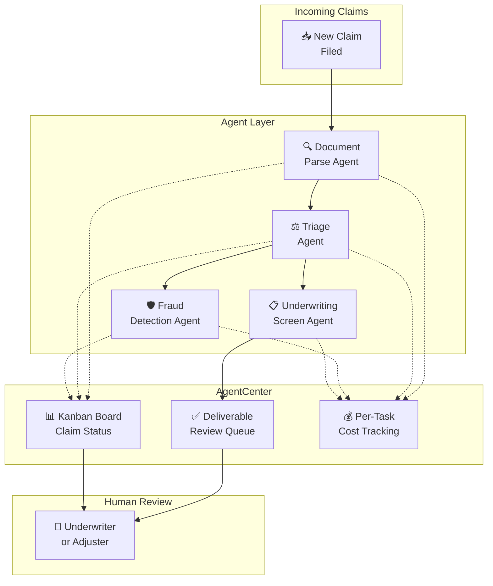

If you work in insurance operations and you've started running AI agents in production, you've probably hit the same wall: the agents are running, tasks are getting processed, but you don't actually know what's happening. A claims triage agent says it's working. Is it? You check the logs. Nothing obvious. You wait. Still nothing.

That's the real problem with AI agent management for insurance teams. Not building the agents. Running them.

## What Breaks Without a Control Plane

A mid-size carrier might run 5 claims triage agents, 4 underwriting screening agents, 3 fraud detection agents, and several document review agents processing policy applications. On a busy Monday that's 15+ agents running in parallel across active claims.

Three things go wrong fast:

**Stuck agents look like slow agents.** Claims triage agents get blocked when a document takes too long to parse. They don't crash. They sit there. Without real-time status, you can't tell if an agent is working or frozen until a claim is 3 hours overdue and an adjuster is asking questions.

**Agent outputs reach humans without review.** An underwriting screening agent scores a policy application and routes it to the underwriter's queue. If the agent misreads an income field or misclassifies a risk category, that output travels all the way to a human who has to unwind it. There's no checkpoint in between.

**LLM costs are invisible at the task level.** Running agents against every incoming claim gets expensive. Without cost visibility per task, you're running blind on spend. By month two you have a billing surprise but no idea which agents or claim types drove it.

## How AgentCenter Fits Into Insurance Agent Workflows

### Real-Time Agent Status

The [agent monitoring dashboard](/features/agent-monitoring) shows every agent's current state: online, working, idle, or blocked. For a claims team, this means you can see at a glance that your Document Parse Agent has been in "working" state for 47 minutes on claim #8823. That's a stuck agent, not a slow one. You know to intervene before the claim goes overdue.

You stop finding out about stuck agents from adjusters. You find out from the dashboard.

### Kanban Board for Claim Stages

The [task orchestration board](/features/task-orchestration) gives each claim a card that moves through stages as agents process it. You see which claims are in triage, which are in fraud review, which are waiting for underwriting. When a card sits in one column too long, something upstream is stuck. It's the same mental model adjusters already use, applied to agent workflows.

For teams that run overnight batch processing on high-volume lines, the board gives you a clear status view at start-of-day without digging through logs.

### Deliverable Review Before Human Handoff

Before an underwriting screening agent's output reaches your underwriters, route it through a review step in AgentCenter. The agent posts its decision and supporting data. A senior analyst reviews it. Only approved outputs move to the underwriter's queue.

Teams that add this step catch bad agent outputs before they cause rework downstream. It's a manual gate, but it takes 90 seconds to review an agent's structured output, not 20 minutes to unwind a misfiled claim.

### Per-Task Cost Tracking

AgentCenter tracks LLM spend per agent, per task, per project. You can see that your fraud detection agent costs $0.12 per standard claim but $0.88 on complex commercial claims. That's information you can act on: add input filters, swap to a lighter model for simple cases, or set per-project spend alerts. Without this, you're paying a monthly bill with no breakdown of what drove it.

### @Mentions for Edge Cases

When an agent flags something unusual, your team can use @mentions in the task thread to loop in a specialist. The conversation stays attached to the specific claim, not buried in Slack or email. When the claim changes hands three days later, the context is still there.

## The Numbers

A typical insurance operations team running agents in production has 12–30 agents across triage, underwriting, fraud, and document review workstreams. The Pro plan handles 15 agents across 15 projects at $29/month — the right fit for regional carriers just starting to automate. Mid-size operations with 20+ active agents or multiple business lines fit the Scale plan at $79/month for up to 50 agents.

AgentCenter replaces the combination of custom dashboards, shared spreadsheets tracking agent runs, and manual end-of-month LLM cost audits that most teams piece together before they find a proper control plane. See [pricing details](/pricing).

## Before vs After AgentCenter

| | Without AgentCenter | With AgentCenter |
|---|---|---|
| **Visibility** | Check logs to guess agent status | Live status per agent on the dashboard |
| **Task handoffs** | Agent posts to queue, humans find it later | Kanban shows where each claim is in real time |
| **Error detection** | Bad outputs discovered after reaching the underwriter | Review step catches errors before human handoff |
| **Cost tracking** | Monthly billing totals, no per-agent breakdown | Per-task, per-agent spend visible |
| **Debugging time** | 30–60 minutes per stuck agent | Activity feed narrows it to under 10 minutes |

## Where to Start

Set up the Kanban board first. Map your claims processing stages as columns. Connect your triage and document parse agents to post updates as cards move through. You'll have a live view of your entire claims pipeline within a few hours.

Everything else — deliverable review, cost tracking, @mentions — you can layer in once you can see what's actually happening.

---

*Insurance operations teams that add a control plane early spend less time firefighting later. [Start your 7-day free trial](/pricing).*
