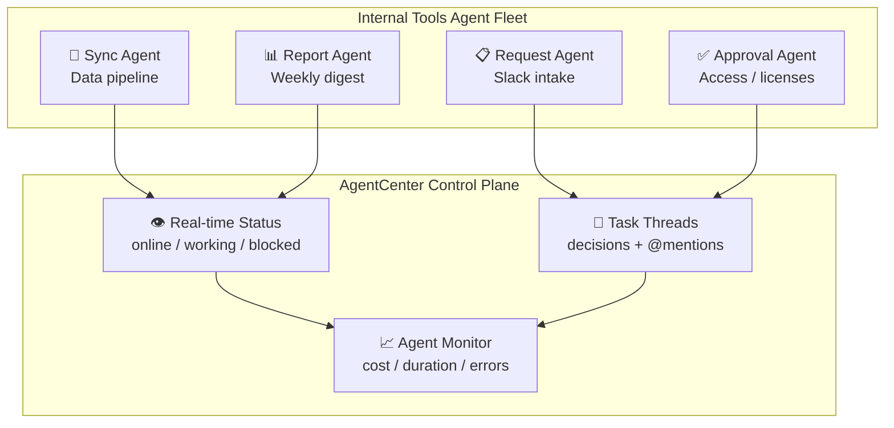

Internal tools engineering teams have a specific problem. They're not building the product. They're building the stuff that makes every other team run faster — Slack bots, data sync scripts, report generators, ticket triage agents. And increasingly, those tools are AI agents.

Which sounds great until you have nine of them in production and someone from finance asks "which agent updated the vendor spreadsheet last Tuesday?" and the honest answer is "we're not sure."

That's where AI agent management for internal tools teams gets complicated. Not because the agents are bad. Because there's no control plane telling you what they're doing.

## What Breaks for Internal Tools Teams Without a Control Plane

Internal tooling sits at an awkward intersection. You own the code, but the outputs go everywhere. When an agent breaks, everyone downstream notices before engineering does, because you don't get a ticket until someone complains.

Three failure patterns show up repeatedly:

**The silent background job.** An agent runs on a schedule — syncing data to a dashboard, generating weekly digest emails, processing Notion pages. No one watches it because "it just runs." Then it stops running correctly, and three weeks of outputs are wrong before anyone notices. No crash. No error. Just wrong.

**The Slack bot that goes off-script.** An agent handles internal requests: PTO approvals, software license requests, access changes. At low volume it works. At higher volume, requests collide, the agent picks up the wrong thread, and someone gets the wrong approval. No exception thrown. Engineering didn't know because nothing failed visibly.

**The dependency tangle.** Four agents call different internal APIs and pass outputs between each other. Agent A passes to B, B calls C. Fine until B starts producing malformed output that C silently drops. Nothing crashes. The breakage is invisible because the pipeline technically completed.

Each of these is a visibility problem, not a code problem. And visibility is exactly what a [control plane like AgentCenter](/features/agent-dashboard) provides.

## Feature-to-Workflow Mapping

**Real-time agent status** solves the silent background job problem. Every agent shows as online, working, idle, or blocked. When your weekly report agent has been on "working" for four hours instead of the usual twelve minutes, you see it before anyone downstream notices.

*Concrete example:* A rate-limited API call stalls your data sync agent mid-run. AgentCenter flags it as working-but-slow. You intervene before 48 hours of missing data hits the finance team's dashboard.

**Task threads with @mentions** solves the Slack bot accountability problem. Every request an agent handles lives in a thread. When your access-change agent processes a request for production admin access — something unusual — you can flag it, loop in the requester via @mention, and verify before the agent acts. Full decision log, no separate Slack channel needed.

**Multi-agent task orchestration** solves the dependency tangle. When agent A hands off to agent B, that dependency is explicit. If B produces output that's 40% shorter than baseline — a signal that something's off — the task is blocked and visible before C silently drops data.

**[Agent monitoring](/features/agent-monitoring)** closes the loop on cost and performance. Internal tools budgets are tight. Knowing which agent is burning the most tokens per run lets you right-size them. One agent running on a model that's overkill for the task is a real cost that compounds.

## The Numbers

A 10-person internal tools org at a mid-size company typically runs 6–12 agents:

- 2 Slack bots (request handling, notifications)
- 2–3 data sync or pipeline agents
- 2 report automation agents
- 1–2 ticket triage or routing agents
- 1 monitoring or alert agent

That's 8–10 agents — right in the Pro plan range (15 agents, $29/month). If the team coordinates across multiple internal projects — data infrastructure, employee tooling, analytics pipelines — Scale at $79/month covers 50 agents and 50 projects.

What AgentCenter replaces: the combination of Slack channels ("hey did that job run?"), manual log checks, and whoever wrote the original script knowing what it does from memory. That tribal knowledge cost is real and doesn't show up in the budget until someone leaves.

## Before vs After

| | Without AgentCenter | With AgentCenter |
|---|---|---|
| **Visibility** | Manual log checks or someone's memory | Real-time status for every agent |
| **Task handoffs** | Implicit, undocumented between agents | Explicit task chain, blocked state visible |
| **Error detection** | Caught when a downstream team complains | Stuck or blocked agents visible before outputs break |
| **Cost tracking** | No per-agent data | Per-agent and per-task token cost tracked |
| **Debugging time** | Reconstruct from logs what ran and when | Task thread shows full timeline and decisions |

## Where to Start

Set up real-time agent status first. Map your current running agents into AgentCenter, connect them to your OpenClaw setup, and spend two weeks just watching the status dashboard — before adding task threads or alert rules.

You will find at least one agent behaving differently than you expected. Slower than it should be, or stuck more often, or producing outputs that look right but aren't. That single catch is worth the setup time.

After that, add task threads for any agent that touches something a non-technical team cares about. Approvals, access changes, financial data — anywhere a wrong output has a real cost.

---

*Internal tools teams that add a control plane early spend less time firefighting later. [Start your 7-day free trial](/pricing).*
