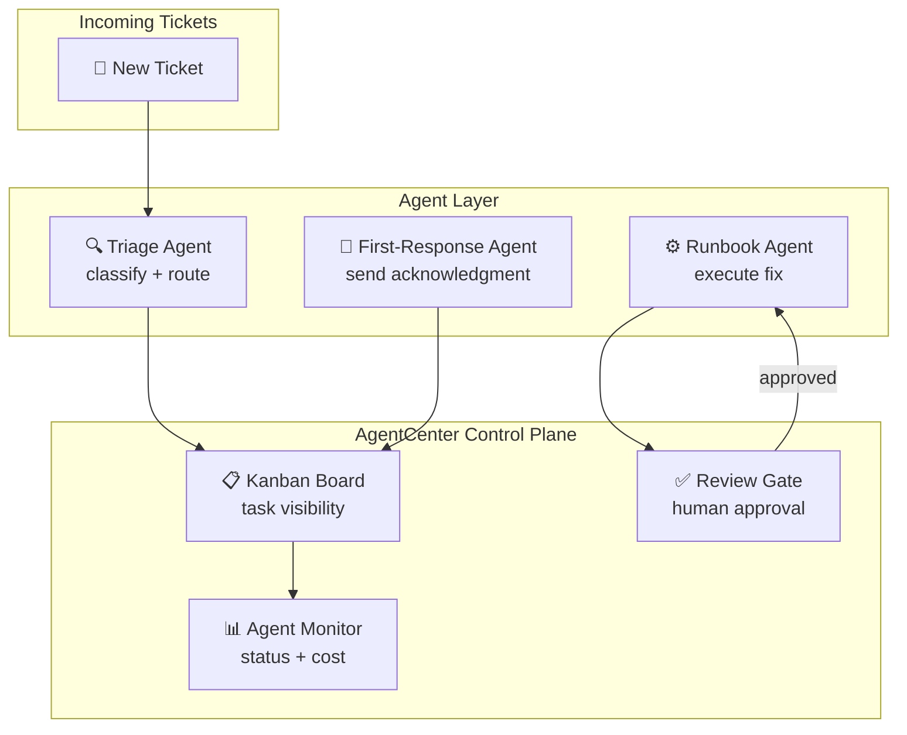

ITSM teams are running more AI agents than most people realize. By the time a company hits 150 employees, the IT service desk has a triage agent, a first-response bot, a runbook executor for restarts and cache clears, maybe one or two more for SLA tracking and escalation routing.

Each one was built to solve a specific problem. Each one worked fine in testing.

Then you go live. Two weeks later, you're looking at a ticket where two agents both auto-responded. Another ticket got auto-resolved while the runbook agent was still mid-execution. And nobody knows which agent is making five model calls per ticket when it should be making one.

That's the ITSM agent problem. Not the agents themselves. The lack of any shared view of what they're all doing.

## The Bottlenecks That Show Up in Week Three

### Agents step on each other

Without a control plane, agents have no awareness of each other. A triage agent routes a ticket to the database team. The first-response bot, running on the same queue, sends an automated reply to the user saying the issue is being investigated. The runbook executor sees the ticket, checks the symptom, and marks it resolved because the service health check passed.

The user reopens it ten minutes later. The database team never saw it.

This isn't a model problem. It's a coordination problem.

### Bad outputs don't announce themselves

A triage agent miscategorizing 25% of tickets won't log an error. It'll just keep routing wrong. You find out during the quarterly SLA review when the average resolution time for Priority 2 tickets is 40% higher than it should be.

With no [agent monitoring](/features/agent-monitoring) in place, the time between a problem starting and a human noticing it is measured in weeks.

### Cost attribution is invisible

Ticket volume scales, model calls scale with it, and the bill shows up as a line item that says "LLM API usage." You have no way to know whether the triage agent is calling the model once per ticket or four times, or which agent started doing that after a prompt change last Tuesday.

## How AgentCenter Handles ITSM Workflows

### Real-time agent status

The Kanban board shows you which agent is working, blocked, or idle — right now. When the runbook executor is waiting on a service health confirmation that never came back, it shows as blocked. You catch it in minutes instead of after the ticket sits unresolved for three hours.

Every ticket your agents touch becomes a task with a visible state. Two agents can't both claim the same task in silence.

### Human approval gates for high-risk runbooks

Some runbooks should not auto-execute. Restarting a payment service at 2pm on a Friday probably needs a human to say yes first.

AgentCenter's [task orchestration](/features/task-orchestration) lets you put a review gate between an agent's decision and its action. The runbook agent creates the task, flags it for approval, and waits. The on-call engineer sees it in the Kanban board, confirms, and the agent proceeds. The whole interaction is logged.

No custom alerting pipeline. No Slack bot to build. The approval workflow is just part of how the task moves through the board.

### Per-agent cost tracking

AgentCenter breaks down model usage by agent. You can see that your triage agent is averaging 1.2 model calls per ticket and your first-response bot is averaging 3.8 — which is higher than it should be given what it's supposed to do.

That's the kind of signal that tells you a prompt change introduced a retry loop before your invoice does.

### @Mentions for agent-to-human escalation

When an agent hits a condition it can't handle, it can mention the relevant engineer directly in the task thread. No custom webhook needed. The mention shows up in AgentCenter, and the engineer can respond in the same thread where the agent's full context is visible.

For ITSM teams, this replaces a whole class of "the agent should have flagged this sooner" complaints.

## The Numbers for a Typical ITSM Team

A mid-size company running IT service automation typically has 8 to 20 agents: triage, first-response, 3 to 5 runbook executors for different service categories, escalation routing, SLA timer, and a knowledge base sync agent.

That puts most teams on the **Pro plan** at $29/month (15 agents, 15 projects). Teams running automation across multiple product lines or geographies usually need the **Scale plan** at $79/month for 50 agents.

What it replaces: the combination of a shared spreadsheet for tracking agent tasks, a Slack channel for escalations, and manual cost attribution from the LLM provider dashboard. Those three things together take 3 to 5 hours of engineering time per week to maintain. AgentCenter handles all three out of the box.

See [full pricing details](/pricing) if you want to match agent counts to plans.

## Before vs After

| | Without AgentCenter | With AgentCenter |
|---|---|---|
| **Visibility** | No shared view of agent state — check logs per agent | Kanban board shows all agents and task states in one place |
| **Task handoffs** | Agents can claim the same ticket, leading to duplicate actions | Each task has one owner; state changes are visible to all |
| **Error detection** | Bad outputs surface in SLA reports weeks later | Blocked or looping agents show up immediately in the status view |
| **Cost tracking** | One line item in the LLM bill, no per-agent breakdown | Per-agent model usage visible in the monitoring panel |
| **Debugging time** | 2 to 4 hours to trace a bad outcome through logs | Full task history and agent decision log in one thread |

## Where to Start

Start with the Kanban board and approval gates for your runbook agents.

ITSM teams have the most to lose from an agent taking an action it shouldn't. Adding a review gate to high-risk runbooks — anything that restarts a service, modifies a config, or closes a ticket without human confirmation — is the single highest-value first step. It takes about 10 minutes to configure and prevents the most painful class of ITSM agent mistake: irreversible actions with no audit trail.

Once that's in place, connect your triage and first-response agents so their tasks flow through the same board. At that point you have the core control plane running, and you can layer in cost monitoring and alert rules from there.

---

*ITSM teams that add a control plane early spend less time firefighting later. [Start your 7-day free trial](/pricing).*
