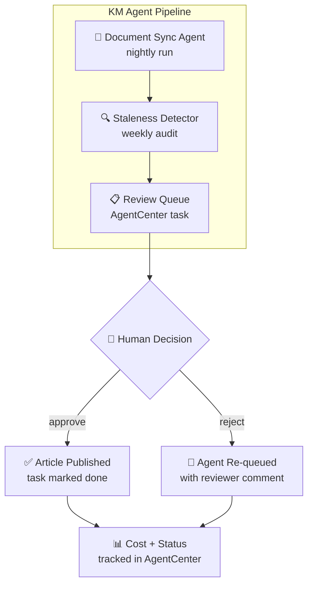

The knowledge management team at a mid-size SaaS company typically runs more agents than anyone realizes. There's one that extracts Q&A pairs from support tickets. Another that classifies internal documents by topic. A third that diffs the product wiki against the latest release notes and flags what's stale. And a fourth that someone on the team built two sprints ago that still runs every night, even though nobody's sure what it does anymore.

That's the real problem for KM teams: agent sprawl with no audit trail.

## Why Knowledge Management Teams End Up with Agent Chaos

Knowledge management work is iterative by nature. You build an agent to extract FAQs from Zendesk. It works, so you build another to cross-reference them against the internal wiki. Then a third to push stale articles to a review queue. Each new agent feels small — but after three months, you've got 12 agents touching 6 systems, and you can't explain to your manager which one ran last Tuesday when the wrong article got published.

Three specific things break without a control plane:

**No visibility into what's running.** KM agents often run on schedules: nightly document syncs, weekly wiki audits, daily FAQ extraction. When one silently fails, you don't know until someone files a ticket wondering why the help center article is two months out of date.

**Task handoffs happen in Slack threads.** Agent A finds stale content. The KM lead reviews it in a spreadsheet. A writer updates the article. The agent doesn't know. There's no record linking the agent's finding to the human action that resolved it. When the original agent runs again, it flags the same article as stale.

**No one knows what anything costs.** KM agents are usually run by a small team, and LLM costs get buried in a shared engineering bill. By the time anyone notices you've spent $600 extracting synonyms from a corpus that didn't need that much processing, you've already run it 50 times.

## How AgentCenter Fixes the Workflow

### Real-Time Agent Status

Every KM agent you connect to AgentCenter shows up on a single dashboard with its current state: running, idle, blocked, or errored. When the nightly document sync silently fails at 2am, you see it the next morning as a blocked task rather than a complaint from a customer service rep three days later.

In practice: the sync agent runs, hits a rate limit from an external API, and marks itself blocked with the error detail attached. You fix the rate limit, re-queue the task, and the agent continues where it left off.

### Kanban Board for Content Review Workflows

Knowledge management is review-heavy work. An agent surfaces stale content, but a human decides whether to update or archive it. AgentCenter's kanban board lets you track each flagged article as a task: agent-created, human-reviewed, resolved.

No more spreadsheets. No more Slack threads where context gets lost. The agent creates the task, attaches the flagged article and its reasoning, and a writer picks it up from the board. The full decision history stays attached to the task.

See the [task orchestration features](/features/task-orchestration) for how task dependencies work across multi-step KM workflows.

### @Mentions and Task Threads

When an agent flags a document that touches two different product areas, you need two subject matter experts to sign off. @Mention both in the task thread. The conversation stays attached to the specific finding, not buried in a Slack channel that scrolled past three days ago.

### Per-Agent Cost Tracking

AgentCenter breaks out LLM costs per agent. When the FAQ extraction agent doubles its token spend because someone updated its prompt to process longer inputs, you see it immediately, not at month-end billing. You can also track cost trends per agent over time and spot which ones need prompt changes to stay within budget.

Check [agent monitoring](/features/agent-monitoring) for the full cost and performance tracking setup.

## The Numbers

A typical knowledge management team running agents in production has 8 to 20 agents: a few document sync agents, a staleness detector, a Q&A extractor, a content classifier, maybe a summarizer or a translation agent. The [Pro plan at $29/month](/pricing) covers 15 agents across 15 projects, which fits most teams. Teams with broader workflows across multiple product lines may need Scale at $79/month for 50 agents.

What it replaces: cron jobs tracked in Notion, a shared Google Sheet for review queues, and Slack pings used as status updates.

## Before vs After

| | Without AgentCenter | With AgentCenter |
|---|---|---|
| **Visibility** | Check logs manually or wait for someone to notice | Every agent's status visible in one dashboard |
| **Task handoffs** | Spreadsheet plus Slack threads | Kanban task with agent reasoning attached |
| **Error detection** | Discovered when content is already wrong | Blocked status surfaced immediately |
| **Cost tracking** | Monthly bill with no per-agent breakdown | Per-agent cost visible in real time |
| **Debugging time** | Re-run the agent and read logs to guess what failed | Task history and error detail in one place |

## Where to Start

Connect your staleness detector or document sync agent first. These are usually scheduled jobs with no human review step, which means failures are completely invisible right now. Getting them into AgentCenter's monitoring view gives you the fastest return: you'll catch the first silent failure within a week and actually know it happened.

From there, add the review queue. Create a project for content flagged by the agent and move your spreadsheet-based review process to the kanban board. That one change removes most of the coordination overhead that currently lives in Slack.

---

*Knowledge management teams that add a control plane early spend less time firefighting later. [Start your 7-day free trial](/pricing).*
