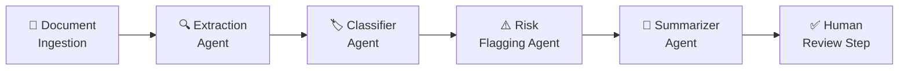

Legal tech teams managing AI agents in production share a common frustration. You build a document review pipeline (a contract extraction agent, a risk-flagging agent, a jurisdiction checker, a plain-language summarizer) and it mostly works. Then a partner flags bad output on a deal that closed last Thursday. You have four agents to blame and no way to trace which one caused it.

That's the core problem: the pipeline looks fine from the outside until something goes wrong, and then it's completely opaque.

## The Specific Bottlenecks

**Silent failures in multi-step pipelines**

Legal document workflows typically chain 4-6 agents. The extraction agent pulls clauses. The classifier tags them by type. The risk agent flags anything non-standard. The summarizer writes the output memo.

When the classifier passes malformed data to the risk agent, the risk agent doesn't always crash. It produces output that looks legitimate but has gaps. No alert fires. The error reaches a lawyer's desk two days later wrapped in a polished memo.

**No cost visibility per document**

A contract review agent that calls an LLM 20 times per document has a very different cost profile from one that calls it twice. Without per-agent cost tracking, your monthly LLM bill is a lump sum. You have no idea whether your extraction agent or your jurisdiction checker is burning the budget.

**Debugging from a blank slate**

When output is wrong, you need to know exactly what the agent saw, what it returned, and at which step the pipeline deviated. Without task-level history, you're re-running the whole job and watching logs scroll by, hoping to spot the divergence.

## How AgentCenter Fixes This

**Kanban board for document pipelines**

In [AgentCenter's task orchestration](/features/task-orchestration), each document becomes a task. Each agent step becomes a stage on the board. You can see at a glance: 12 contracts in extraction, 4 in risk review, 2 blocked at the summarizer. When something stalls, you see it without digging through logs.

**Real-time agent status**

The [agent dashboard](/features/agent-dashboard) shows each agent's current state: online, working, idle, or blocked. If your risk agent is blocked waiting for classifier output that never came, that's visible immediately. You don't find out from a lawyer two days later.

**Cost tracking per task**

Every task in AgentCenter tracks LLM spend tied to it. A contract that ran $3.40 in agent calls stands out next to the $0.22 average. That's where you start the cost investigation, not with a monthly invoice.

**Deliverable review before output ships**

Legal output can't just auto-send to a client. AgentCenter supports a human approval step before deliverables leave the system. The agent finishes the summary memo; it lands in a review queue, not in the lawyer's inbox.

**@Mentions and task threads**

When a partner flags an issue, they can leave a comment on the specific task. The context is right there: which agents ran, what each one returned, and what the final output looked like. This replaces the "can you trace what happened on document 847?" Slack thread.

## The Numbers for Legal Tech

A legal tech team running document automation typically deploys 5-15 agents: clause extractors, risk classifiers, jurisdiction checkers, deadline scanners, plain-language translators, and summarizers.

The [Pro plan at $29/month](/pricing) covers up to 15 agents across 15 projects. That fits most legal tech shops handling multiple document types: NDAs, MSAs, employment agreements, regulatory filings. The Scale plan at $79/month covers 50 agents if you're running separate agents per jurisdiction or document category.

What it replaces: a combination of Slack threads, Google Sheets tracking which documents have been processed, and manual log searches when output goes wrong.

## Before vs After

| | Without AgentCenter | With AgentCenter |
|---|---|---|
| Visibility | No idea which agent processed which document | Every document has a task card showing all agent steps |
| Task handoffs | Silent failures between agents surface days later | Blocked agents appear immediately on the status board |
| Error detection | Lawyer flags bad output after the fact | Errors surface in real time with full task context |
| Cost tracking | Monthly LLM bill with no per-document breakdown | Per-task cost visible, sortable by agent |
| Debugging time | 2-4 hours re-running jobs and reading logs | 15-20 minutes with task timeline and run history |

## Where to Start

Start with the Kanban board. Map your document pipeline: one project per document type, one task per document. Add your agents as the processing stages. In the first week, you'll see where the pipeline slows down and which agents are the actual bottlenecks.

[Agent monitoring](/features/agent-monitoring) comes next. Once you know which agents matter most, you'll know what to watch first.

---

*Legal tech teams that add a control plane early spend less time firefighting later. [Start your 7-day free trial](/pricing).*
