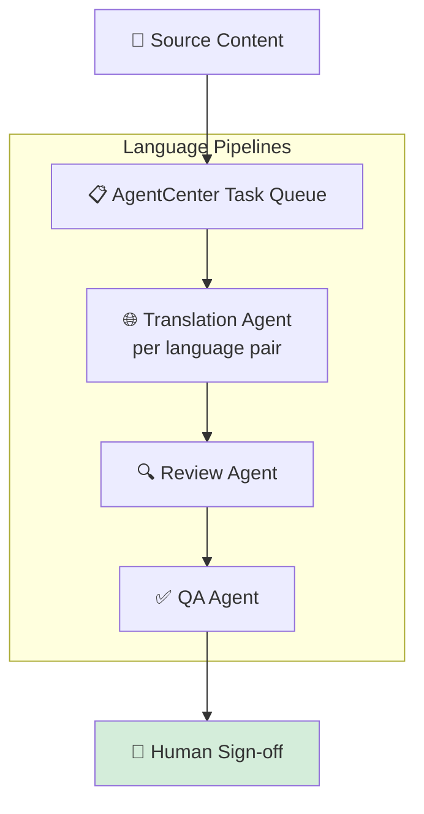

You have 12 language pairs in production. Each one needs a translation agent, a review agent, and sometimes a dedicated QA agent on top. That's potentially 36 agents running in parallel during a major product release.

Without a control plane, you're blind. You're pinging your localization vendor on Slack asking if Japanese copy is done. You're checking log files to find out why Spanish review errored out. You're learning three days later that the German QA agent finished but the output never made it to the sign-off queue.

That's the daily reality for localization teams running AI agents without visibility into what's actually happening.

## Why Localization Pipelines Break Without a Control Plane

The pain shows up in three specific places.

**Language pair explosion.** Ten languages means ten translation agents at minimum. Add review and QA agents per language, and you're at 20-30 agents running in parallel during a content push. There's no way to see, at a glance, which ones are blocked, which are idle, and which finished two hours ago with output sitting in a queue nobody is watching.

**Sequential handoff failures.** Localization pipelines are chained. Translation finishes, output goes to review, review passes to QA, QA flags to a human linguist for sign-off. When an agent completes its step but doesn't trigger the next one, the whole chain stalls. You typically find out when a linguist asks why there's nothing to review.

**No per-language cost data.** Different language pairs cost very different amounts to run. Legal content in Japanese burns far more tokens than short UI strings in French. Without tracking which agents spend what, you're budgeting blind and getting surprised at month-end.

## How AgentCenter Fits a Localization Workflow

Here's how each AgentCenter feature maps to a real localization problem.

### Real-Time Agent Status

Every translation, review, and QA agent shows its current state in the dashboard: online, working, idle, or blocked. During a content launch with 20 agents running simultaneously, you can see which language pairs are progressing and which ones are stuck without opening a single log file.

When the Japanese review agent goes blocked at 2am, you see it in the morning before the linguist has to tell you.

### Kanban Board for Translation Pipelines

Set up columns that match your localization stages: Queued, Translating, In Review, QA, Done. Each language pair gets a card that moves through the board as agents complete their steps.

Your localization manager can watch this board without touching the terminal. A content manager or project manager can do the same. Visibility stops being an engineering problem.

### Task Orchestration with Dependencies

Set dependencies between tasks. When the Spanish translation agent finishes, AgentCenter automatically queues the review agent. When review is done, QA gets triggered. The pipeline runs without anyone manually handing off output between steps.

This is the part that prevents "the agent finished but nothing happened next" failures. See how the full dependency model works at [task orchestration](/features/task-orchestration).

### Per-Agent Cost Tracking

Every agent logs token usage at the task level. You can compare French marketing copy at $0.09/task against Japanese legal content at $0.38/task. That data helps you decide which content types justify premium model routing and which can go to cheaper alternatives.

No more month-end surprises. Full breakdown available in [AgentCenter's agent monitoring view](/features/agent-monitoring).

### @Mentions for Human Review Steps

When QA flags a translation issue, the QA agent can trigger a mention to the linguist assigned to that language pair. The thread lives on the task card, not in a Slack channel that will scroll away. The sign-off history is attached to the deliverable.

## The Numbers

A mid-size SaaS localization team typically runs 8-15 agents: one translation agent per language pair, one review agent per major language, and a shared QA agent per content type. During major releases, that can spike to 25 or more running in parallel.

The **Pro plan at $29/month** supports up to 15 agents and covers most localization teams. If you're running 20 or more agents across multiple product lines or content types, the **Scale plan at $79/month** handles 50 agents across 50 projects. Full pricing at [agentcenter.cloud/pricing](/pricing).

AgentCenter replaces: Slack threads for status updates, shared spreadsheets tracking which agents finished, and ad-hoc cron jobs polling output directories.

## Before vs. After

| | Without AgentCenter | With AgentCenter |
|---|---|---|
| Visibility | Check logs per language pair separately | Real-time status board for all agents |
| Task handoffs | Manual routing or hope the chain fires correctly | Automatic dependencies trigger the next agent |
| Error detection | Linguist reports missing output two days later | Blocked or errored agent visible within minutes |
| Cost tracking | No per-language or per-task data | Token cost logged per agent per task |
| Debugging time | 2-4 hours reading logs to trace where the pipeline broke | Under 20 minutes tracing the specific failed task |

## Where to Start

Set up the Kanban board first. Create one card per active language pair and map your three core stages (Translating, In Review, Done) as columns. You'll see within 10 minutes which language pairs are actually running and which ones are sitting idle.

That single view will save your next content launch.

---

*Localization teams that add a control plane early spend less time firefighting later. [Start your 7-day free trial](/pricing).*
