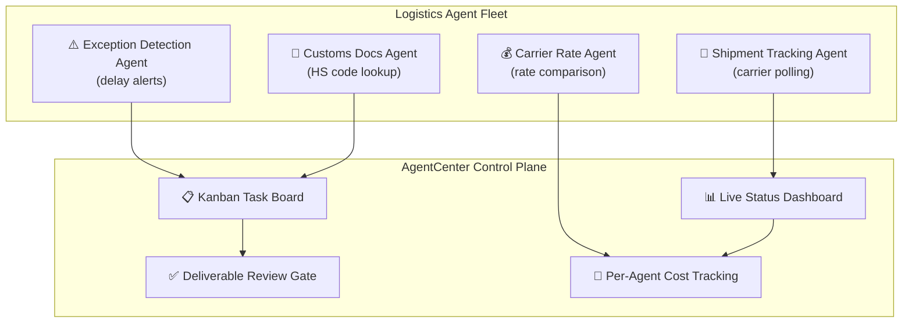

Logistics ops teams are some of the most aggressive adopters of AI agents. The work is repetitive, high-volume, and time-sensitive — perfect for automation. Tracking agents, carrier rate comparison agents, exception detection agents, customs documentation agents. On a good quarter you might be running 12 of them across 5 carriers and 3 internal systems.

The problem shows up around the eighth agent.

You don't know which ones are running. You don't know which one stopped. You don't know if the carrier parsing agent is returning empty fields because the API changed or because someone forgot to rotate a key. You find out when a client emails asking why their ETA is blank.

## Where Logistics Agent Stacks Break Down

It usually starts with a silent API change. A carrier updates their response schema. Your parsing agent doesn't error — it just starts returning empty ETAs. No alerts fire because the agent technically completed its task. Three hours later, your shipment visibility board has blanks across it and you're manually querying carrier portals to reconstruct data.

The second break is handoff failure. A delay detection agent flags an exception. The customer notification agent is supposed to pick it up and send an update. But the notification agent was already assigned to a different task batch, the handoff was implicit, and nothing enforced the dependency. The customer finds out on their own. SLA dispute. Support ticket. Frustrated account manager.

The third is cost blindness. You're running carrier rate queries through two different agents — one built in-house, one from a template. You don't know which one runs more often, which produces better results, or what each costs per query. Your monthly LLM bill shows a total. That's it.

## How AgentCenter Fixes This

Here's what the feature-to-workflow mapping looks like for logistics ops teams specifically.

**Real-time agent status**

The [agent monitoring dashboard](/features/agent-monitoring) shows live status for every agent: working, idle, blocked, or offline. When a carrier API drops or an auth key expires, the affected tracking agent goes to blocked immediately. You see it on the dashboard before a client calls. That's the difference between catching a 20-minute outage and discovering a 3-hour one.

**Task dependencies on the Kanban board**

When your exception detection agent fires a delay alert, the notification agent needs to pick it up right away — not when someone manually reassigns it. The [task orchestration Kanban](/features/task-orchestration) enforces that dependency. The notification task is created and blocked until the exception summary is ready. No implicit handoff. No missed update.

**Deliverable review before anything goes to a customer**

Before an exception notification or rate quote goes out, you want a human to look at it. Approval workflows let you add a review gate between the agent output and the downstream action. Your ops lead reviews the delay summary, confirms the exception details are accurate, and approves. Then it sends. That's one extra step that stops your agents from confidently sending wrong information at scale.

**Cost tracking per agent**

AgentCenter tracks LLM costs per agent, per task, per project. If you're running rate comparison queries through two different agents, you can see exactly what each costs per run. One logistics team found that one of their carrier query agents was costing 3x more than the other because it was pulling full carrier metadata on every request when only the rate field was needed. That's the kind of fix you can't make without per-task cost visibility.

## The Numbers

A typical logistics ops team running AI agents looks like this:

- 10-18 active agents at peak (tracking, exceptions, docs, rate comparison, invoice reconciliation)
- Pro plan ($29/mo, 15 agents) covers most teams
- Scale plan ($79/mo, 50 agents) for teams running carrier-specific agents per lane
- Replaces: Slack status threads, spreadsheet task tracking, manual SLA monitoring

See [pricing](/pricing) for current plan details and what's included.

## Before vs. After

| | Without AgentCenter | With AgentCenter |
|---|---|---|
| **Visibility** | Agents running in the background, status unknown | Live status per agent — working, blocked, idle |
| **Task handoffs** | Implicit, breaks when the receiving agent is busy | Task dependencies enforced, chain runs every time |
| **Error detection** | Parsing agent returns empty fields silently | Agent goes to blocked; team sees it immediately |
| **Cost tracking** | Monthly LLM total, no breakdown | Per-agent cost by carrier, by task type |
| **Debugging time** | 2-3 hours reconstructing logs per incident | Activity feed covers every step, under 15 minutes |

## Where to Start

Set up the Kanban board with your tracking agents first. Before you touch dependencies or approval workflows, having a live view of which agents are active vs. blocked will catch your next silent failure before it reaches a client.

Once you've got that running for a week and you can see the status patterns, add dependencies between your exception and notification agents. That's the fix for the handoff problem. It takes about 10 minutes to configure.

---

*Logistics and freight teams that add a control plane early spend less time explaining to clients why the ETAs were blank. [Start your 7-day free trial](/pricing).*
