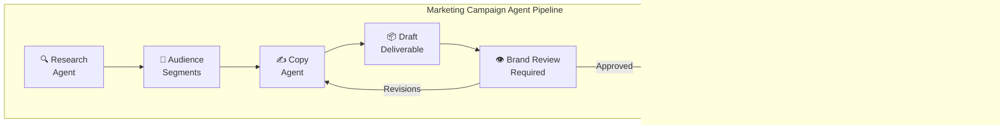

Marketing teams were quick to adopt AI agents for content generation, campaign analysis, and audience research. The speed benefit is real. An agent that drafts 20 email subject lines in 30 seconds versus a copywriter spending 3 hours on it — the math is obvious.

What's less obvious is the operational problem. Marketing outputs are public-facing. They carry brand risk. One off-brand campaign, one factual error in a published article, one tone-deaf email subject line — these have consequences that an internal agent failure doesn't.

That changes what "managing agents" means for marketing teams.

## The Specific Bottlenecks Marketing Teams Hit

**Brand voice consistency.** AI agents drift. The same agent producing on-brand copy last month might produce generic filler this month, not because the prompt changed, but because the model changed. Without systematic review, you catch this after publishing.

**Campaign coordination at scale.** A campaign involves multiple agents: one researching audience segments, one drafting copy, one generating image briefs, one analyzing competitor campaigns. These agents need to share context and hand off work in sequence. Without coordination, the copy agent drafts messaging that contradicts what the audience research found.

**Approval bottlenecks.** Marketing has approval chains. Legal reviews certain copy. Brand reviews new creative formats. Senior marketing reviews customer-facing content. Agents produce work faster than these approval chains can handle — which means either agents sit idle waiting for reviews, or reviews get skipped and content goes out unreviewed.

## How AgentCenter Addresses Marketing Team Workflows

**Deliverable review as a required step.** In AgentCenter's [multi-agent workflows](/features/multi-agent-workflows), the review gate is not optional. Before the copy agent's draft goes to the creative brief agent, a human reviewer approves it. The pipeline pauses. The reviewer sees the draft, approves with one click (or sends back with notes), and the pipeline continues.

This is the structure that eliminates the "we forgot to review it before it went out" problem.

**@mentions for approval routing.** When a deliverable needs review, the agent can @mention the specific reviewer in AgentCenter's chat thread. The reviewer gets a notification. No Slack message to coordinate the handoff. No email thread. The request, the context, and the deliverable are all in one place.

**Task orchestration for campaign coordination.** The research agent, copy agent, and analytics agent are all connected through the same project. When the research agent finishes, the copy agent starts automatically with the research output as context. No manual handoffs. No "did you get the research findings?" Slack message.

## Feature-to-Workflow Mapping

| Marketing Challenge      | AgentCenter Feature      | How It Helps                        |
| ------------------------ | ------------------------ | ----------------------------------- |
| Brand consistency        | Deliverable review gate  | Human approval before publishing    |
| Campaign coordination    | Task orchestration       | Agents hand off automatically       |
| Approval routing         | @mentions + chat threads | Right person notified automatically |
| Content quality tracking | Rejection rate tracking  | Catch drift before it's chronic     |
| Campaign cost tracking   | Per-task cost monitoring | Know AI cost per campaign           |
| Multiple campaigns       | Multi-project management | Separate workspaces per campaign    |

## The Numbers

Most marketing teams run 3-10 agents: content research, copywriting, subject line generation, campaign analysis, competitor monitoring, and social content drafting. The [Starter plan](/pricing) at $14/month handles 5 agents — a good pilot for 2-3 core marketing workflows. Pro at $29/month (15 agents, 15 projects) covers a full marketing team.

What AgentCenter replaces: review tracking in Notion or Google Docs, Slack threads that are hard to trace back to specific agent outputs, manual handoffs between team members for multi-agent campaigns, and custom scripts for sequencing agents.

## Before vs After AgentCenter

|                   | Without AgentCenter                     | With AgentCenter                   |
| ----------------- | --------------------------------------- | ---------------------------------- |
| Visibility        | Ask the team for status                 | Dashboard shows all campaigns      |
| Task handoffs     | Slack messages or email                 | Automatic with agent coordination  |
| Error detection   | Missed by reviewer, caught post-publish | Review gate catches before publish |
| Cost tracking     | Monthly provider bill                   | Per-campaign, per-agent            |
| Approval workflow | Ad-hoc email/Slack                      | Structured with notifications      |

## Where to Start

Start with one content workflow and a required review gate. Pick something you publish regularly — a newsletter, a social post, a product update — and route it through AgentCenter with a human review step before it goes out.

After 30 days, check: how many times did the reviewer catch something that would have gone out unreviewed? That number tells you whether the review gate is earning its place in the workflow.

_Marketing teams that add a control plane early spend less time firefighting later. [Start your 7-day free trial](/pricing)._
