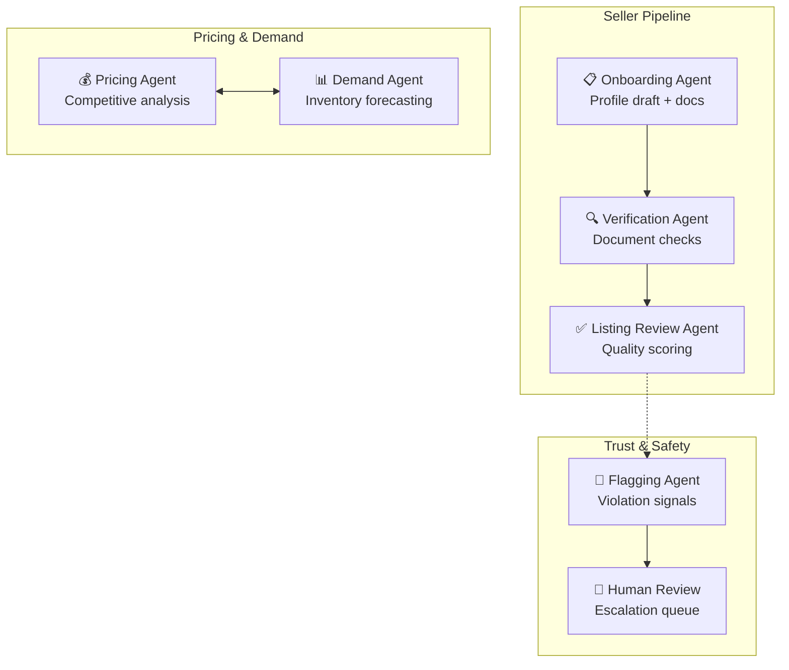

Running a two-sided marketplace means managing chaos from both sides at once. Sellers want faster onboarding. Buyers want accurate listings. Trust and safety wants flagged items reviewed before they go live. And your operations team is caught in the middle, trying to keep all of it moving.

Most marketplace ops teams hit the same wall: you deploy agents to handle the repetitive parts — listing review, price checks, fraud signals, seller verification — and for a while, it works. Then you hit 15 agents running across 4 workflows and you have no idea which one stalled your seller pipeline at 2am or why the listing quality score for a batch of 200 products never showed up.

That's not an AI problem. It's a visibility problem.

## What Breaks Without a Control Plane

Marketplace operations agents don't run in isolation. They hand off to each other. A seller onboarding agent generates a draft profile; a verification agent checks the documents; a listing review agent scores the first product batch. If one step stalls, everything downstream stalls too.

Without a control plane, three things go wrong fast.

**First, task handoffs go silent.** Your seller onboarding agent finishes its job, but the verification agent never picks up the handoff. There's no error — it just didn't run. You find out when the seller emails support asking why their account is stuck after three days.

**Second, trust and safety backlogs get invisible.** Your flagging agent marks 80 listings as needing human review. That queue lives somewhere — a spreadsheet, a Slack channel, an internal tool that three people have access to. By Thursday, you don't know if 20 of those are resolved or none of them are.

**Third, you can't tell cost from output.** Your pricing agent and your demand forecasting agent both call LLMs repeatedly. You're spending on both. But you can't see whether the pricing agent's recommendations are actually worth the token cost, or whether the demand agent is looping on a dataset it can't parse.

## How AgentCenter Fixes the Specific Problems Marketplace Teams Hit

### Kanban Board — See the Full Seller Pipeline

AgentCenter's [Kanban board](/features/task-orchestration) shows every agent task as a card. When you have 12 sellers going through onboarding simultaneously, you can see exactly where each one is in the pipeline: onboarding complete, verification in progress, listing review queued.

When the verification agent stalls on one seller, you see that card sitting in "in progress" for six hours while everything else moves. You don't wait for an angry support ticket.

### Real-Time Agent Status — Catch Idle When You Need Running

The [agent monitoring dashboard](/features/agent-monitoring) shows which agents are online, working, idle, or blocked right now. For marketplace ops, this matters for time-sensitive flows. Your pricing agent should be running during peak hours. If it shows idle at 3pm on a Friday, something's wrong before the weekend traffic hits.

The status view also catches loops. Demand forecasting agents that can't process a corrupted dataset will spin and call the LLM repeatedly. Real-time status shows you that within minutes, not after you get the LLM bill.

### @Mentions — Escalate to a Human Without Breaking the Workflow

Trust and safety reviews can't all be automated. Some listings need a human decision. With @Mentions in AgentCenter, your flagging agent can create a task and mention the ops lead directly. The task includes the listing ID, the signal that triggered the flag, and the relevant context.

No more routing through Slack. The escalation lives inside the workflow where it belongs.

### Cost Tracking — Know What Each Workflow Actually Costs

AgentCenter tracks token usage and cost per agent. For marketplace operations, this tells you whether your listing review agent (which runs on every new product upload) is eating budget on edge cases that rarely pass anyway. If your pricing agent costs $4 per batch and your demand agent costs $0.40, you know where to focus when the LLM bill spikes.

## The Numbers for a Mid-Size Marketplace Team

A marketplace ops team at a mid-size platform typically runs between 12 and 30 agents: seller onboarding, document verification, listing quality, price intelligence, demand signals, review moderation, fraud signals, and payout verification. Some of those agents run continuously; others fire on triggers.

The [Pro plan](/pricing) at $29/month handles up to 15 agents across 15 projects — enough for most marketplace teams getting started with agent automation. Once you're past 15 agents, the Scale plan at $79/month handles up to 50.

What AgentCenter replaces: a combination of shared spreadsheets for queue tracking, Slack channels for agent status updates, and manual cost exports from your LLM provider. Teams that make this switch report spending less time on coordination overhead and more time on the actual agent quality work.

## Before vs After AgentCenter

| | Without AgentCenter | With AgentCenter |
|---|---|---|
| **Visibility** | Check 4 separate tools to understand what's running | Single dashboard: agent status, task queue, and costs |
| **Task handoffs** | Silent failures; find out from support tickets | Stalled handoffs visible as blocked cards on the Kanban board |
| **Error detection** | Hourly manual checks or waiting for downstream failures | Real-time status flags idle agents and loops immediately |
| **Cost tracking** | Monthly LLM bill with no breakdown by workflow | Per-agent cost tracking across each marketplace workflow |
| **Debugging time** | 2-4 hours per incident chasing context across tools | Task history and agent logs in one place; under 30 minutes |

## Where to Start

Set up the Kanban board for your seller onboarding pipeline first.

Map your onboarding stages to columns: "Submitted," "Verification in Progress," "Listing Review," "Live." Wire your onboarding, verification, and listing agents to create and move tasks through those columns. This single change makes the pipeline visible to your entire ops team, not just the engineer who deployed the agents.

Once the board is running, add cost tracking so you know what the onboarding pipeline costs per seller. That baseline is useful before you add more agents to the flow.

---

*Marketplace ops teams that add a control plane early spend less time firefighting seller pipeline failures later. [Start your 7-day free trial](/pricing).*
