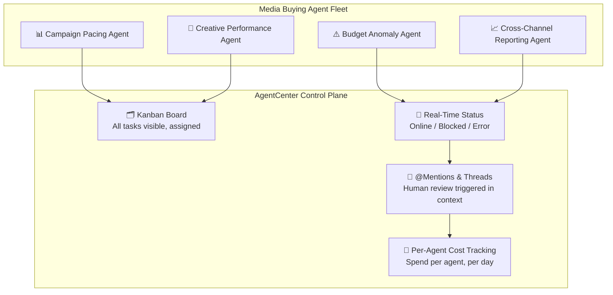

Media buying teams are running more agents than they realize. Campaign pacing monitors. Creative rotation analyzers. Budget burn rate calculators. Cross-channel anomaly detectors. Most teams started with one agent to handle overnight reporting and ended up with 12 doing things nobody fully documented.

That's not an AI problem. That's an agent management problem.

## What AI Agent Management for Media Buying Teams Actually Looks Like

A mid-size agency team running paid media across three platforms might have agents doing all of this in the background: checking hourly CPM against the previous 7-day average, flagging creative fatigue when CTR drops below threshold, pulling spend data from Google, Meta, and TikTok into a unified daily summary, and alerting when a campaign goes 15% over daily budget.

None of that is complicated to build. What gets complicated is knowing what each agent is doing right now, what it did last night, whether it failed, what it cost, and what a human is supposed to do when it surfaces something.

Without a control plane, that coordination lives in Slack threads and someone's head.

## Three Things That Break Without a Control Plane

**1. Silent agent failures.** Your keyword analysis agent stopped returning data two days ago. An analyst noticed the numbers looked off in a spreadsheet and spent four hours tracing it back to an API rate limit error that the agent swallowed without alerting anyone. There was no status dashboard. No alert. Just missing data that looked like normal variance until it didn't.

**2. Duplicate work across agents.** Your campaign performance agent and your budget pacing agent both pull impression data from the same endpoint at the same time. Neither team member knows. You're paying for two identical API calls and occasionally getting slightly different numbers in two different reports because the pulls happen seconds apart.

**3. Handoffs that live in people's heads.** Your creative performance agent flags underperforming ad sets and drops them in a CSV. Separately, a human is supposed to pull that CSV, review it, and brief the creative team. That handoff exists nowhere in writing. When the person who owns it is out sick, the briefing doesn't happen. The underperforming creative keeps running. Spend burns.

These aren't edge cases. Teams running 8 to 15 agents hit all three of these within the first few months.

## How AgentCenter Solves the Specific Problems Media Buying Teams Hit

**Kanban board for campaign task tracking.** Every agent output becomes a card on a board. When your creative performance agent identifies an underperforming ad set, it creates a task in AgentCenter and assigns it to the creative lead. The handoff is no longer implicit. You can see it, track whether it happened, and reassign it without sending a Slack message. [See how task orchestration works](/features/task-orchestration).

**Real-time agent status.** You open AgentCenter at 9am and see that your campaign pacing agent is "error" and your attribution agent is "blocked." You know this before your account manager asks why last night's pacing report is missing. No more four-hour debugging sessions that start with a client email. [Explore agent monitoring](/features/agent-monitoring).

**@Mentions for human-in-the-loop review.** When your anomaly detection agent spots a budget spike that crosses a threshold you set, it triggers a mention to your paid media lead in the task comment thread. The review happens in context, with the data attached. No separate notification to miss. No copy-paste from a CSV into Slack.

**Per-agent cost tracking.** Your CPM optimization agent costs $4 per day in LLM spend and your pacing monitor costs $0.40. That ratio was invisible until AgentCenter showed it. You can look at the cost vs. output for each agent and make a call based on data, not gut feel.

## The Numbers for Media Buying Teams

A typical mid-size agency media buying team runs 8 to 15 agents. The breakdown usually looks something like:

- 3 to 5 campaign performance monitoring agents (one per major platform)
- 2 to 3 creative analysis agents
- 1 to 2 budget anomaly detection agents
- 1 to 2 attribution and consolidated reporting agents

That fits the Pro plan at $29/month with support for up to 15 agents. Larger agency groups running campaigns for 10 or more clients, with dedicated agent clusters per account, would fit the Scale plan at $79/month for up to 50 agents. [See full pricing and plan comparison](/pricing).

What AgentCenter replaces: the mix of Slack alerts, shared spreadsheets, and informal check-ins that hold the agent fleet together right now. That informal system works until the day a client asks why spend ran 40% over on Tuesday and nobody can reconstruct what the agents were doing.

## Before vs After: Media Buying Agent Management

| | Without AgentCenter | With AgentCenter |
|---|---|---|
| **Visibility** | Check each agent's logs separately; ask around | Single dashboard shows all agent status at a glance |
| **Task handoffs** | Slack DMs or verbal; breaks when someone's out | Task cards with assignees; no step gets dropped |
| **Error detection** | Analyst notices numbers are off 2 days later | Real-time error status change, visible immediately |
| **Cost tracking** | Unknown; LLM costs lumped into general infra | Per-agent cost per day; outliers surface fast |
| **Debugging time** | 3 to 5 hours to reconstruct what an agent did | Task thread and activity log narrow it to minutes |

## Where to Start

If you have 3 or more campaign agents running right now, start with the **Kanban board and task assignment**. Map each of your existing agent outputs to a task type, assign it to the person who acts on it, and move that handoff out of Slack and into a tracked card. You don't need to change any agent code to do this.

Once the task flow is in place, turn on cost tracking and real-time status monitoring. You'll find at least one agent that costs more than it returns within the first week.

---

*Media buying teams that add a control plane early spend less time explaining to clients why the numbers don't match. [Start your 7-day free trial](/pricing).*
