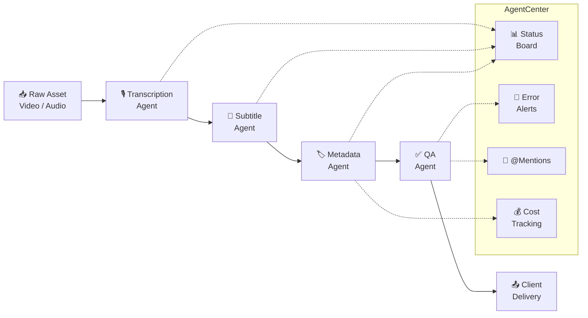

Media production teams are running more AI agents than most people outside the industry realize. By the time a post-production house or streaming tech team hits mid-size, with 20 or more concurrent projects, they've typically got agents handling transcription, subtitle generation, content moderation, metadata tagging, and pre-delivery QA. That's five or more agents per asset. With 15 assets in production at once, you've got 75+ agent tasks running any given week.

The agents aren't the problem. The visibility is.

## What Breaks When AI Agents for Media Production Have No Control Plane

Here are three things that actually happen when media production teams run agents without a central management layer.

**You don't know which agent is doing what.** Your transcription agent is labeled "agent-transcribe-07" and it's showing a "working" state. Working on what? The 47-minute documentary? The 90-second promo cut? The feature that was supposed to ship yesterday? Without task-level visibility, you're SSH-ing into logs to find out.

**Silent failures hit the client first.** A subtitle agent encounters a non-standard audio format (compressed mono with audio artifacts) and quietly writes an empty SRT file. The task shows as "complete" because the agent ran without crashing. Nobody finds the empty file until QA checks it four hours later. Or until the client flags it.

**Cost per episode is unknowable.** You're running 12 agents across a streaming platform delivering 40 episodes a month. Your head of infrastructure asks what it costs to process one episode end-to-end. You can't answer with any confidence. The spending is spread across three services, five agents, and a stack of cloud charges nobody's mapped.

## How AgentCenter Fixes the Workflow

The goal isn't to add process overhead. It's to give your team one view of what's running, what's failed, and what costs what, without digging through logs.

### Real-Time Status Board

The [agent dashboard](/features/agent-dashboard) shows every running agent, what task it's on, and its current status: working, idle, or blocked. For a media team, this means you can see that "Project Falcon Ep 3 transcription" is in progress and "Project Falcon Ep 2 QA" just flagged an error. One screen, no log parsing.

When an agent blocks because the input file is corrupted or an API rate limit hit, it shows up as blocked in the dashboard, not silently stalled. You find out in minutes, not hours.

### @Mentions for Review Handoffs

When the subtitle agent finishes a file, the task in AgentCenter can be picked up by a QA agent or handed to a human reviewer with a direct @mention in the task thread. No more Slack messages asking "hey, did you check the SRT for Episode 4?" The task holds the conversation, the files, and the review status in one place.

This matters especially in localization workflows where multiple people — translators, QA reviewers, post-production coordinators — touch the same asset in sequence.

### Error Detection Before It Reaches the Client

The [agent monitoring](/features/agent-monitoring) layer catches failures that agents themselves don't surface clearly. An empty output file, a response timeout, a task that should have finished in 10 minutes but is now at 45 minutes — these all trigger alerts in AgentCenter before QA or a client sees them.

For a media team doing client deliveries, catching a bad subtitle file internally vs. having the client flag it is the difference between a quick fix and an angry email chain.

### Cost Tracking Per Asset

With cost analytics in AgentCenter, you can see what each agent spent per task: compute time, API calls, retries. After a few months of tracking, you can tell your finance team exactly what it costs to process a 45-minute episode through transcription, subtitles, metadata tagging, QA, and delivery. That's a number most studios don't have today, and it becomes a real input for scoping and pricing future productions.

## The Numbers for Media Production Teams

Most post-production studios and streaming tech teams run between 8 and 30 agents depending on output volume. The [Pro plan](/pricing) at $29/month covers up to 15 agents, a good fit for a boutique post-production house or a mid-size content team. The Scale plan at $79/month handles up to 50 agents, which works for platforms delivering 60+ episodes a month or running parallel localization pipelines.

What it replaces: spreadsheet tracking, Slack-based handoffs, manual log review, and the time spent figuring out which agent broke the pipeline.

## Before vs After

| | Without AgentCenter | With AgentCenter |
|---|---|---|
| **Visibility** | SSH into logs per agent | Dashboard with live status per task |
| **Task handoffs** | Slack DMs, missed pings | @Mentions per task, auto-assigned |
| **Error detection** | Client or QA finds it first | Alert fires before delivery |
| **Cost tracking** | Spread across cloud bills | Cost per agent, per task |
| **Debugging time** | 2-4 hours tracing logs | 15-20 minutes from alert to fix |

## Where to Start

Connect your most failure-prone agent first. For most media teams that's the one handling the widest variety of input formats: different codecs, varying audio quality, mixed frame rates. Set it up in AgentCenter and run it for a week. You'll almost certainly find at least one silent failure pattern you didn't know existed.

From there, wire in the rest of the pipeline one agent at a time. The [multi-agent workflows view](/features/multi-agent-workflows) makes it straightforward to link agents that hand tasks to each other.

---

*Media production teams that add a control plane early spend less time firefighting later. [Start your 7-day free trial](/pricing).*
