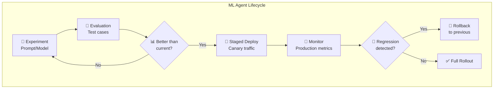

ML engineers have a specific frustration with AI agents: you know exactly how to build them, but once they're running in production, you lose visibility into whether what you built is still what's running.

A model version changes. A prompt gets edited by a product manager. The input distribution shifts because the upstream data pipeline got "improved." None of these trigger alerts. The agent keeps running. The outputs silently degrade.

That's the operational gap between ML work and MLOps reality.

## The Specific Bottlenecks ML Teams Hit

**Model version tracking.** Which model is each agent actually using? When did it last change? If your provider updates the model default and you're not pinning versions, you're running controlled experiments without knowing it. I've seen teams spend days debugging what turned out to be a model-version drift.

**Experiment isolation.** When you're iterating on a prompt or trying a new model, you need to run the new version alongside the old one without contaminating production outputs. Without a proper deployment model for agents, this usually means manually managing two copies — or just deploying the change and hoping.

**Cost attribution.** ML experiments that worked in evaluation can fail in production by being 10x more expensive than expected. Tracking cost at the task level, tied to specific agent configurations, is how you know whether a "better" agent is actually better when you factor in compute cost.

## How AgentCenter Addresses ML Team Workflows

**Task-level audit trail for model experiments.** Every task run in AgentCenter is logged with the agent configuration that ran it. When you're comparing v1 and v2 of a prompt, you can pull the full history for both and compare output quality, duration, and cost side by side. No custom experiment tracking needed for operational comparisons.

**Deliverable review as evaluation gate.** ML engineers often build eval harnesses that run offline. That's valuable, but you also need evaluation in the deployment loop. AgentCenter's [deliverable review](/features/agent-monitoring) creates a human-in-the-loop eval gate in production: every agent submission goes through review before the next step starts. Rejection feedback feeds back into your iteration cycle.

**Real-time status for long-running inference jobs.** Agents that do multi-step reasoning or retrieval can run for minutes. The [agent dashboard](/features/agent-dashboard) shows you what state each is in without having to poll logs. If a batch of inference jobs is stuck, you see it immediately.

## Feature-to-Workflow Mapping

| ML Engineering Concern | AgentCenter Feature          | Benefit                          |
| ---------------------- | ---------------------------- | -------------------------------- |
| Model version tracking | Agent config in task history | Know exactly what ran            |
| Experiment comparison  | Side-by-side task history    | Compare without custom logging   |
| Cost per experiment    | Per-task cost tracking       | Factor cost into model selection |
| Staging new prompts    | Multi-project isolation      | Keep prod and staging separate   |
| Human eval in prod     | Deliverable review gate      | Catch regressions before users   |
| Inference job status   | Real-time agent dashboard    | No polling, immediate visibility |

## The Numbers

Most ML teams managing agents run 5-20 agents across 4-10 projects. That maps to [Pro plan](/pricing) ($29/month, 15 agents, 15 projects) or Scale ($79/month, 50 agents, 50 projects) depending on scale.

What AgentCenter typically replaces for ML teams: custom experiment tracking in spreadsheets, ad-hoc cost monitoring via provider dashboards (which don't show per-task breakdown), manual status checks via Slack pings to the team, and custom eval scripts that only run offline.

## Before vs After AgentCenter

|                 | Without AgentCenter     | With AgentCenter               |
| --------------- | ----------------------- | ------------------------------ |
| Visibility      | Check provider logs     | Real-time dashboard            |
| Task handoffs   | Custom code or manual   | Built-in orchestration         |
| Error detection | Log grep, hours later   | Per-agent, configurable alerts |
| Cost tracking   | Provider aggregate only | Per-task, per-agent            |
| Debugging time  | 2-6 hours per incident  | 30-60 minutes                  |

## Where to Start

Start with the audit trail. Connect your most-iterated agent and run a week of tasks through AgentCenter. After a week, you'll have a ground truth record of what every run produced, at what cost, and with what config. That alone changes how you approach iteration.

_ML teams that add a control plane early spend less time firefighting later. [Start your 7-day free trial](/pricing)._
