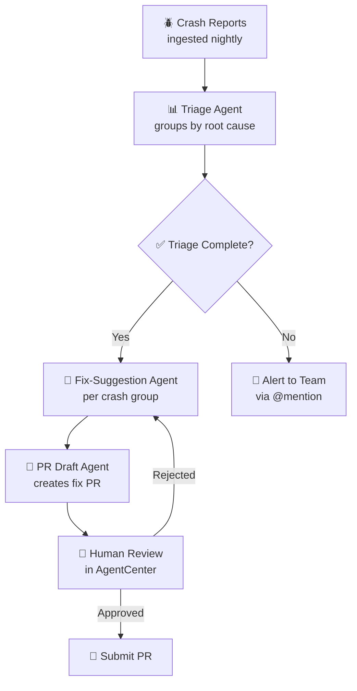

Mobile engineering teams have a problem that most agent platforms don't talk about: your most important agent work happens while you're asleep.

Crash triage runs at 3am. App store optimization analysis queues overnight. Code review agents chew through PRs while the iOS team is in meetings. By the time anyone looks at the results, you have no idea if anything ran correctly, finished on time, or produced output worth trusting.

That's the gap. Not whether AI agents can help mobile teams. They clearly can. The question is how you manage them once they're running.

## What Breaks Without a Control Plane

Mobile engineering teams hit three specific failure modes when they run agents without shared visibility.

**The overnight blind spot.** A crash triage agent groups 200 reports by root cause and writes them to a file. The team shows up to standup assuming it ran. It actually failed at 2am due to a rate limit. The crash backlog from the previous night is still unprocessed, and no one knew until a developer checked the file manually an hour into their day.

**The unreviewed recommendation problem.** An app store optimization agent surfaces keyword changes for an upcoming release. Someone downstream assumes the output was validated and submits it directly to the App Store. Two weeks later, impressions are down because the agent recommended a set of niche keywords that looked plausible but weren't tested.

**The conflicting agent output.** Two agents run against the same crash report with slightly different context windows. One classifies it as P1. The other flags it as P3. The team spends 45 minutes figuring out which agent was right, then manually re-classifies. The agents ran fine. The coordination failed.

These aren't edge cases. They happen when mobile teams scale from one agent to five or six without adding any structure around how those agents hand off work.

## How AgentCenter Fits Mobile Engineering Workflows

**Real-time agent status.** The [agent dashboard](/features/agent-dashboard) shows whether your crash triage agent is running, blocked, or done. You open AgentCenter at standup, see it completed at 2:14am and produced 47 grouped reports, and move on. No log spelunking.

**Task dependencies.** The fix-suggestion agent should not start until crash triage finishes and passes review. With [task orchestration](/features/task-orchestration), you set that dependency once. If triage fails, fix-suggestion doesn't run and waste tokens. The activity feed shows exactly where the pipeline stopped.

**Deliverable review gates.** ASO keyword recommendations, PR draft outputs, release notes from commit history — these should not flow downstream until a human confirms them. AgentCenter's approval workflow stops the output in a review queue. The on-call engineer approves or sends back with a comment. Nothing reaches the App Store submission without that gate.

**Agent monitoring for costs.** Crash triage agents can get expensive when a bad release generates thousands of reports. The [monitoring view](/features/agent-monitoring) shows per-task token spend. If last Tuesday's crash agent cost $0.14 and this Tuesday's cost $3.80, you catch that before it compounds.

**@Mentions for escalation.** When the triage agent classifies a crash group as P0, it needs to reach someone immediately. With @mentions on the task card, the agent can flag the on-call engineer directly in the task thread. No separate Slack integration required.

## The Numbers for Mobile Engineering Teams

A typical mobile engineering team running agents in production operates somewhere between 5 and 12 agents: crash triage, fix suggestion, ASO optimizer, release notes generator, screenshot test coordinator, and a PR reviewer for platform-specific patterns like memory management in Swift or Kotlin.

That puts most teams comfortably in the [Pro plan](/pricing) at $29/month — 15 agents, 15 projects. Teams with separate iOS and Android tracks running parallel agent pipelines sometimes move to Scale when the project count goes over 15.

What AgentCenter replaces in this setup: manual log checks after overnight runs, a spreadsheet tracking which agents ran and when, a Slack channel where someone pings "did the crash agent finish?" at 9am, and the informal human coordination that exists to fill gaps in agent visibility.

## Before and After

| | Without AgentCenter | With AgentCenter |
|---|---|---|
| **Visibility** | Check logs manually to confirm overnight run | Dashboard shows status, duration, and output location |
| **Task handoffs** | Fix-suggestion starts manually after verifying triage | Dependency enforced; fix-suggestion only starts when triage passes |
| **Error detection** | Discover at standup that nightly run silently failed | Notification fires when agent fails; no silent gaps |
| **Cost tracking** | No per-run visibility into LLM token spend | Per-task cost in the monitoring view; spikes are visible immediately |
| **Debugging time** | 1-2 hours tracing which agent produced conflicting output | Activity feed shows exact execution sequence per task |

## Where to Start

Set up a deliverable review gate for your ASO agent before anything else.

App store metadata errors are slow to recover from. A bad keyword set takes weeks to test and correct, and the ranking damage is hard to attribute. The ASO agent is exactly the kind of high-stakes, low-feedback-loop workflow that needs a human check before anything ships.

The setup in AgentCenter takes about 10 minutes: create the project, assign the ASO agent, turn on the approval workflow for its output tasks. The agent runs as normal. Its deliverable lands in the review queue. Your product manager or ASO specialist approves it before it touches the submission pipeline.

That one gate removes the most expensive failure mode mobile engineering teams hit. Once it's working, the rest of the agent pipeline is easier to instrument.

---

*Mobile engineering teams that add a control plane early spend less time firefighting later. [Start your 7-day free trial](/pricing).*
