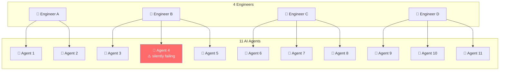

The standup was going fine until Ravi said, "I think the extraction agent is running slow but I'm not sure if that's mine."

We had four engineers and eleven AI agents. Nobody could name all eleven off the top of their heads. That was the moment I realized we'd crossed a line without noticing.

## Why the Ratio Matters

One agent per engineer is fine. You built it, you know it, you check on it. Two agents per engineer is manageable. You have notes. You have a sense of what each does.

When agents outnumber people, something shifts. It's not that the agents are harder to build. It's that the accountability model you built for "who knows about what" stops working.

Eleven agents across four engineers means nobody has full mental coverage. Someone is always assuming someone else has eyes on something. And that gap, that shared assumption that someone else is watching, is exactly where failures sit undetected for days.

## What Actually Breaks

The first thing that breaks is ownership. Not formally, not in a ticket system, but operationally. When three agents call the same downstream API and that API starts throttling, which engineer gets the alert? In practice: nobody, until a human notices the wrong output and asks around.

The second thing that breaks is incident scope. When a code deployment goes wrong, you look at the diff. When an AI agent starts producing subtly wrong output, you don't always know whether it's one agent or five. The blast radius is invisible until you go looking.

The third thing that breaks is your sense of system state. You knew your staging environment. You knew which services were up. With ten-plus agents, you don't have a live picture of what's running, what's stuck, and what's quietly failing.

Here's what that pattern looks like in practice:

Agent 4 is failing. Engineer B thinks Engineer C has it. C thinks it belongs to B. Nobody looks. Three days later, someone in ops asks why the reports look wrong.

## The Moments Before You Cross the Line

Teams usually hit this ratio faster than they expect. Automating individual tasks is quick. One sprint, one agent. Then two. Then a team member ships three in a week because the pattern is working.

What's slow is the infrastructure layer that keeps you informed. Ownership tracking, status visibility, cost monitoring per agent. Teams skip it because it doesn't feel necessary when you have four agents. By the time you have fifteen, it's a retrofit project nobody has time for.

The signal to watch for: you start saying "I think" a lot. "I think Agent 6 is working." "I think we have someone on the extraction pipeline." That uncertainty is the gap. You're guessing at state because you have no live view.

The other signal: you stop updating your team on individual agents because there are too many to mention. Standup shifts from "here's what's running" to "nothing broke this week." That's not the same thing.

## What You Need Before You Hit This Wall

You don't need a bigger ops team. You need one thing to be true: every agent has a named owner in a place everyone can see.

Not a spreadsheet that gets stale in a month. A live view. When Agent 4 is blocked, Engineer B's name is on it. When Agent 9 goes idle for 6 hours, that's visible to anyone who looks. When three agents all start costing more than expected in the same billing cycle, that's one screen, not three separate checks.

The [agent monitoring dashboard](/features/agent-monitoring) in AgentCenter shows this per agent, not per project or per team. You can see which agents are running, which are stuck, which haven't produced output in longer than expected. That's the live picture you lose when agents outnumber people.

The [kanban board for task management](/features/task-orchestration) gives each agent's work a home. Not just "agent is running" but "this is what it's working on and here's the last output." That's what makes ownership real rather than nominal.

## Who Hits This First

Usually not the biggest teams. The fastest path to agents-outnumber-engineers is a small, fast-moving team. Two to six engineers shipping automations quickly. One agent per task, because that's the natural unit. Then the tasks multiply and the agents multiply with them.

ML engineers building model pipelines. DevOps engineers automating deployment checks. Content operations teams spinning up per-channel publishing agents. In each case, the automations scale faster than the visibility layer.

If you're running more than three agents per engineer today and nobody has a single place to check status across all of them, you're already in the gap.

## The Honest Part

Giving every agent a named owner and a live status board doesn't fix a broken agent. If the agent is producing bad output, that's a prompt issue or a data issue or a model issue. The dashboard tells you which agent to look at, not what's wrong with it.

The difference is time. A silent failure that runs for three days costs more than one you catch in three hours. Not because the agent is different, but because of what accumulated in between: wrong reports filed, bad data downstream, a deliverable someone acted on.

You don't need everything perfect before you add more agents. But knowing which ones are running, who owns them, and what they last produced shouldn't require a Slack thread and two days of memory archaeology.

---

*The dashboard won't fix a broken agent. But it will tell you which one is broken at 3am. [Try AgentCenter free](/pricing).*
