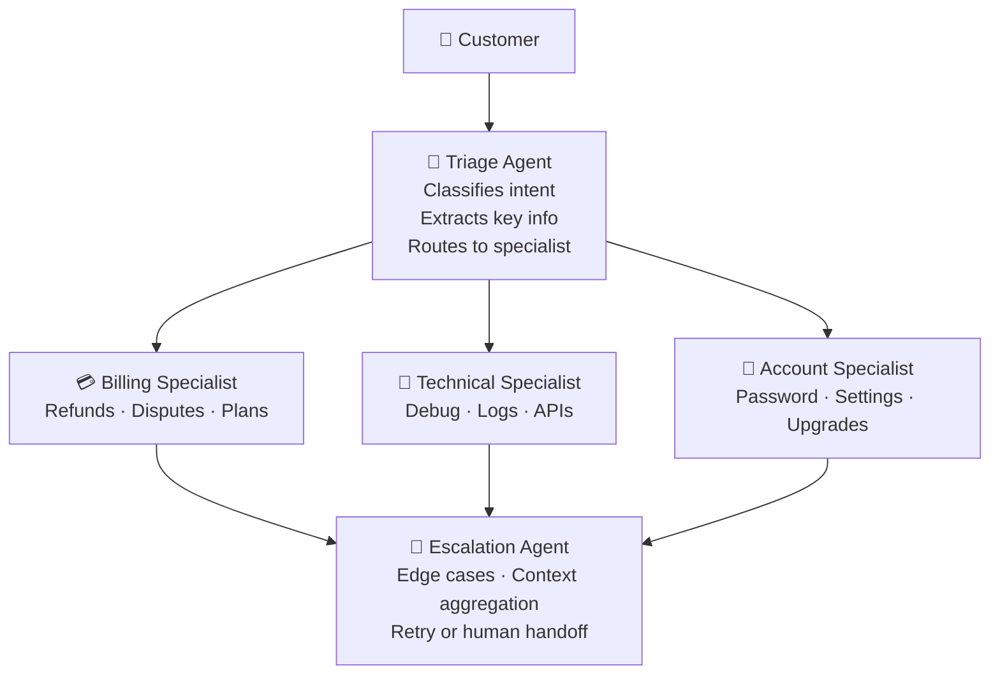
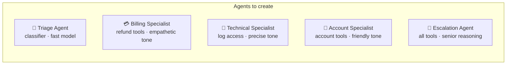

_Why single-bot support breaks at scale, and how to design an agent architecture that actually works._

---

Every company that deploys a single AI chatbot for customer support hits the same wall. The bot handles password resets fine. It struggles with billing disputes. It completely fails at technical troubleshooting that requires checking multiple systems.

The problem isn't the AI — it's the architecture. You're asking one generalist agent to do the work of an entire support department. That's like hiring one person to handle tier-1 tickets, billing escalations, technical debugging, and VIP account management simultaneously.

The solution: **multi-agent customer support** — specialized agents working together, each handling what they're best at, with clean handoffs between them.

This guide walks through the full architecture: why single agents fail, how to design the multi-agent system, handoff protocols, monitoring, and a deployment walkthrough using [AgentCenter](https://agentcenter.cloud).

## Why Single-Agent Support Bots Fail at Scale

A single support bot works when you have:

- A narrow product with few support categories
- Low volume (under ~100 tickets/day)
- Simple, repetitive queries

But as your product and customer base grow, three problems compound:

### 1. Context Window Bloat

A generalist bot needs instructions for every support category stuffed into its system prompt. Billing rules. Technical docs. Policy edge cases. Return procedures. As you add categories, the prompt grows — and the bot's accuracy on each category drops. More context ≠ better answers.

### 2. Skill Dilution

Fine-tuning or prompt-engineering a bot to be great at empathetic responses ("I understand how frustrating this must be") actively conflicts with making it great at technical precision ("Run `dig +trace example.com` and paste the output"). Different support scenarios require fundamentally different communication styles.

### 3. Escalation Dead Ends

When a single bot can't solve a problem, the only option is "let me transfer you to a human." There's no intermediate step — no specialist agent that can try a deeper investigation before burning expensive human agent time.

The result: your bot handles 40% of tickets well, frustrates customers on another 40%, and dumps the remaining 20% on humans with no useful context.

## Designing the Multi-Agent Architecture

A multi-agent support system mirrors how real support teams work. You need three layers:



### The Triage Agent

This is your front door. Every customer message hits the triage agent first. Its job is narrow and well-defined:

1. **Classify intent** — What does the customer need? Billing help, technical support, account management, general inquiry?
2. **Extract structured data** — Pull out order IDs, error messages, account emails, product names
3. **Assess urgency** — Is this a service outage affecting their business, or a "how do I change my password" question?
4. **Route** — Send to the right specialist with the extracted context

The triage agent should be fast and cheap. Use a smaller, faster model. It doesn't need to solve anything — just understand and route.

```python
# Triage agent configuration
triage_agent = {
    "name": "triage",
    "model": "claude-3-haiku",  # Fast, cheap
    "system_prompt": """You are a support triage agent.
    Classify the customer's intent into one of:
    billing, technical, account, general.
    Extract: customer_id, order_id, error_message, urgency (low/medium/high).
    Respond ONLY with JSON classification — do not chat with the customer.""",
    "output_schema": {
        "intent": "string",
        "urgency": "string",
        "extracted": {
            "customer_id": "string|null",
            "order_id": "string|null",
            "error_message": "string|null"
        },
        "route_to": "string"
    }
}
```

### Specialist Agents

Each specialist is an expert in one domain. They have:

- **Focused system prompts** — only the knowledge they need
- **Tool access scoped to their domain** — billing agent can issue refunds, technical agent can query logs, account agent can reset passwords
- **Domain-specific tone** — billing agent is empathetic about money, technical agent is precise about debugging steps

```python
# Example: Technical support specialist
tech_specialist = {
    "name": "technical_support",
    "model": "claude-sonnet-4-20250514",  # Needs strong reasoning
    "system_prompt": """You are a technical support specialist.
    You help customers debug API issues, integration problems,
    and infrastructure questions.

    Available tools: query_logs, check_api_status,
    run_diagnostic, search_docs.

    Always ask for reproduction steps before suggesting fixes.
    Include relevant documentation links in your response.""",
    "tools": ["query_logs", "check_api_status",
              "run_diagnostic", "search_docs"],
    "max_turns": 10
}
```

A good rule of thumb: if you'd hire a different person for it in a real support team, it should be a different agent.

### The Escalation Agent

The escalation agent handles cases that specialists can't resolve. It's the senior support engineer of your system:

- **Cross-domain knowledge** — understands billing AND technical AND account issues
- **Context aggregation** — receives the full conversation history plus specialist notes
- **Decision authority** — can retry with a different specialist, try a novel approach, or escalate to a human with a complete context package

This agent should use your most capable model. It handles the hardest 10-15% of tickets.

## Agent Handoff Protocols and Context Passing

Handoffs are where multi-agent systems succeed or fail. A bad handoff makes the customer repeat themselves. A good handoff is invisible.

For deeper patterns on agent coordination, see our guide on [AI agent orchestration patterns](/blog/ai-agent-orchestration-patterns).

### The Handoff Payload

Every agent-to-agent handoff should include a structured context object:

```json
{
  "handoff_id": "hnd_abc123",
  "from_agent": "triage",
  "to_agent": "technical_support",
  "timestamp": "2026-02-19T14:30:00Z",
  "customer": {
    "id": "cust_456",
    "name": "Sarah Chen",
    "plan": "enterprise",
    "account_age_days": 340
  },
  "classification": {
    "intent": "technical",
    "urgency": "high",
    "category": "api_integration_error"
  },
  "context": {
    "summary": "Customer reports 502 errors on /api/v2/webhooks endpoint since 2pm UTC. Affecting their production pipeline.",
    "extracted_data": {
      "error_code": 502,
      "endpoint": "/api/v2/webhooks",
      "started": "2026-02-19T14:00:00Z"
    },
    "conversation_history": [...],
    "attempted_solutions": []
  },
  "routing_reason": "API error requiring log investigation"
}
```

### Handoff Rules

1. **Never lose context.** The receiving agent must have everything the previous agent learned. The customer should never repeat information.
2. **Summarize, don't dump.** Pass a structured summary plus the raw history. The specialist reads the summary first, digs into history only if needed.
3. **Track handoff chains.** If a ticket bounces through 3+ agents, something is wrong — flag it for review.
4. **Announce transitions.** Tell the customer: "I'm connecting you with our technical team who can look into those API errors." Never silently swap agents.

```python
def handoff(from_agent, to_agent, conversation, classification):
    """Execute agent handoff with context preservation."""

    # Generate summary from conversation
    summary = from_agent.summarize(conversation)

    # Build handoff payload
    payload = {
        "handoff_id": generate_id(),
        "from_agent": from_agent.name,
        "to_agent": to_agent.name,
        "context": {
            "summary": summary,
            "conversation_history": conversation.messages,
            "classification": classification,
            "attempted_solutions": conversation.get_solutions_tried()
        }
    }

    # Transition message to customer
    customer_message = (
        f"I'm connecting you with our {to_agent.display_name} "
        f"who can help with {classification['category']}. "
        f"They'll have the full context of our conversation."
    )

    # Start new agent with context
    to_agent.start_conversation(
        system_context=payload,
        first_message=customer_message
    )

    return payload["handoff_id"]
```

For more on designing robust handoff patterns, see [common AI agent design patterns](/blog/common-ai-agent-design-patterns).

## Monitoring Conversation Quality and Resolution Rates

You can't improve what you don't measure. Multi-agent systems need monitoring at two levels: individual agent performance and system-wide flow.

For a comprehensive monitoring setup, see our guide on [monitoring AI agents in production](/blog/monitoring-ai-agents-production).

### Agent-Level Metrics

| Metric                | What It Measures                       | Target              |
| --------------------- | -------------------------------------- | ------------------- |
| Resolution rate       | % of tickets solved without escalation | >70% per specialist |
| Avg. response time    | Time to first meaningful response      | &lt;30 seconds      |
| Handoff accuracy      | % of correct triage routings           | >90%                |
| Customer satisfaction | Post-resolution CSAT score             | >4.2/5              |
| Turns to resolution   | Messages needed to solve               | &lt;8 avg           |
| Escalation rate       | % needing human intervention           | &lt;15%             |

### System-Level Metrics

```python
# Key metrics to track across the system
system_metrics = {
    # Flow metrics
    "total_tickets_24h": 0,
    "auto_resolved_pct": 0.0,       # Target: >60%
    "avg_resolution_minutes": 0.0,   # Target: <10
    "human_escalation_pct": 0.0,     # Target: <15%

    # Quality metrics
    "misrouted_tickets_pct": 0.0,    # Target: <5%
    "customer_repeat_info_pct": 0.0, # Target: <3%
    "handoff_chain_avg": 0.0,        # Target: <2.0

    # Cost metrics
    "cost_per_ticket": 0.0,          # Track trend
    "tokens_per_resolution": 0,      # Optimize over time
}
```

### Alert Conditions

Set up alerts for:

- **Escalation spike** — If escalation rate jumps >25% in an hour, something is broken (maybe a service outage creating tickets your agents can't handle)
- **Routing loops** — If a ticket bounces between agents 3+ times, auto-escalate to human
- **Resolution time creep** — If avg resolution time doubles, investigate which agent or category is causing it
- **CSAT drops** — If satisfaction drops below 3.5 for any agent, review its recent conversations

## Deployment Walkthrough with AgentCenter

[AgentCenter](https://agentcenter.cloud) makes deploying multi-agent systems straightforward. Here's how to set up the customer support architecture described above.

### Step 1: Define Your Agents

Create each agent with its role, model, and capabilities:



In AgentCenter, each agent gets its own identity, system prompt, tool access, and monitoring dashboard. You can see all agents' status, current tasks, and performance from a single view.

### Step 2: Configure Routing Rules

Set up the triage agent's routing logic. AgentCenter's task system lets you define routing as task assignments:

- Triage classifies incoming ticket → creates a task
- Task gets assigned to the appropriate specialist agent
- If specialist can't resolve → task escalates to the escalation agent
- Full conversation context travels with the task

### Step 3: Set Up Monitoring

AgentCenter provides built-in monitoring:

- **Agent status** — See which agents are active, idle, or stuck
- **Task flow** — Track tickets through the pipeline
- **Heartbeat monitoring** — Agents send periodic heartbeats so you know they're alive
- **Activity feed** — Every agent action is logged

### Step 4: Deploy and Iterate

Start with a shadow deployment:

1. Run the multi-agent system alongside your existing support
2. Compare resolution quality and speed
3. Gradually route more traffic to the agent system
4. Use AgentCenter's deliverable system to collect and review agent outputs

```
Week 1: Shadow mode — agents process tickets but humans verify responses
Week 2: Hybrid mode — agents handle tier-1, humans handle tier-2+
Week 3: Full auto on low-risk categories (password reset, FAQs)
Week 4: Expand to medium-risk categories based on CSAT data
```

## FAQ

### How many specialist agents do I need?

Start with 3-5 matching your top support categories. Analyze your ticket distribution — if 80% of tickets fall into 4 categories, build 4 specialists. You can always add more later. Don't over-engineer on day one.

### What happens when two specialists could handle a ticket?

The triage agent picks the best match. If it's genuinely ambiguous, route to the one with lower current load. Track misroutes and refine the triage prompt based on patterns.

### How do I prevent infinite handoff loops?

Set a max handoff count (we recommend 3). After 3 handoffs, auto-escalate to human with the full context chain. Also monitor for ping-pong patterns (A → B → A) and flag them.

### What model should each agent use?

Triage: fast and cheap (Haiku-class). Specialists: mid-tier (Sonnet-class) for the balance of quality and cost. Escalation: top-tier (Opus-class) for the hardest problems. This keeps costs proportional to difficulty.

### How do I handle customers who want to talk to a human?

Always honor it immediately. The escalation agent should have a "transfer to human" tool that packages the full context and hands off. Never argue with a customer who wants a human.

### What's the cost compared to human-only support?

Typically 60-80% lower per ticket for auto-resolved issues. The real savings come from humans only handling the genuinely hard problems, not password resets and FAQ questions. Expect breakeven within 2-3 months for teams handling 500+ tickets/day.

---

## What's Next

Multi-agent customer support isn't theoretical — teams are running these architectures in production today. The key is starting simple (triage + 2-3 specialists), measuring everything, and expanding based on data.

The architecture in this guide scales from handling hundreds of tickets to thousands. Start with [AgentCenter](https://agentcenter.cloud) to get your agents deployed, monitored, and coordinated from day one.

**Related reading:**

- [AI Agent Orchestration Patterns](/blog/ai-agent-orchestration-patterns)
- [Common AI Agent Design Patterns](/blog/common-ai-agent-design-patterns)
- [Monitoring AI Agents in Production](/blog/monitoring-ai-agents-production)
