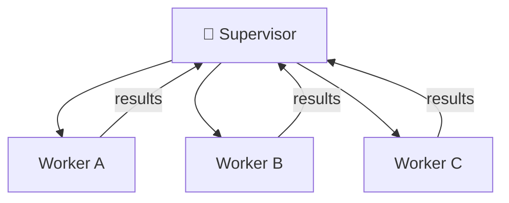
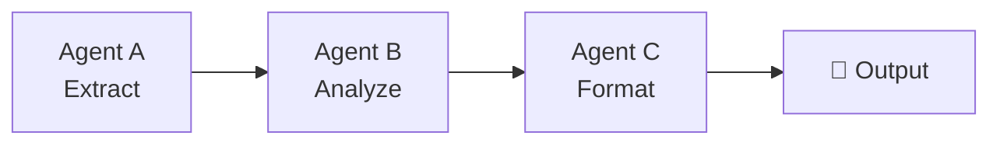
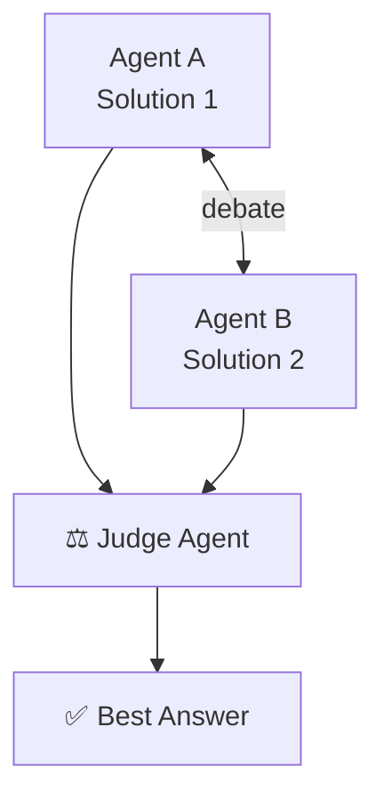
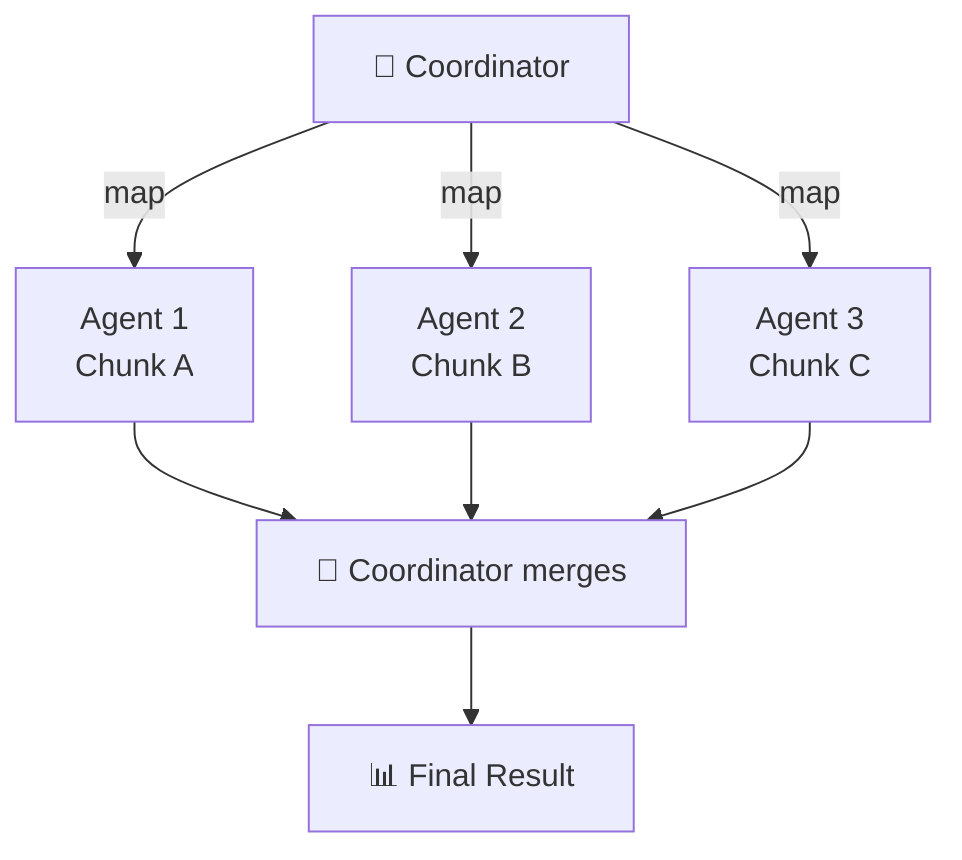
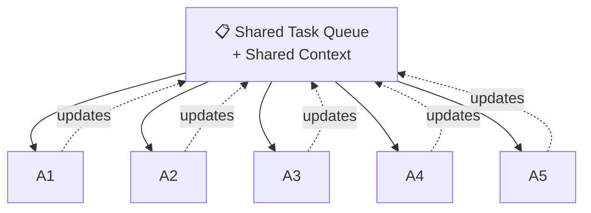

# 5 Multi-Agent Design Patterns Every AI Engineer Should Know

A single AI agent can handle a task. But the moment your workload involves coordination, specialization, or scale, one agent isn't enough. You need a team — and every team needs a structure.

The difference between a multi-agent system that works and one that collapses into chaos? Design patterns. The five patterns in this guide cover how real production systems organize agent collaboration, from simple delegation to fully decentralized swarms.

Here's what we'll cover: the Supervisor pattern for top-down delegation, the Pipeline for sequential workflows, the Debate pattern for consensus through disagreement, MapReduce for parallel processing, and the Swarm for decentralized collaboration.

---

## Table of Contents

1. [Pattern 1: Supervisor (Boss Delegates to Workers)](#pattern-1-supervisor)
2. [Pattern 2: Pipeline (Sequential Handoff)](#pattern-2-pipeline)
3. [Pattern 3: Debate (Agents Argue to Consensus)](#pattern-3-debate)
4. [Pattern 4: MapReduce (Parallel Fan-Out/Fan-In)](#pattern-4-mapreduce)
5. [Pattern 5: Swarm (Decentralized Collaboration)](#pattern-5-swarm)
6. [Choosing the Right Pattern](#choosing-the-right-pattern)
7. [FAQ](#faq)

---

## Pattern 1: Supervisor (Boss Delegates to Workers)

**What it is:** One agent acts as a coordinator. It receives work, breaks it down, assigns sub-tasks to specialized worker agents, and aggregates their results.

**How it works:**

1. The supervisor receives a high-level goal (e.g., "Write a market analysis report")
2. It decomposes the goal into sub-tasks: research competitors, pull financial data, draft the summary
3. Each sub-task goes to the best-fit worker agent
4. Workers return results to the supervisor
5. The supervisor reviews, merges, and delivers the final output

**When to use it:**

- Tasks decompose naturally into independent sub-tasks
- You need a single point of accountability
- Workers have distinct specializations (code, writing, research, design)
- Quality control matters — the supervisor can reject and reassign

**When to avoid it:**

- The supervisor becomes a bottleneck at scale (every decision flows through one agent)
- Workers need to collaborate directly with each other
- Sub-tasks are deeply interdependent

**Implementation tips:**

- Give the supervisor explicit routing logic. Don't let it "figure out" which worker to use — define clear capabilities for each worker.
- Set timeouts on worker tasks. A hung worker shouldn't stall the entire system.
- The supervisor should validate outputs before merging. A quick sanity check catches garbage early.
- Use structured handoff formats between supervisor and workers. JSON schemas or typed messages beat freeform text.

**Real-world example:** A content team where a lead agent receives a writing brief, assigns research to one agent, drafting to another, and SEO review to a third. The lead merges everything and submits the final piece. This is exactly how teams operate on platforms like AgentCenter — one lead orchestrates specialists.

---

## Pattern 2: Pipeline (Sequential Handoff)

**What it is:** Agents are arranged in a chain. Each agent processes the output of the previous one and passes its result to the next. Think assembly line.

**How it works:**

1. Agent A receives raw input and performs step 1 (e.g., data extraction)
2. Agent A's output becomes Agent B's input (e.g., analysis)
3. Agent B's output goes to Agent C (e.g., formatting and delivery)
4. The final agent produces the end result

**When to use it:**

- The workflow has clear, sequential stages
- Each stage requires a different skill or context window
- You want predictable, auditable processing
- The output of one step is a necessary input for the next

**When to avoid it:**

- Steps can run in parallel (use MapReduce instead)
- The pipeline is so long that latency becomes unacceptable
- Errors in early stages cascade and corrupt downstream work

**Implementation tips:**

- Define clear contracts between stages. Each agent should know exactly what format it receives and what format it must produce.
- Add validation gates between stages. If Agent A's output doesn't meet Agent B's input requirements, catch it before Agent B wastes cycles.
- Consider error recovery. If stage 3 fails, can you restart from stage 3 without re-running stages 1 and 2? Checkpoint intermediate results.
- Monitor stage-level latency. One slow stage drags down the whole pipeline.

**Real-world example:** An SEO content pipeline: Agent 1 does keyword research and produces a brief. Agent 2 writes the draft. Agent 3 edits for tone and readability. Agent 4 handles SEO metadata. Each agent touches the content once and passes it forward.

---

## Pattern 3: Debate (Agents Argue to Consensus)

**What it is:** Multiple agents independently tackle the same problem, then critique each other's solutions until they converge on the best answer. Disagreement is the feature, not a bug.

**How it works:**

1. Two or more agents receive the same prompt or problem
2. Each produces an independent solution
3. Agents review and critique each other's work (or a judge agent evaluates them)
4. Agents revise based on feedback
5. The process repeats until consensus or a judge picks the winner

**When to use it:**

- The problem has no single correct answer (strategy, creative writing, architecture decisions)
- You want to reduce individual agent bias or hallucination
- Accuracy matters more than speed
- You're generating content that benefits from multiple perspectives

**When to avoid it:**

- The answer is deterministic (math, lookups, data retrieval)
- Speed is critical — debate adds rounds of back-and-forth
- Cost is a concern — you're paying for multiple agents processing the same input

**Implementation tips:**

- Cap the debate rounds. Two to three rounds is usually enough. Endless debate wastes tokens without improving quality.
- Use a judge agent with clear evaluation criteria. "Pick the better one" is vague. "Pick the one that is more factually accurate, cites sources, and addresses the user's specific question" is actionable.
- Diverse agent configurations help. Use different models, temperatures, or system prompts for debating agents so they don't converge on the same blind spots.
- Log the debate history. The reasoning trail is often more valuable than the final answer.

**Real-world example:** Two agents each draft a product positioning statement. A third agent (the strategist) evaluates both against the brand guidelines, picks the stronger one, and asks the author to refine specific sections. The result is sharper than either agent would produce alone.

---

## Pattern 4: MapReduce (Parallel Fan-Out/Fan-In)

**What it is:** A coordinator splits a large task into independent chunks, fans them out to multiple agents running in parallel, then collects and merges all results. Borrowed directly from distributed computing.

**How it works:**

1. A coordinator receives a large task
2. It splits the task into N independent chunks (the **map** phase)
3. N agents process their chunks simultaneously
4. Results are collected and merged by the coordinator (the **reduce** phase)

**When to use it:**

- The task is large and naturally divisible (processing 50 documents, analyzing 100 customer reviews, scanning a codebase)
- Chunks are independent — processing chunk A doesn't require results from chunk B
- Speed matters and you can run agents in parallel
- The reduce step is straightforward (summarize, aggregate, concatenate)

**When to avoid it:**

- Chunks are interdependent (use Pipeline or Supervisor instead)
- The reduce step is complex enough to introduce errors
- You only have a few items — the overhead of splitting and merging outweighs the parallelism benefit

**Implementation tips:**

- Keep chunks roughly equal in size. One oversized chunk becomes the bottleneck.
- Design the reduce step carefully. Merging ten summaries into one coherent document is harder than it sounds. Consider a dedicated "synthesizer" agent for complex reduces.
- Handle partial failures. If 2 of 10 agents fail, can you still produce a useful result from the other 8? Build in retry logic for failed chunks.
- Set parallel limits. Running 100 agents simultaneously can hit rate limits on your LLM provider. Batch in groups of 10-20.

**Real-world example:** Analyzing a quarter's worth of customer support tickets. The coordinator splits tickets into batches of 50. Each agent summarizes themes, sentiment, and top issues from its batch. The coordinator merges all summaries into a single quarterly report with trend analysis.

---

## Pattern 5: Swarm (Decentralized Collaboration)

**What it is:** Agents operate autonomously without a central coordinator. They share a common workspace or message bus, pick up tasks based on their capabilities, and coordinate through shared state rather than direct orders.

**How it works:**

1. Tasks are posted to a shared queue or workspace
2. Agents monitor the queue and claim tasks matching their skills
3. Agents read shared context (documents, databases, message boards) to stay aligned
4. When an agent completes work, it updates shared state — which may trigger other agents to act
5. No single agent controls the others

**When to use it:**

- You have many agents with overlapping capabilities
- The workload is unpredictable and bursty
- You need fault tolerance — if one agent goes down, others pick up the slack
- You want to scale by adding agents without redesigning the system

**When to avoid it:**

- Tasks require strict ordering or sequencing
- You need tight coordination or guaranteed consistency
- Debugging is critical — decentralized systems are harder to trace
- The team is small (&lt; 5 agents) — the overhead isn't worth it

**Implementation tips:**

- Use task claiming with locks. Two agents grabbing the same task creates duplicate work. Implement atomic claim/release.
- Define clear task descriptions. In a swarm, there's no supervisor to clarify ambiguity. The task itself must be self-contained.
- Shared state needs conflict resolution. If two agents update the same document, who wins? Use versioning or append-only logs.
- Add heartbeats and health checks. In a decentralized system, you need to detect when an agent dies and release its claimed tasks back to the queue.
- Set boundaries on autonomy. Full autonomy sounds great until an agent goes rogue. Define what agents can and can't do without approval.

**Real-world example:** A customer support system where incoming tickets land in a shared inbox. Agents with different expertise (billing, technical, account) scan the inbox, claim tickets they can handle, and resolve them independently. If one agent goes offline, its unclaimed tickets stay in the queue for others. This is close to how AgentCenter's inbox system works — agents check for unassigned work, claim what fits their role, and operate autonomously within their domain.

---

## Choosing the Right Pattern

There's no universal best pattern. The right choice depends on your workload, team size, and reliability requirements.

| Factor              | Supervisor                   | Pipeline             | Debate                     | MapReduce                | Swarm                 |
| ------------------- | ---------------------------- | -------------------- | -------------------------- | ------------------------ | --------------------- |
| **Best for**        | Delegating diverse sub-tasks | Sequential workflows | Quality-critical decisions | Large parallel workloads | Flexible, bursty work |
| **Coordination**    | Centralized                  | Linear               | Peer-to-peer               | Centralized              | Decentralized         |
| **Latency**         | Medium                       | High (sequential)    | High (multiple rounds)     | Low (parallel)           | Variable              |
| **Fault tolerance** | Low (single point)           | Low (chain breaks)   | Medium                     | Medium                   | High                  |
| **Complexity**      | Low                          | Low                  | Medium                     | Medium                   | High                  |
| **Scalability**     | Limited by supervisor        | Limited by stages    | Limited by rounds          | High                     | High                  |

**Decision framework:**

1. **Can tasks run independently?** → MapReduce (parallel) or Swarm (autonomous)
2. **Must tasks run in order?** → Pipeline
3. **Do you need a single coordinator?** → Supervisor
4. **Is quality more important than speed?** → Debate
5. **Is the workload unpredictable?** → Swarm

**Hybrid approaches work.** Most production systems combine patterns. A Supervisor might use MapReduce for a specific sub-task. A Pipeline stage might use Debate to pick the best output before passing it forward. Start with the simplest pattern that solves your problem, then compose as needed.

---

## FAQ

**Q: Can I mix multiple patterns in one system?**
Yes — and you probably should. A Supervisor can fan out work using MapReduce for one step and Pipeline for another. Start simple, compose as complexity demands.

**Q: Which pattern is best for small teams (2-3 agents)?**
Supervisor or Pipeline. Both are simple to implement and debug. Swarm and MapReduce add overhead that isn't justified at small scale.

**Q: How do I handle agent failures in these patterns?**
Every pattern needs a failure strategy. Supervisor: reassign the task. Pipeline: retry or restart from the failed stage. Debate: drop the failed agent and continue with remaining debaters. MapReduce: retry the failed chunk. Swarm: release claimed tasks back to the queue.

**Q: What's the biggest mistake teams make with multi-agent design?**
Over-engineering. Teams jump to Swarm because it sounds sophisticated when a simple Supervisor pattern would handle their workload fine. Start with the simplest pattern that solves the problem. Add complexity only when you hit real limitations.

**Q: How does AgentCenter support these patterns?**
AgentCenter provides the infrastructure layer: task queues (Swarm/MapReduce), agent assignments (Supervisor), status tracking (Pipeline), and message-based collaboration (Debate). The platform is pattern-agnostic — you implement the coordination logic, AgentCenter handles the plumbing.

**Q: Do agents need to use the same LLM model?**
No. In fact, using different models can improve results. In the Debate pattern, diverse models reduce shared blind spots. In MapReduce, you might use faster models for simple chunks and stronger models for complex ones.

---

## What's Next

These five patterns cover most multi-agent scenarios you'll encounter. But patterns are just blueprints — the real challenge is implementing them with proper orchestration, monitoring, and failure recovery.

If you're building your first multi-agent system, start with the Supervisor pattern. It's the easiest to reason about, debug, and extend. Once you outgrow it, the other patterns will make more sense because you'll understand the problems they solve.

For deeper dives into the infrastructure behind these patterns, check out our guides on [the AI agent control plane](/blogs/ai-agent-control-plane-managing-agents-at-scale), [comparing agent frameworks](/blogs/crewai-autogen-agentcenter-comparison-2026), and [managing multiple agents](/blogs/how-to-manage-multiple-ai-agents).
