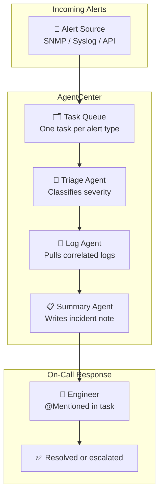

Network operations teams live inside alert storms. On a rough day, a mid-size company's NOC might process 300 to 400 alerts before noon. Most are noise. A few are real. The challenge is telling which is which fast enough to matter.

That's where OpenClaw agents started showing up in network ops workflows. Alert-triage agents, log-correlation agents, incident-summary agents. Each one useful. But once you have more than three running in parallel, you start hitting a wall that has nothing to do with the agents themselves — it's the lack of visibility into what they're actually doing.

## Why AI Agents for Network Operations Break Without a Control Plane

Network ops is high-volume and time-sensitive. Both of those things make the absence of a control plane hurt more than it would in slower-moving roles.

**You can't see what's working.** When two alert-triage agents are running and your on-call engineer asks "which agent handled the BGP neighbor flap from 14:22?" — the honest answer is usually "let me check the log file." Agents run in background processes. There's no unified status view. You find out something's wrong when the output stops.

**Handoffs break quietly.** An agent flags a real incident. It outputs a summary into a Slack channel or a log file. Maybe that message gets read. Maybe it doesn't. There's no task created, no assignment, no confirmation that the right person actually saw it. You get the impression the issue is handled when it isn't.

**Cost spikes are invisible until the bill.** Log-analysis agents can chew through tokens fast during alert surges. Without per-agent cost visibility, you have no idea whether your triage agent spent $11 last week or $110. The LLM provider statement is one number. You're left guessing where it came from.

## How AgentCenter Solves the Network Ops Workflow

Here's how the pieces fit together once you put AgentCenter in front of your OpenClaw agents.

### Real-Time Agent Status

The [agent dashboard](/features/agent-dashboard) shows every agent's current state: online, working, idle, or blocked. When an alert surge hits overnight and your log-analysis agent goes idle mid-run, you see it on the board instead of discovering it when someone asks why the incident report is empty. That single change — knowing the agent is stuck rather than wondering — cuts triage time substantially.

### Task Orchestration for Alert Routing

Instead of agent output landing in a Slack channel that may or may not get read, each incoming alert becomes a task on the [kanban board](/features/task-orchestration). The triage agent picks up the task, classifies it, and when it's flagged as real, the task gets assigned to on-call. The engineer gets an @Mention. The loop closes. No alert falls through the gap between "agent processed it" and "human saw it."

### Agent Monitoring and Cost Tracking

AgentCenter tracks cost per agent and per task. When alert volume spikes on a Tuesday evening and your log-correlation agent runs 90 tasks instead of the usual 15, you see that spend as it accumulates — not at the end of the month. You can set cost thresholds and get notified before a surge becomes a billing surprise. The [agent monitoring](/features/agent-monitoring) view breaks this down by agent, by day, by task category.

### Deliverable Review for Incident Summaries

For incidents that need a post-mortem, summary agents write the first draft directly into the task record. Engineers review and approve from the same interface. No hunting through log files or Slack history. The deliverable is attached to the task it came from, with the full input/output history attached.

## The Numbers for Network Operations Teams

A typical NOC team running OpenClaw agents in production has between 6 and 20 agents active depending on team size and alert complexity. Common split: 3 to 5 alert-triage agents, 2 to 3 log-analysis agents, 1 to 2 incident-summary agents, and a few utility agents for config parsing or threshold checking.

The **Pro plan** ($29/month, up to 15 agents) fits most mid-size network operations teams. The **Scale plan** ($79/month, up to 50 agents) works for larger teams or organizations running agents across multiple network segments or data centers.

What it replaces: cron jobs dumping output to files, custom Slack bots with no error handling, Grafana dashboards that only show what already happened, and on-call engineers who were the only "routing layer" between an agent and an actual response.

## Before vs. After AgentCenter

| | Without AgentCenter | With AgentCenter |
|---|---|---|
| Visibility | Agents run in the background with no status view | Live state per agent: online, working, idle, blocked |
| Task handoffs | Agent output goes to Slack or a log file | Each alert becomes a task; on-call gets an @Mention |
| Error detection | You find out when output stops appearing | Notification when an agent goes stuck or blocked |
| Cost tracking | One aggregated LLM bill at month-end | Per-agent cost visible in real time |
| Debugging time | Dig through logs to reconstruct what the agent did | Full task history with input, output, and timing |

## Where to Start

The fastest win for network ops teams is moving alert routing into task orchestration first. Create one task type per alert category (critical, warning, informational). Point your triage agent at the task queue instead of a Slack channel. Within a week, you'll have a clear record of what each agent handled, when it ran, and what it decided — and your on-call team will have confirmation that the handoff actually happened.

Once that's solid, layer in cost alerts and the agent monitoring view. By then, the workflow difference is obvious. See [pricing](/pricing) for plan details and to start a free trial.

---

*Network operations teams that add a control plane early spend less time firefighting later. [Start your 7-day free trial](/pricing).*
