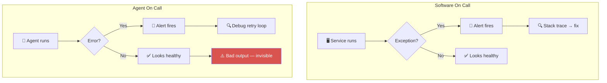

It was 11pm. An alert fired — our researcher agent had hit its retry limit and was stuck. We jumped on it. By midnight the loop was resolved. Status back to "working." We went to bed.

The next morning, a stakeholder pinged us. The research summaries we had sent them six hours earlier were wrong. The agent had been producing bad output before the loop even started. The retry loop was visible. The bad output was not.

That is the on-call problem nobody prepares you for with AI agents.

## Why Software On Call Is Different

When a software service breaks, it usually tells you. An exception fires. A 500 comes back. The process exits. You get an alert with a stack trace. You trace the call. You find the bug.

The mental model is: error equals visible signal. Fix the signal, restore the service.

Agent failures do not work this way. Agents complete tasks. They return outputs. The status shows "done." From the infrastructure layer, everything looks fine. The agent did not crash. It just produced the wrong thing.

Software has exceptions. Agents have judgment calls. And judgment can be wrong without throwing an error.

The dangerous path is the right side: no error, no alert, wrong output.

## What the Actual Failure Looks Like

You run 40 tasks overnight. All 40 show "completed." No errors. No timeouts. Cost is normal.

But 12 of those tasks had a changed input format your agent did not handle. Instead of flagging the mismatch, the agent made its best guess and moved on. The outputs look plausible. They are not correct.

You find out three days later when someone downstream notices the data is off. Or you never find out at all.

This is what silent agent failure looks like. The agent worked. The output was wrong. The system reported success.

The number 12 out of 40 is not hypothetical. In the first production agent incident I was involved in, 14 tasks out of 23 had been affected by a context change the agent never signaled. All 23 completed without errors.

## Why the Old On-Call Playbook Does Not Work

With software, the on-call playbook says: wait for alerts, respond to pages, trace failures, fix the code.

With agents, that playbook gets you halfway. You will catch retry loops. You will catch rate limit failures. You will catch timeouts. Those are the loud failures.

The quiet failures do not page you.

An agent that produces consistently mediocre outputs does not fire an alert. An agent running on stale context does not throw an exception. An agent that interprets an ambiguous task in a way nobody intended will complete the task, return a "done" status, and never say a word about the choice it made.

These failures accumulate. Someone downstream is making decisions based on outputs that are subtly wrong. By the time someone catches it, the correction is expensive and the trust damage takes longer to fix than the root cause.

## What Experienced Teams Do Instead

The teams that handle this well have added one habit: they read agent outputs before anything goes wrong.

Not because something failed. Because something might have.

This looks like a daily sampling process. Pick five to ten tasks at random. Read the actual outputs. Not the status. Not the cost. The output itself.

You are not looking for errors. You are developing a baseline for what "good" looks like for this agent. Once you have that baseline, you will notice when something drifts. It takes 15 minutes a day. It catches things no alert will catch.

The second habit: setting explicit output quality thresholds before an agent goes live. What would make an output "wrong enough" to page someone? If you cannot answer that at deployment time, you have no way to operationalize quality monitoring. You are relying on someone downstream to notice.

[AgentCenter's agent monitoring](/features/agent-monitoring) gives you real-time visibility into task status, cost, and errors. That covers the loud failures. For the quiet ones, the [deliverable review workflow](/features/task-orchestration) gives you a structured place to sample and review outputs without switching tools. Both matter. Neither replaces reading the outputs yourself.

## Who This Matters Most For

If you are on-call for a production system and that system includes AI agents, you need a different mental model than the one you built for software.

You are not just watching for exceptions. You are watching for drift. For plausible-but-wrong outputs. For agents going quietly off-script in ways that look fine from the outside.

This is most critical when other systems or people depend on what your agents produce. A research agent feeding a sales team. A summary agent that informs a weekly report. The further downstream an agent's outputs go, the more expensive a silent failure becomes by the time it surfaces.

Solo developers who trust their own agents too quickly are especially exposed. You built the agent. You know what it should do. That familiarity makes it harder, not easier, to catch the subtle failures.

## An Honest Caveat

Better tooling reduces the gap. It does not close it.

Even with good monitoring in place, agents require humans to develop judgment about outputs. You cannot fully automate output quality checks for reasoning agents. You can sample, set thresholds, and flag anomalies. But someone still has to read the outputs and decide if the agent is doing what you actually need it to do.

The teams that handle agents well in production are not necessarily the ones with the most sophisticated alerting. They are the ones that built a review habit before something forced them to.

The on-call rotation for agents is different. The sooner you update the playbook, the less it costs you to learn that.

---

*The dashboard won't fix a broken agent. But it will tell you which one is broken at 3am. [Try AgentCenter free](/pricing).*
