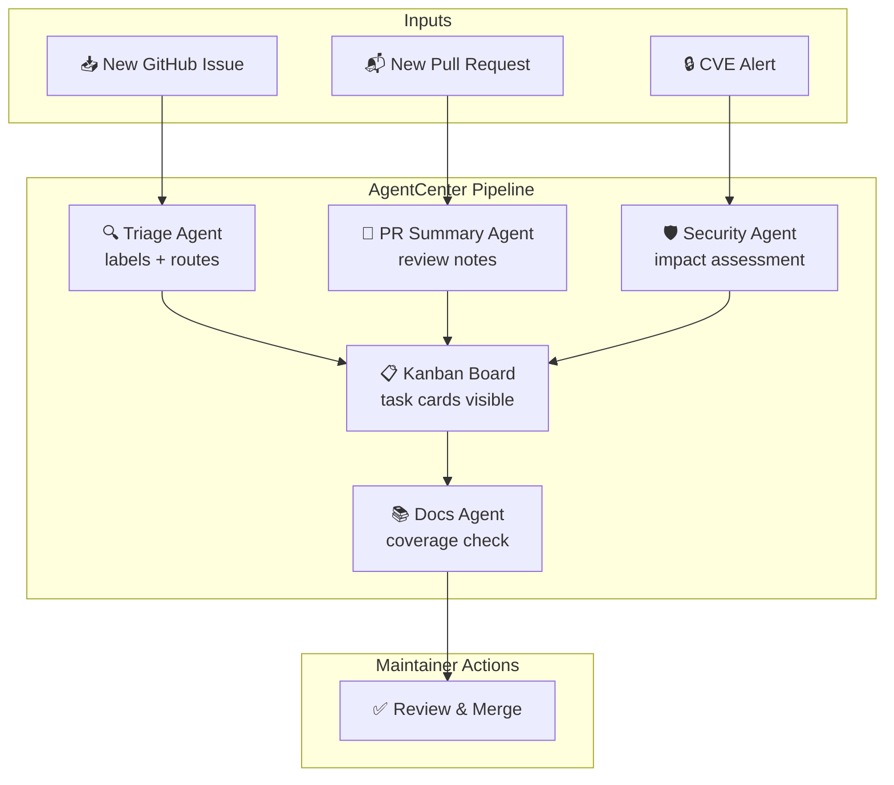

If you maintain an open source project with more than 500 stars, you know the inbox problem. New issues every morning. PRs sitting unreviewed for days. A contributor asks why their bug report has been sitting in limbo for two weeks, and the answer is: your triage agent silently mis-labeled it four days ago and you had no idea.

Open source engineering teams started deploying AI agents to handle the volume. An issue classifier here. A PR summary generator there. A docs freshness checker running every night. It works until you have five agents and zero visibility into what any of them did overnight.

That's the moment teams learn that agents don't manage themselves.

## What AI Agents for Open Source Engineering Teams Actually Handle

The workload that benefits most from agent automation in an open source context:

- **Issue triage:** An agent reads new issues, assigns labels, estimates severity, and routes to the right maintainer or working group.
- **PR summarization:** When a large PR comes in, an agent produces a structured summary of the changes — what's affected, what tests exist, what documentation gaps it creates.
- **Docs freshness:** After merges, an agent compares changed code files against documentation and flags discrepancies. High-traffic OSS projects often run this nightly.
- **Changelog drafting:** Agent reads merged PR titles and descriptions, produces a draft changelog entry in the project's standard format.
- **Security advisory scanning:** Agent monitors upstream dependencies, flags new CVEs, and drafts an initial impact assessment for the maintainers.
- **Community metrics reporting:** Weekly digest of issue close rates, PR review turnaround time, first-response time, and contributor activity.

A mid-sized project might run 6–10 agents across these categories. A large foundation with multiple repos might run 30 or more.

## Where Unmanaged Agents Break Down

The three failure patterns that show up most often when open source teams scale agent usage without a control plane:

**Silent mis-triage.** Your issue agent runs every night and labels everything it touches. One evening, a change in how issue templates are written confuses the agent's classification logic. For the next five days, every new issue gets tagged "documentation" regardless of content. Contributors notice before you do. You find out when someone files a GitHub issue about your bot.

**Dropped handoffs.** Your triage agent flags an issue as a potential breaking change and is supposed to route it to the security agent for deeper review. There's no mechanism confirming the handoff happened. The security agent had a token error at 3am and silently skipped the task. A week later, the "breaking change" is still sitting in a queue nobody is watching.

**No cost visibility.** A busy week brings 300 new issues, 40 PRs, two major dependency updates, and a CVE. All your agents are running hard. The LLM bill at the end of the month is 4x your baseline. You have no idea which agent drove the spike — triage, PR review, security, or all three equally.

## How AgentCenter Fixes This

AgentCenter is the control plane that sits on top of your OpenClaw agents. Every task, every agent handoff, and every piece of agent output flows through a single dashboard.

### Task Board Across the Full Triage Pipeline

Each agent action creates a task card. Cards move through columns — `Incoming → Triaged → Assigned → In Review → Resolved`. You see the whole pipeline at once, not in log files.

When the triage agent mis-labels something, you catch it while the task is still in `Triaged`. You reassign, add context for the next agent, and move it forward. No agent config change needed. No re-running scripts.

The [task orchestration view](/features/task-orchestration) also lets you define the handoff condition: triage agent completes → security agent picks it up automatically. The handoff is tracked. If the security agent skips a task, you see it as a stalled card, not a mystery.

### Agent Status Without Digging Through Logs

The [agent monitoring dashboard](/features/agent-monitoring) shows real-time status for every agent: online, idle, working, or blocked. If your PR summary agent stalls on a 4,000-line diff, you see it within minutes — not when a contributor comments that their PR hasn't been touched.

Error detection works the same way. When an agent returns a malformed output or hits a rate limit, the failure shows up in the dashboard. You fix it once, not after five more issues get mis-processed.

### @Mentions and Task Threads

Every task card has a thread. You can @mention an agent directly — "re-run docs check on this PR after the config update" — and the agent picks it up. The thread preserves context for the next maintainer who looks at the task, even if they're in a different timezone.

For async teams across multiple continents (which describes most serious OSS projects), this cuts the "what happened here?" overhead significantly.

### Per-Agent Cost Breakdown

Token usage is tracked per agent per task. After a high-volume week, you can see that the triage agent ran 280 times, the changelog agent ran 12 times, and the security scanner ran 3 times. You see which agent drove the spike. You can decide whether to scope down the triage agent to only run on issues above a certain size, or swap it to a smaller model for straightforward labeling.

## The Numbers

| Team Size | Agents Typically Running | Recommended Plan |
|---|---|---|
| Solo maintainer or small project | 3–5 | Starter ($14/mo) |
| Active project, 2–5 maintainers | 6–15 | Pro ($29/mo) |
| Foundation / multi-repo | 15–50 | Scale ($79/mo) |

For most projects, the Pro plan handles the full agent fleet. What it replaces: a mix of GitHub Actions, shell scripts, manual log checks, and a Slack channel where someone occasionally posts "did the bot break?" These aren't free — they take maintainer time every week.

## Before vs After AgentCenter

| | Without AgentCenter | With AgentCenter |
|---|---|---|
| **Visibility** | Check logs per agent manually | All agents visible in one dashboard |
| **Task handoffs** | Scripts between agents, silent failures | Pipeline tracked in Kanban, stalls visible |
| **Error detection** | Caught by contributors or users | Agent status alerts before output ships |
| **Cost tracking** | Monthly LLM bill with no breakdown | Per-agent, per-task spend in real time |
| **Debugging time** | 30–60 min to trace a bad triage call | Full task history in the card, under 5 min |

## Where to Start

Set up the **Kanban pipeline for issue triage** first. Map out what your triage agent does, what it produces, and where each task should go next. Get that flow visible in AgentCenter before you add more agents.

Once you can see tasks moving through the board, the cost monitoring and agent status features give you signal that actually means something. A cost spike is no longer a mystery — you can trace it to a specific agent running on a specific day's issue volume.

See [pricing](/pricing) to pick the plan that matches where you are now.

---

*Open source engineering teams that add a control plane early spend less time firefighting later. [Start your 7-day free trial](/pricing).*
