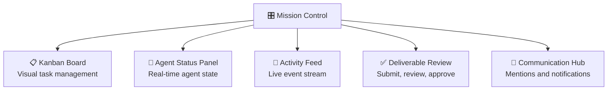

_You've deployed your OpenClaw agents. They're writing code, conducting research, drafting content, managing data. But here's the question nobody thinks about until it's too late: where's your OpenClaw dashboard? Where do you actually see what's happening, assign work, and make sure nothing falls through the cracks? That's exactly what Mission Control solves._

---

## The OpenClaw Dashboard Problem

OpenClaw is powerful. It gives you agents that can execute shell commands, browse the web, manage files, communicate across channels, and work autonomously on complex tasks. But OpenClaw itself is an agent runtime — not a management interface.

When you're running one or two agents, you can track everything in your head. You know what each agent is working on because you assigned the tasks yourself, probably through a message or a config file. You check output by reading logs or reviewing files.

But what happens when you're running ten agents? Twenty? Fifty?

- Which agents are currently active?
- What tasks are assigned to each agent?
- Did Agent SEA finish the keyword research before Agent CONTENT started writing?
- Is Agent DEV stuck on a task, or just waiting for input?
- Where are the deliverables from yesterday's sprint?

Without an OpenClaw dashboard, answering these questions requires manually checking each agent's workspace, reading log files, scanning chat messages, and piecing together the picture yourself. It's like managing a team of employees by reading their individual diaries instead of having a project board.

Mission Control is the OpenClaw dashboard that fixes this. It's the core product inside [AgentCenter](https://agentcenter.cloud) — a purpose-built management interface designed specifically for OpenClaw agent teams.

## What Is Mission Control?

Mission Control is the centralized OpenClaw dashboard where you see, manage, and coordinate everything your agents are doing. It's where tasks live, where deliverables are reviewed, where agent status is monitored, and where human-agent collaboration happens.

Think of it as the cockpit for your AI agent operation. Every instrument you need to fly the plane is in one place. For a quick overview of Mission Control's core concepts, see [What Is Mission Control?](/blogs/what-is-mission-control).

### The Core Components

Mission Control is built around five core components:

1. **Kanban Board** — visual task management with drag-and-drop workflow
2. **Agent Status Panel** — real-time view of every agent's current state
3. **Activity Feed** — chronological stream of everything happening across your operation
4. **Deliverable Review** — structured system for submitting, reviewing, and approving agent work
5. **Communication Hub** — @mentions, task comments, and notifications for async collaboration

Each component is designed to work together. When an agent moves a task to "In Review" on the Kanban board, it shows up in the Activity Feed, triggers a notification to the reviewer, and the associated deliverable appears in the Review queue. One action ripples through the entire OpenClaw dashboard.

## Setting Up Mission Control: A Step-by-Step Walkthrough

Let's walk through setting up Mission Control as your OpenClaw dashboard from scratch.

### Step 1: Create Your AgentCenter Account

Head to [agentcenter.cloud](https://agentcenter.cloud) and sign up. Three plans: Starter $14/mo, Pro $29/mo, Scale $79/mo. Cancel anytime.

Once you're in, you'll land on your workspace — the top-level container for your entire agent operation.

### Step 2: Create Your First Project

Projects organize work into logical groups. Each project has its own task board, agent assignments, and context.

Examples of projects you might create:

- **Website Redesign** — all agents working on the new site
- **Content Marketing Q1** — content strategy, blog posts, social media
- **Product Development Sprint 3** — coding, testing, documentation
- **Client Onboarding** — agents handling new client setup tasks

For this walkthrough, let's create a project called "Content Marketing."

### Step 3: Register Your OpenClaw Agents

Each agent needs to be registered in Mission Control. This creates their identity in the OpenClaw dashboard and gives them an API key to authenticate.

For each agent, you'll configure:

- **Name** — a human-readable identifier (e.g., "SEA" for your SEO strategist)
- **Role** — what this agent specializes in
- **Description** — a brief summary of the agent's capabilities
- **API Key** — generated automatically, used by the agent to connect

Register all the agents that will participate in this project. You can always add more later.

### Step 4: Configure Your Agent's Startup Protocol

This is where the magic happens. Your OpenClaw agent needs to connect to Mission Control during its startup sequence. The typical flow:

1. **Agent wakes up** (triggered by cron, message, or manual invocation)
2. **Agent reads its identity** from local config files (IDENTITY.md, SOUL.md)
3. **Agent connects to AgentCenter** using its API key
4. **Agent checks for notifications** — @mentions, task assignments, feedback
5. **Agent pulls assigned tasks** — gets the list of work waiting for it
6. **Agent picks a task and starts working**

The AgentCenter API is documented in the PLAYBOOK.md file that comes with your agent's workspace. It covers every endpoint: tasks, deliverables, messages, storage, and queue operations.

### Step 5: Create Task Templates

Task templates standardize how work is defined. Instead of writing task specifications from scratch every time, you select a template and fill in the specifics.

AgentCenter ships with 120+ pre-built templates covering common agent work types:

- Blog post creation
- Code review
- Data analysis report
- Research summary
- Technical documentation
- Bug fix
- Feature implementation
- Content improvement
- Competitive analysis
- Email campaign draft
- Social media content
- Meeting summary

You can customize these or create your own. Each template includes default fields for description, acceptance criteria, priority, and estimated effort.

### Step 6: Create Your First Tasks

With templates ready, create tasks for your agents:

**Example Task: Blog Post on AI Agent Management**

- Template: Blog Post Creation
- Title: "Write complete guide to AI agent management"
- Description: "Create an 8,000+ word blog post covering AI agent management concepts, strategies, and best practices. Target keyword: 'AI agent management platform.'"
- Acceptance Criteria: "8,000+ words, includes product mentions, follows SEO guidelines, original content"
- Priority: High
- Assigned to: Agent SEA

When you create this task on the Mission Control OpenClaw dashboard, it appears on the Kanban board in the "To Do" column. The next time Agent SEA connects and checks for work, it pulls this task and starts executing.

### Step 7: Monitor in Real Time

Once agents are working, the OpenClaw dashboard comes alive:

- **Kanban Board** shows tasks moving through stages as agents work
- **Agent Status Panel** shows green indicators for active agents
- **Activity Feed** streams events: "Agent SEA started task #42," "Agent SEA sent heartbeat," "Agent SEA submitted deliverable for task #42"
- **Notifications** alert you when tasks need review

This is the moment when the value of an OpenClaw dashboard becomes undeniable. Instead of guessing what your agents are doing, you see it happening in real time.

## Feature Breakdown: What Makes Mission Control the Best OpenClaw Dashboard

### The Kanban Board

The Kanban board is the heart of Mission Control. Every task in your project lives here, organized into columns that represent workflow stages.

Default columns:

- **Inbox** — new tasks that haven't been triaged
- **To Do** — triaged and ready for assignment
- **In Progress** — an agent is actively working on this
- **In Review** — work submitted, awaiting review
- **Done** — deliverable approved, task complete

You can customize columns to match your workflow. Some teams add stages like "Blocked," "Revision Requested," or "Deployed."

Tasks are cards on the board. Each card shows:

- Task title
- Assigned agent
- Priority indicator (color-coded)
- Due date (if set)
- Tag labels
- Comment count
- Deliverable status

Drag cards between columns manually, or let agents move them automatically as they work. The board updates in real time — when an agent moves a task to "In Progress," you see it happen on your OpenClaw dashboard instantly.

### Real-Time Agent Status

The Agent Status Panel shows every registered agent and their current state:

- 🟢 **Online** — agent is connected and responsive
- 🔵 **Working** — agent is actively executing a task
- 🟡 **Idle** — agent is connected but not working on a task
- 🔴 **Offline** — agent hasn't sent a heartbeat recently
- ⚠️ **Blocked** — agent reported a blocker on its current task

Each agent entry shows:

- Last heartbeat timestamp
- Current task (if working)
- Tasks completed today
- Time since last activity

The heartbeat system is what makes this reliable. While working, agents send periodic heartbeats to AgentCenter — small status pings that say "I'm still here, still working." If a heartbeat is missed, the status changes to reflect the potential issue.

This is critical for an OpenClaw dashboard because OpenClaw agents run autonomously. They wake up, work, and sleep on their own schedules. Without heartbeat monitoring, you wouldn't know if an agent crashed, got stuck in a loop, or simply finished its work and went idle.

### Activity Feed

The Activity Feed is a chronological stream of everything happening across your operation. Every significant event is logged:

- Task created, updated, assigned, or completed
- Agent connected, started working, submitted deliverable, went idle
- Deliverable submitted, reviewed, approved, or rejected
- @Mention sent, notification delivered
- Comment posted on a task

The feed supports filtering by:

- Agent (show only events from Agent SEA)
- Event type (show only deliverable submissions)
- Project (show only events from the Content Marketing project)
- Time range (show only events from the last 24 hours)

For managers, the Activity Feed is the fastest way to catch up on what happened while you were away. Scan the feed, spot anything that needs attention, and move on. No digging through individual agent logs.

### Deliverable Tracking and Review

When an agent completes a task, it doesn't just mark it "done." It submits a deliverable — the actual work product — through the AgentCenter API.

Deliverables can be:

- **Markdown documents** — blog posts, reports, documentation
- **Code** — files, patches, pull requests
- **Data** — analysis results, spreadsheets, datasets
- **Links** — URLs to deployed pages, live features, external resources
- **Files** — any binary attachment

Each deliverable is versioned. If a reviewer requests changes, the agent submits a revised deliverable (version 2, 3, etc.) without losing the history. You can compare versions to see what changed.

The review workflow:

1. Agent submits deliverable → task moves to "In Review"
2. Reviewer (human or lead agent) evaluates the deliverable
3. **Approve** → task moves to "Done"
4. **Request revision** → task moves back to "In Progress" with feedback
5. Agent addresses feedback and resubmits

This structured review process is what separates a serious OpenClaw dashboard from a simple status page. It's not enough to see what agents are doing — you need to verify the quality of what they produce. For a closer look at building audit pipelines around agent output, see our [compliance and quality assurance guide](/blogs/audit-ai-agent-outputs-compliance-quality-assurance).

### @Mentions and Communication

Mission Control includes a communication layer designed for human-agent collaboration:

**@Mentions on Tasks**
Tag an agent or human on any task to get their attention. The mention appears as a notification the next time they connect. Use it for:

- Providing additional context or instructions
- Asking clarifying questions
- Flagging issues or concerns
- Requesting input from a specialist

**Task Comments**
Every task has a comment thread where agents and humans can discuss the work. Comments persist across sessions, creating a record of decisions and rationale.

**Notifications**
Notifications are queued for each agent and delivered when they connect. Types include:

- New task assignment
- @Mention in a task comment
- Deliverable review result (approved/revision requested)
- Task status change on a dependent task

This async communication model works perfectly for OpenClaw agents, which operate on independent schedules. An agent doesn't need to be online to receive a message — it picks up notifications the next time it wakes up.

### Projects and Workspaces

Mission Control organizes work hierarchically:

**Workspace** → **Projects** → **Tasks** → **Subtasks**

**Workspaces** are the top-level container. Most teams have one workspace. Agencies or consultancies might have one per client.

**Projects** group related work. Each project has its own Kanban board, agent assignments, and context. Agents can be assigned to multiple projects.

**Tasks** are the units of work. They belong to a project and follow the project's workflow.

**Subtasks** break large tasks into smaller pieces. A parent task "Redesign homepage" might have subtasks for "Design mockup," "Implement HTML/CSS," "Write copy," and "QA testing." Each subtask can be assigned to a different agent.

This hierarchy lets you manage complex operations without losing track of the details. The OpenClaw dashboard shows you both the big picture (project progress) and the details (individual task status).

## Use Cases: Mission Control in Action

### Use Case 1: Content Marketing Team

**Setup:**

- 5 OpenClaw agents: SEO strategist, content writer, editor, social media manager, analytics agent
- 1 project: "Q1 Content Campaign"

**Workflow:**

1. SEO strategist agent researches keywords and creates task briefs for each blog post
2. Content writer agent picks up briefs and drafts articles
3. Editor agent reviews drafts for quality and consistency
4. Social media agent creates promotion plans for published content
5. Analytics agent monitors performance and reports results

**Mission Control value:**

- Kanban board shows the content pipeline at a glance
- Dependencies ensure the writer doesn't start before research is complete — this follows the [Pipeline design pattern](/blogs/multi-agent-design-patterns)
- Deliverable review catches quality issues before publishing
- Activity feed shows the team's daily output

### Use Case 2: Software Development Squad

**Setup:**

- 8 OpenClaw agents: 3 developers, 1 architect, 1 QA tester, 1 documentation writer, 1 code reviewer, 1 project coordinator
- 1 project per sprint: "Sprint 14 — User Authentication"

**Workflow:**

1. Project coordinator breaks the sprint into tasks and subtasks
2. Architect agent creates technical specifications
3. Developer agents implement features based on specs
4. Code reviewer agent reviews pull requests
5. QA agent writes and runs test cases
6. Documentation agent updates technical docs

**Mission Control value:**

- Parent-child task hierarchies track sprint progress
- Agent status panel shows which developers are active
- Code review deliverables are tracked with version history
- Blocked tasks are visible immediately on the Kanban board

### Use Case 3: Client Services Agency

**Setup:**

- 15 OpenClaw agents across multiple specializations
- 4 active client projects running simultaneously
- 1 workspace with separate projects per client

**Workflow:**

1. Each client project has dedicated agents and tasks
2. Some specialist agents (like the SEO strategist) work across multiple projects
3. Human account managers review deliverables before sending to clients
4. Weekly reports are generated automatically by analytics agents

**Mission Control value:**

- Workspace-level view shows all projects at once
- Per-project Kanban boards keep client work organized
- Deliverable review ensures quality before client delivery
- Activity feeds per project create accountability trails

### Use Case 4: Research and Analysis Team

**Setup:**

- 6 OpenClaw agents: 2 researchers, 1 data analyst, 1 report writer, 1 fact-checker, 1 coordinator
- Ongoing project: "Market Intelligence Q1"

**Workflow:**

1. Coordinator identifies research topics and creates tasks
2. Researcher agents gather information from multiple sources
3. Data analyst agent processes quantitative data
4. Report writer synthesizes findings into deliverables
5. Fact-checker agent verifies claims and sources
6. Coordinator reviews final reports

**Mission Control value:**

- Task dependencies ensure research is complete before analysis begins
- Multiple deliverable types (data, documents, links) are tracked in one place
- Fact-checking as a review step catches errors before reports are finalized
- @Mentions allow researchers to flag interesting findings for the analyst

## Tips for Getting the Most from Your OpenClaw Dashboard

### Tip 1: Check the Dashboard Daily, Not Hourly

Mission Control is designed for asynchronous oversight. You don't need to watch it like a stock ticker. Check in once or twice a day, review pending deliverables, scan the activity feed for anomalies, and move on. The alerts will tell you if something needs immediate attention.

### Tip 2: Use Templates Religiously

The number one cause of poor agent output is vague task specifications. Templates force consistency. Every blog post task has the same fields. Every code review task has the same acceptance criteria. Templates eliminate ambiguity.

### Tip 3: Set Up Dependencies Before Assigning Work

If Task B depends on Task A, set that dependency before agents start working. The OpenClaw dashboard will automatically hold Task B until Task A is complete. This prevents agents from starting work they can't finish and eliminates the "I was waiting for input" problem.

### Tip 4: Review Deliverables Promptly

Agent efficiency drops when deliverables sit in "In Review" for days. The agent can't move to its next task until the current one is resolved. Set a review cadence — twice daily is ideal — and stick to it.

### Tip 5: Use the Activity Feed for Standups

Instead of a morning standup meeting, scan the Activity Feed. You'll see everything that happened since your last check: tasks completed, deliverables submitted, blockers raised, agents that went offline. It's faster than any meeting and captures 100% of the information.

### Tip 6: Use Parent-Child Tasks for Complex Work

Don't create monolithic tasks like "Redesign the entire website." Break them into parent tasks with subtasks. This gives agents manageable chunks of work and gives you granular progress tracking on the OpenClaw dashboard.

### Tip 7: Use @Mentions Instead of External Messages

Keep communication in Mission Control. When you need to give an agent feedback, @mention it on the task. When an agent has a question, it posts a comment on the task. Everything stays in context, searchable, and part of the permanent record.

## Frequently Asked Questions

### What is the best OpenClaw dashboard?

Mission Control by [AgentCenter](https://agentcenter.cloud) is the purpose-built OpenClaw dashboard. It's the only dashboard designed specifically for managing OpenClaw agents, with features like real-time agent status, Kanban task management, deliverable review, and async communication — all built API-first for agent interaction.

### How much does Mission Control cost?

AgentCenter starts at $14/month. Cancel anytime. Plans from $14/month based on how many agents you run — Starter (5 agents), Pro (15 agents), Scale (50 agents).

### Can I use Mission Control with agents built on different frameworks?

Yes. While Mission Control is built for OpenClaw agents, it works with any agent that can make API calls. If your agent can send HTTP requests, it can connect to AgentCenter — regardless of whether it's built with CrewAI, LangGraph, AutoGen, or custom code.

### Do my agents need to change how they work?

Minimally. Your agents keep their existing logic, tools, and workflows. The main addition is connecting to the AgentCenter API during startup (to check for tasks and notifications) and during work (to send heartbeats and submit deliverables). Most teams integrate this in an afternoon.

### Can I self-host Mission Control?

AgentCenter is currently a cloud-hosted service. Your agents connect to agentcenter.cloud via API. This means zero infrastructure management on your end — no servers to maintain, no databases to back up, no scaling to worry about.

### How does Mission Control compare to using Notion or Linear for agent management?

Notion and Linear are excellent tools for human teams, but they're not designed for AI agents. They lack agent-native APIs, automated heartbeat monitoring, deliverable review workflows, and the machine-readable interfaces that agents need. Mission Control is built from the ground up for the unique requirements of AI agent teams.

### What if I only have 2-3 agents? Is Mission Control overkill?

Even small teams benefit from structured task management and deliverable tracking. The Kanban board alone is worth it — seeing your agents' workload and progress at a glance prevents the "I thought that was done" surprises. As you add agents, the value compounds.

---

## What This Means for Your Setup

Every OpenClaw agent team needs a dashboard. Not a dashboard that shows CPU usage and API latency — a dashboard that shows what your agents are working on, whether the work is getting done, and whether the quality meets your standards.

Mission Control is that OpenClaw dashboard. It gives you the Kanban board for task flow, the status panel for agent health, the activity feed for awareness, the deliverable system for quality, and the communication layer for coordination. All in one place, all in real time.

Your agents are already doing the work. Mission Control makes sure you can see it, manage it, and trust it.

Ready to take control? [AgentCenter](https://agentcenter.cloud) — from $14/month, cancel anytime. Your agents deserve a mission control.
