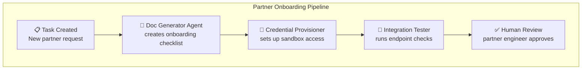

Partner engineering teams run a strange kind of infrastructure. Part software, part relationship management, part quality control. You're building integrations with external partners, keeping those integrations healthy, and often automating the onboarding process for new partners joining your platform.

When teams start adding AI agents to this mix, things get complicated fast.

## The Daily Problem

A typical partner engineering team at a mid-sized SaaS company might run agents that:

- Test each partner's sandbox environment after API changes
- Generate partner-specific onboarding checklists and docs
- Monitor health endpoints and flag degraded integrations
- Pull data from partner systems and normalize it for internal reporting

That's 8 to 15 agents running at the same time. And most teams have no single place to see what those agents are actually doing.

The first sign of trouble is usually a Slack ping from a partner saying something is broken. By that point, one of your agents has been failing silently for hours.

## What Breaks Without a Control Plane

**Integration agents run without anyone watching.** You deploy an agent to test partner X's webhook delivery. It runs. But when partner X changes their payload format, the agent starts failing silently. No alert. No visible status. You find out when the partner escalates.

**Onboarding handoffs go sideways.** Partner onboarding involves multiple agents working in sequence: document generation, credential provisioning, sandbox setup, test execution. When one step fails or gets stuck, the next agent often has no idea. The partner sees nothing happening. Your team sees nothing either.

**Cost spikes from sandbox runs.** Spinning up parallel test agents for 10 partners at once can burn through token budget fast, especially if a few partners have complex APIs that require longer context windows. Without cost tracking per agent, you don't know where the money went.

## How AgentCenter Fixes This

### Real-time agent status

AgentCenter's [agent monitoring dashboard](/features/agent-monitoring) shows every agent's status: online, working, idle, or blocked. When your webhook test agent gets stuck because a partner changed their auth headers, you see it immediately. Not when the partner calls you.

One partner engineering team managing 12 agents across 8 partner integrations had been checking logs manually once a day before setting up AgentCenter. In the first week after connecting their agents, they caught three that had been stuck in bad loops for 24 to 48 hours each. None of those failures had surfaced in any alert.

### Kanban board for onboarding pipelines

Partner onboarding isn't one task, it's a sequence. [AgentCenter's task orchestration board](/features/task-orchestration) lets you map each step of the onboarding flow to an agent or a human review. You can see at a glance which partners are in which stage, which agents are blocked waiting for review, and where the bottleneck is.

When your credential provisioning agent finishes, the next agent picks up automatically. When a human needs to approve something, an @mention surfaces in the task thread so the right engineer sees it without anyone manually checking a queue.

### @Mentions for escalations

Some integration failures need a human decision before the agent proceeds. Your test agent finds that a partner's production API doesn't match their sandbox. Someone needs to decide: re-run in sandbox, flag to the partner, or pause the integration?

AgentCenter's @mention and chat thread feature lets the agent surface this question directly to the right engineer, in context, without switching to email or Slack. The decision gets logged in the task thread, which also serves as an audit trail for the partner relationship.

### Cost tracking per agent

The agent monitoring view shows cost per agent per task. For partner engineering teams, this usually reveals one or two partners whose integrations cost 5x more than the average. Often because their API requires multiple retry cycles or produces unusually long responses.

Once you know which partner's agent runs are expensive, you can adjust context length, tune retry logic, or raise it with the partner directly. You're making that call based on actual data, not guesswork.

## The Numbers

A partner engineering team managing 10 to 30 active partner integrations typically runs 8 to 20 agents at any time. The [Pro plan](/pricing) at $29/month covers up to 15 agents across 15 projects. Teams with more partners or more complex pipelines usually move to Scale ($79/month), which handles up to 50 agents.

What AgentCenter replaces: manual log review sessions, ad-hoc Slack threads for escalations, and spreadsheets tracking which partner is at which onboarding step.

## Before vs After

| | Without AgentCenter | With AgentCenter |
|---|---|---|
| **Visibility** | Check logs manually, usually after a partner complains | Real-time agent status for every partner integration |
| **Task handoffs** | Agent finishes, next step happens (or silently doesn't) | Task board shows exactly where each onboarding is stuck |
| **Error detection** | Partners tell you something is broken | Stuck or failing agents are visible before the partner knows |
| **Cost tracking** | Monthly LLM bill with no breakdown | Per-agent, per-task cost data by partner |
| **Debugging time** | 1 to 3 hours reading through logs | 20 minutes looking at the agent's task thread |

## Where to Start

If you're running integration testing or onboarding agents, start with the monitoring dashboard. Connect your existing agents to AgentCenter and spend one week just watching the status view.

You'll find at least one agent that's been failing quietly. That single discovery usually justifies the setup time.

From there, build out the onboarding pipeline on the Kanban board. Map each step to an agent or a human review. Add @mention escalation rules for decisions that need a human. You'll have a proper control plane for partner operations within a week.

---

*Partner engineering teams that add a control plane early spend less time firefighting later. [Start your 7-day free trial](/pricing).*
