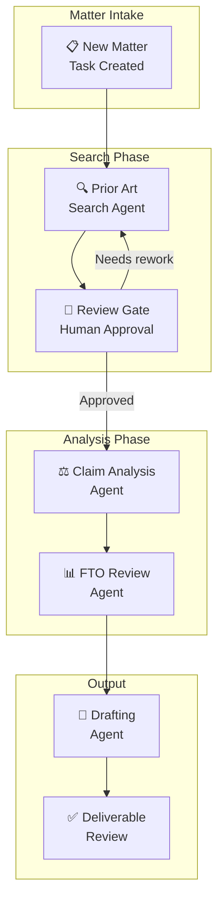

You have a prior art search agent running. A claim analysis agent behind it. A competitor portfolio monitor checking three technology domains. And one more agent tracking filing deadlines across 40 active matters.

All four are running. You have no idea which one finished, which one stalled waiting on input, and which one quietly returned an empty result two hours ago.

That's where most patent and IP management teams land after deploying their first round of agents. The agents work. The visibility doesn't.

## The Problem with Unmanaged Patent Agents

Patent work has three characteristics that make loose agent management genuinely risky, not just annoying.

**Outputs that can't be skipped.** A prior art search that misses a relevant reference can invalidate a filing or expose a client to challenge. Agents don't know what they don't know. Without a formal review gate between the search step and the drafting step, the pipeline moves forward automatically — and nobody checked the work.

**Sequential pipelines where one stall breaks everything.** Claim drafting can't start until the prior art search is clean. The freedom-to-operate analysis can't run until claim scope is set. These are strict dependencies. When one agent stalls or returns incomplete results, every step downstream stops. Teams find out two days later when the deadline is tomorrow, not when the stall happened.

**Per-matter cost accountability.** Most patent practices bill by matter. When an agent runs 60 API calls researching a pharmaceutical compound, that cost belongs to the client file, not to a shared infrastructure budget line. Without per-task cost tracking, you can't bill it accurately, you can't audit it, and you can't tell which matter types are actually profitable to handle with agents.

## How AgentCenter Fits Patent and IP Workflows

**Deliverable review gates between pipeline steps**

The deliverable review feature in AgentCenter lets you put a human checkpoint between any two agent steps. The prior art search agent finishes, its output lands in a review queue, and the claim analysis agent stays blocked until someone approves it.

That's not bureaucracy. That's the difference between "the agent ran" and "we verified the agent produced something trustworthy before anything depended on it."

For patent work, that one gate on the search output catches the cases where an agent searched the wrong patent class, returned results from the wrong jurisdiction, or found nothing because it misread the claim scope.

**Task dependencies and status visibility**

Set up a prior art task in AgentCenter, attach a claim drafting task as a dependent step, and the second task shows as blocked until the first is approved. Anyone on the team opens the [kanban board](/features/task-orchestration) and sees exactly where each matter stands — not by asking in Slack, not by checking logs, not by emailing the person who set up the agent.

For a team managing 15-25 active matters simultaneously, that board is the first tool that makes the whole pipeline readable at a glance.

**Per-task cost tracking per matter**

Every task in AgentCenter records how much it cost to run. A prior art search on a software patent runs $5 in API calls. A pharmaceutical compound freedom-to-operate sweep runs $12. A competitor portfolio monitor that runs weekly on three technology domains runs $8 per cycle.

Those numbers attach to the task record, which maps to the matter. When billing time comes, the data is already there. When a partner asks why agent costs are up 30% this quarter, you can pull up which matter types are driving the increase.

**@Mentions for agent-to-human escalation**

Patent agents hit judgment calls. A reference that might be prior art but needs attorney interpretation. A claim element that's close to competitor IP but not clearly infringing. The agent can't make those calls.

In AgentCenter, you configure the agent to flag those cases with an @mention — the task thread holds the output, the note, and the context. The attorney gets the notification, reviews the specific piece, and marks it resolved. Nothing gets buried in email. Nothing falls through.

## The Numbers

A typical patent firm or in-house IP team running agents across active matters uses 10-18 agents:

- 3-5 prior art search agents (one per major technology domain)
- 2-3 claim analysis agents
- 2-3 competitor portfolio monitoring agents
- 1-2 filing deadline tracking agents
- 1-2 for drafting assistance or search summarization

The Pro plan at $29/month covers 15 agents across 15 projects. That's enough for a small IP team handling matters across multiple clients or technology classes. What it replaces: shared tracking spreadsheets, Slack status updates, manual time entries for per-matter agent costs, and the three-minute "did the search agent finish yet?" conversations.

## Before vs After

| | Without AgentCenter | With AgentCenter |
|---|---|---|
| Visibility | Check logs or ask whoever ran the agent | Kanban board shows all matters and agent status in one view |
| Task handoffs | Manual — someone notifies when a step is done | Dependencies enforced, next step blocked until prior is approved |
| Error detection | Noticed when a deadline passes or output is wrong | Status alerts when tasks stall, fail, or miss a timeout |
| Cost tracking | Estimated or not tracked per client matter | Per-task cost tied to the matter record automatically |
| Debugging time | Re-run the full pipeline, trace step by step | Task-level run history in AgentCenter, isolated to the failing step |

## Where to Start

Set up deliverable review on your prior art search agent first. That's the step where a missed reference has the worst downstream consequences — a filing that moves forward on incomplete search is a liability, not an oversight.

Putting a review gate on that one step, before anything else runs, takes about 10 minutes to configure in AgentCenter. It also changes how much you trust every step that follows.

From there, see [how task orchestration and dependencies work](/features/task-orchestration) and [check which plan fits your team](/pricing).

---

*Patent and IP teams that add a review layer early catch more problems before they become client issues. [Start your 7-day free trial](/pricing).*
