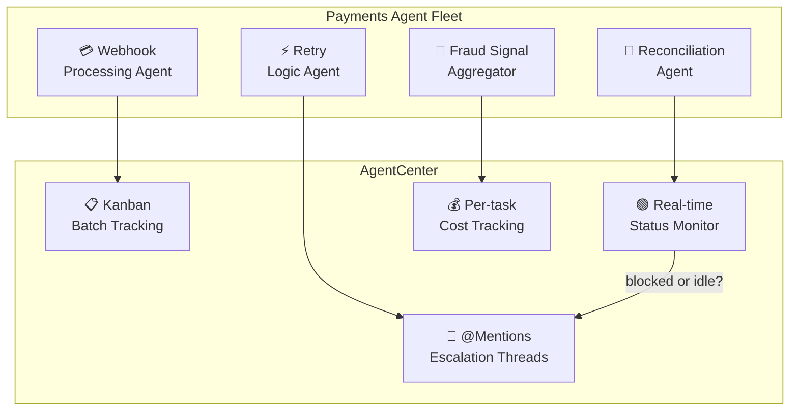

Payments engineering teams don't build AI agents for fun. They build them because someone got tired of manually reconciling 40,000 transactions a day, or watching a retry queue grow at 3am with nobody around to drain it. The agents are real, they're doing real work, and the stakes are higher than most. When an agent misbehaves in a content pipeline, you get a bad blog post. When one misbehaves in a payments pipeline, you get a ledger discrepancy the finance team finds two days later.

That's the daily problem: agents fail silently, and the failure surface isn't your logs. It's your books.

## What Breaks Without a Control Plane

Payments agents have three failure patterns specific to this role.

**Reconciliation drift.** A batch reconciliation agent processes 40,000 transactions and writes results to a ledger. If it silently fails on 300 of them, skips them, marks them as pending, or extracts incorrect amounts — you don't find out until month-end. The agent reports "complete." Your ledger disagrees. You spend three days tracing back which batch, which records, which agent run.

**Retry storms.** Agents that handle payment retries often share a single upstream payments API. When that API slows down, your retry agents back off and then retry, sometimes at overlapping intervals. You end up with three agents all retrying the same transactions simultaneously. The upstream service rate-limits them. The retry queue grows. Nobody is watching. This shows up as "mysterious latency" in your dashboards and as duplicate charges in your data.

**Parallel pipeline collisions.** A webhook processing agent and a reconciliation agent both write to the same payment record within seconds of each other. One wins. The other's update gets overwritten. No error is raised. Just a record that's wrong, with no trace of how it got that way.

All three of these are hard to catch with log monitoring alone. You need to know what the agent was *doing at the time* it wrote bad data, not just that it wrote bad data.

## How AI Agents for Payments Teams Map to AgentCenter Features

**Real-time agent status.** When your reconciliation agent is stuck on a specific batch, AgentCenter shows it as "blocked" rather than "running." That distinction matters. Your team sees the status change, opens the task thread, and has the full context right there — batch ID, last action, how long it's been stuck. Finding out now beats finding out at month-end.

**Kanban board for batch tracking.** Payments work comes in batches. An agent picks up a batch, processes it, hands off to the next stage. The [AgentCenter task board](/features/task-orchestration) makes each batch a trackable task moving through your pipeline. You can see which batches are in-flight, which are done, and which have been sitting in "processing" for six hours without an update.

**@Mentions for escalations.** When a retry agent hits its circuit breaker, a human needs to know. In AgentCenter, the agent creates a task, @mentions the on-call engineer, and the full thread is there — no Slack hunting, no log grepping at 3am. The engineer sees the task, sees the context, and decides whether to intervene or let the backoff complete.

**Cost tracking per task.** Retry agents are expensive when downstream services go down. Every retry is a new API call and a new set of LLM tokens. During a 2-hour outage, your retry agent costs can multiply by 20x. AgentCenter tracks cost per task so you see which agent ran how much and when — not just an aggregate bill at the end of the month.

## The Numbers for Payments Engineering Teams

A typical payments engineering team runs 8 to 18 agents: one or two reconciliation agents, a handful of retry and webhook processing agents, fraud signal aggregators, reporting agents, and a few for payment method validation or fee calculation.

The [Pro plan at $29/month](/pricing) handles up to 15 agents across 15 projects — the right fit for most payments engineering teams. If you're running separate staging and production environments, or managing multiple payment products, Scale at $79/month gives you room for 50 agents.

What it replaces: log-based monitoring that tells you after the fact, manual Slack pings from engineers doing incident calls at midnight, and spreadsheet tracking of which batches have actually reconciled.

## Before vs After AgentCenter

| | Without AgentCenter | With AgentCenter |
|---|---|---|
| **Visibility** | Query logs, check database, ask someone | Real-time agent status on the board |
| **Task handoffs** | Manual, often missed or undocumented | Tasks move between pipeline stages automatically |
| **Error detection** | Finance team notices discrepancy 2 days later | Agent flags "blocked" status within minutes |
| **Cost tracking** | Aggregate LLM bill appears at month end | Per-task cost visible during the run |
| **Debugging time** | Hours reconstructing what the agent did | Thread with full task context, ready to review |

## Where to Start

Set up [agent monitoring](/features/agent-monitoring) for your reconciliation agent first. It's the agent with the highest-stakes output and the most likely to drift silently. Connect it to AgentCenter, create tasks for each batch run, and track their movement through the pipeline.

You'll know within a week whether you've been flying blind. After that, add the retry agent. The cost tracking alone pays for itself during the next downstream outage.

---

*Payments engineering teams that add a control plane early spend less time firefighting later. [Start your 7-day free trial](/pricing).*
