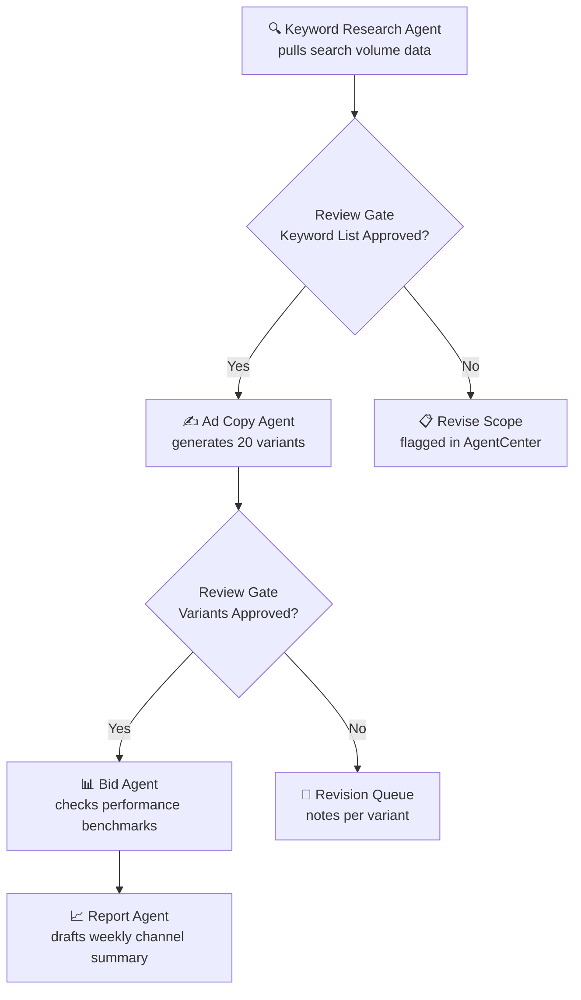

Performance marketing teams have a specific problem. You're running campaigns across Google, Meta, TikTok, and LinkedIn at the same time. You've added AI agents to help: one generates ad copy variations, another pulls bid performance and flags underperformers, a third monitors competitor creatives, and a fourth drafts weekly channel reports. Within two months you have 12 agents running, and no clear picture of which ones are actually working.

That's the moment managing agents starts to feel like managing another campaign. Except this time there's no attribution dashboard.

## The Breakdown Points

Ad agents fail in three specific ways that hurt performance teams.

**Copy agents stop generating variations silently.** Your A/B test queue runs dry. CTR drops. You don't notice for four days because the agent status shows "completed" — it just hasn't picked up new tasks.

**Reporting agents deliver stale numbers.** A bid performance report runs with yesterday's data, but nobody flags it. The media buyer makes a budget shift based on figures that don't include last night's auction results.

**Agents chew through token budget on low-value work.** An agent you set up to monitor competitor ad copy is running every 30 minutes on 40 brands instead of the 8 that actually matter. Token cost: $180 in three weeks. Business impact: near zero.

None of these are catastrophic failures. They're the kind of drift that erodes confidence over weeks, not hours. And they're hard to catch without a control plane.

## How AgentCenter Solves These

### Kanban Board for Task State

Performance marketers think in campaigns and channels, not agent logs. AgentCenter's [task management board](/features/task-orchestration) surfaces every agent task on a Kanban: backlogged, in progress, blocked, done.

When your copy generation agent stalls, the backlog column fills up instead of quietly sitting at zero. You see it in 10 minutes, not four days.

### Real-Time Agent Status and Heartbeat Monitoring

Every agent connected to AgentCenter sends a heartbeat. If an agent goes offline, idles too long, or gets stuck mid-task, the dashboard updates and you can set alert rules.

For a reporting agent running on a daily schedule, this means you know by 7am whether last night's data pull completed. Not when a media buyer notices the date on their export.

### Cost Tracking Per Agent

AgentCenter's [agent monitoring](/features/agent-monitoring) shows token usage and estimated cost at the agent level, not the account level. You can see exactly which agent is running up your OpenClaw spend.

Here's a real example: your competitor monitoring agent. With per-agent cost visibility, you spot it's generating 600 requests per day across 40 brands when you only care about 8. One scope update and you cut its cost by 80%, without touching any other agent.

### Deliverable Review Workflows

Not every agent output should feed directly into a live campaign. AgentCenter adds a review gate between agent output and action.

Your copy agent generates 20 variants for a new campaign. Instead of auto-publishing or emailing a CSV, those drafts land in a review queue. A strategist approves or rejects each one. Approved variants move to the next step. Rejected ones get flagged with notes. No manual file routing.

### Task Dependencies and Handoffs

Performance marketing pipelines run in sequence. Keyword research has to finish before copy generation starts. Bid audit has to complete before budget reallocation runs.

AgentCenter's dependency system enforces this. The copy agent won't start until the keyword agent marks its output as approved. Budget reallocation tasks sit in the queue until the bid audit deliverable clears review.

This diagram shows a typical performance marketing agent pipeline. Each step has a review gate before the next agent starts. No gate, no handoff.

## The Numbers for Performance Marketing Teams

A typical performance marketing team running agents across three to five channels manages somewhere between 8 and 20 agents. That covers copy generation, bid monitoring, creative testing, competitor tracking, reporting, and attribution analysis.

The **Pro plan at $29/month** supports up to 15 agents across 15 projects. For most performance teams, that's enough to run one project per major channel or client account. Teams managing multiple clients benefit from the Scale plan at $79/month, which covers 50 agents.

What it replaces: a mix of manual reporting scripts, shared spreadsheets for agent output, Slack threads for review approvals, and automation tools you wired together to connect them. Not all of that goes away. The coordination overhead does.

## Before vs After

| | Without AgentCenter | With AgentCenter |
|---|---|---|
| Visibility | Check agent logs manually | Kanban shows all task states live |
| Task handoffs | CSV files, Slack threads, manual triggers | Enforced dependencies with approval gates |
| Error detection | Noticed when output is missing or wrong | Heartbeat alerts before output fails |
| Cost tracking | Total account spend only | Per-agent token cost and weekly trend |
| Debugging time | 2-4 hours tracing logs | 20-minute review of task audit trail |

## Where to Start

Set up [agent monitoring](/features/agent-monitoring) first. Connect your existing agents, let them run for a week with heartbeat monitoring on, and watch the cost-per-agent breakdown.

In most cases, the first week reveals one agent running far more than intended. That single finding alone justifies the setup time, and gives you a clear scope change to make before building anything else. Once you have visibility, adding review gates and task dependencies becomes a natural next step.

---

*Performance marketing teams that add a control plane early spend less time firefighting later. [Start your 7-day free trial](/pricing).*
