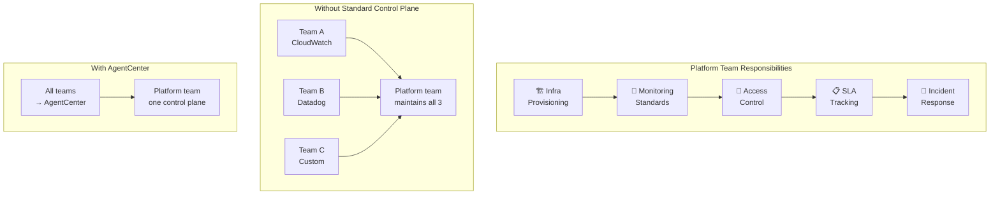

Platform engineering teams have a specific problem with AI agents: they didn't build them, they're not going to maintain the prompts, but they're responsible for keeping them running. And every team that deploys agents builds slightly different infrastructure, which means the platform team ends up maintaining 12 different monitoring setups and 8 different deployment patterns.

The platform engineering version of AI agent chaos is an internal consistency problem, not a technical one.

## The Specific Bottlenecks Platform Teams Hit

**No standard deployment pattern.** One team deploys agents as long-running services. Another deploys them as batch jobs. A third runs them inside existing microservices. The platform team has to support all three, which means custom runbooks, custom monitoring, and custom oncall procedures for each. None of it transfers.

**No unified visibility.** Different teams use different logging approaches. Some agents log to CloudWatch. Some log to Datadog. Some email Slack. When the platform team needs a cross-fleet view — "which agents are currently active?" — there's no single answer.

**Access control fragmentation.** Who can deploy an agent? Who can update a prompt? Who can view agent outputs? Without a standard access model, you end up with either everyone having too much access or teams creating their own ad-hoc permissions.

## How AgentCenter Addresses Platform Team Needs

**Standardized agent management pattern.** Every team using AgentCenter gets the same deployment model: agents connect via API, tasks flow through a queue, status is visible in the dashboard, deliverables go through review. The platform team writes one integration guide and one set of runbooks that applies to everyone.

**Cross-fleet visibility.** The [agent dashboard](/features/agent-dashboard) gives a unified view across all projects and agents. If the platform team needs to answer "how many agents are currently active across the organization," that's one query, not six.

**Workspaces with access control.** AgentCenter's workspace model lets platform teams define who can access which projects and agents. Teams get self-service within their workspace. The platform team retains control over the overall structure.

## Feature-to-Workflow Mapping

| Platform Engineering Concern | AgentCenter Feature                | Benefit                                   |
| ---------------------------- | ---------------------------------- | ----------------------------------------- |
| Standardized deployment      | API-first architecture             | One integration pattern for all teams     |
| Cross-fleet visibility       | Multi-project dashboard            | No more log aggregation DIY               |
| Access control               | Workspace + project permissions    | Teams self-serve, platform controls scope |
| SLA tracking                 | Task duration + error rate metrics | SLA reporting without custom dashboards   |
| Capacity planning            | Agent count + task throughput      | Know when to upgrade plans                |
| Incident response            | Real-time status + task history    | Faster root cause, shared runbooks        |

## The Numbers

A platform team supporting 5-10 internal product teams, each running 2-5 agents, will typically see 15-40 total agents in production at once. The [Scale plan](/pricing) at $79/month handles up to 50 agents and 50 projects — typically one project per team.

What platform teams replace with AgentCenter: custom Terraform modules for per-team monitoring, team-specific Datadog dashboards (which each team maintains differently), ad-hoc access management via IAM roles, and quarterly reviews of "what agents are we even running" because nobody has a current list.

Cloud VM provisioning on the Scale plan removes one more thing the platform team has to own.

## Before vs After AgentCenter

|                 | Without AgentCenter         | With AgentCenter                  |
| --------------- | --------------------------- | --------------------------------- |
| Visibility      | 6+ different log sources    | One dashboard                     |
| Task handoffs   | Each team's custom approach | Standard across all teams         |
| Error detection | Team-specific alerts        | Consistent threshold-based alerts |
| Cost tracking   | Cloud billing by service    | Per-agent, per-project            |
| Debugging time  | Coordinate with each team   | Single source of truth            |

## Where to Start

Start with one team, not all of them. Pick the team with the most active agents and the most complaints about operational overhead. Migrate their agents to AgentCenter, document what the integration looks like, and use that as the template for every other team.

Internal adoption goes faster when the first example is clearly better, not just different.

_Platform engineering teams that add a control plane early spend less time firefighting later. [Start your 7-day free trial](/pricing)._
