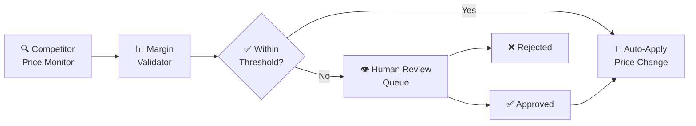

Pricing operations teams are some of the heaviest users of AI agents in production. You're running agents that track competitor prices around the clock, validate margins before changes go live, flag promotional conflicts across thousands of SKUs, and queue approved updates to your pricing engine. The agents do real work. The problem is that managing AI agents for pricing operations is messier than it looks.

When an agent makes the wrong call on a price change at 2am, you find out at 9am when the sales team is furious about a 40% margin hit. By then, reconstructing what happened takes hours.

## What Actually Breaks Without a Control Plane

Pricing ops teams hit three specific problems when agents run without visibility or coordination.

**No audit trail when a price goes wrong.** Pricing decisions affect revenue directly. When a product gets mispriced — too low and margin tanks, too high and conversion drops — you need to know which agent made the call, what data it acted on, and what logic it applied. If your agents run as cron jobs or Lambda functions, that audit trail doesn't exist. You're left piecing it together from logs across three systems.

**Agents stepping on each other.** Your margin validation agent and your competitor tracking agent both trigger on the same price signal. They produce contradictory recommendations for the same SKU. Neither agent knows the other ran. Without sequenced task handling, you get race conditions in your pricing logic that only surface in monthly P&L reviews.

**No real-time view into what's running.** When the CFO asks "what are your agents doing right now?" — the honest answer for most pricing ops teams is "we'll check the logs." That's not an answer that builds confidence in the program.

## How AgentCenter Fits a Pricing Agent Workflow

Here's what a typical pricing agent pipeline looks like when it runs through AgentCenter:

**Real-time agent status** is the first thing pricing ops teams notice. You can see which agents are working, idle, or blocked — without tailing logs. When your competitor monitoring agent goes silent at 2am, you know before morning standup instead of after the damage.

**Task orchestration** is where it pays off for pricing. Instead of your competitor agent and margin validator running independently and possibly contradicting each other, you sequence them as linked tasks in AgentCenter. The margin validator only runs after the competitor agent completes and submits its output. No more conflicting recommendations on the same product.

**Deliverable review workflows** are the right tool for high-impact changes. Configure AgentCenter so any price change that drops below a margin threshold — say, anything below 15% gross margin — goes into a human review queue before it reaches your pricing engine. The agent does the analysis and flags the change. A human approves or rejects it. This keeps agents in an assisted mode for your most sensitive decisions, which is what most pricing ops leads actually want.

**Cost tracking per agent** matters when you're running a fleet of agents that each call an LLM to interpret market signals or generate pricing rationale. AgentCenter shows LLM spend per agent and per task. If your competitor research agent is making 40 token-heavy calls per SKU when it should be making 4, you'll catch that before the bill arrives.

**@Mentions and task threads** give your team a single place to discuss a flagged pricing decision. The agent output, the margin data, and the human discussion all live on the same task card. No more searching three different Slack threads to find out why a product was re-priced last Tuesday.

## The Numbers

A mid-size retailer or marketplace pricing ops team typically runs 8-20 agents: competitor trackers, margin validators, promotional conflict detectors, price change queues, and summary reporting agents. The [Pro plan](/pricing) covers up to 15 agents across 15 projects — that's the right fit for most teams. Larger operations running agents across multiple geographies or business units will want the [Scale plan](/pricing) at $79/month for up to 50 agents.

What does it replace? Usually a combination of cron job alerts sent to Slack, a shared spreadsheet logging what each agent did, and whoever happened to be on call when something broke. That's not a system. It's technical debt running on a schedule.

## Before vs After

| | Without AgentCenter | With AgentCenter |
|---|---|---|
| **Visibility** | Check logs after the fact | Live status across all pricing agents |
| **Task handoffs** | Agents run independently, can conflict | Sequenced tasks with clear dependencies |
| **Error detection** | Noticed when a customer or sales rep complains | Flagged before the price change reaches production |
| **Cost tracking** | Monthly LLM bill with no breakdown | Per-agent, per-task cost tracking |
| **Debugging time** | 2-3 hours reconstructing what happened | Task history and agent output available immediately |

## Where to Start

If you're new to AgentCenter, start with the [deliverable review workflow](/features/task-orchestration). Before connecting your pricing engine, run your agents in review mode: they submit their recommended price changes as deliverables, and your team approves them manually. Run it for two or three weeks.

Most pricing ops teams find that review mode reveals agent behavior they didn't expect — changes that technically followed the logic but didn't match business intent. You want to catch that before it's live in production.

After that, wire in the full sequence. You'll have a working control plane instead of a collection of scripts that happen to fire on a schedule.

---

*Pricing ops teams that add a control plane early spend less time firefighting later. [Start your 7-day free trial](/pricing).*
