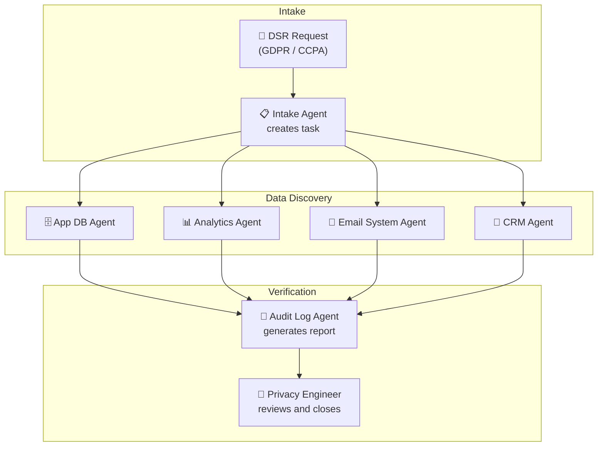

Privacy engineering teams run AI agents in some of the most legally sensitive pipelines in the company. PII scanning. GDPR deletion requests. Consent signal monitoring. Data lineage tracking. A single agent failure here isn't a bug report — it's a compliance incident.

Most teams start with three or four agents and feel fine. By the time they're running ten, nobody can clearly state which agent processed which data subject request, which PII scan actually completed, or what happened when the consent pipeline fell behind last Thursday.

## The Problem AI Agents Create for Privacy Engineering

The agents work individually. The pipeline as a whole becomes invisible.

Three specific things break:

**Data subject request (DSR) workflows go dark.** A mid-size tech company handles hundreds of GDPR and CCPA deletion and access requests monthly. When you automate this with agents — one per request type, or one per data system — you lose coordination fast. The agent ran. Did it delete the record in all six systems? Did it search the analytics warehouse or skip it because of a timeout? What timestamp can you defend in a regulator audit? Without a control plane, this lives in spreadsheets, Slack messages, and crossed fingers.

**PII scanning agents fail silently.** An agent that scans S3 buckets for PII looks great in a demo. In production, it hits a file type it doesn't handle, times out on a 200GB dataset, or misses a newly spun-up data store that the infrastructure team added last sprint. You find out three months later when the security team flags it — not when the scan ran on Tuesday morning.

**Multi-system handoffs drop context.** A CCPA data access request might touch your application database, analytics warehouse, email system, and CRM. When each step uses a different agent, the handoff between them is the failure point. Agent 2 needs to know what Agent 1 found. Without task tracking, you have no audit trail of what passed between them — and no way to reconstruct it later.

## How Privacy Engineering Teams Use AgentCenter

**Kanban board for DSR tracking**

Each data subject request becomes a task in [AgentCenter's task orchestration board](/features/task-orchestration). Columns map to workflow stages: Intake → In Progress → Pending Review → Complete. As each downstream agent finishes processing a system — database, analytics, CRM — the task moves or gets updated. The privacy team sees exactly which step is stuck without pinging an engineer. No more "did the CRM deletion agent run for request #2847?"

**Real-time agent status for PII scans**

An agent scanning 14 S3 buckets doesn't need to run invisibly. [Agent monitoring in AgentCenter](/features/agent-monitoring) surfaces status in real time: working, blocked, or failed. If a scan runs for 40 minutes and hits an error, the activity feed shows it immediately. You don't find out three months later.

**Task threads for multi-system handoffs**

When Agent 3 fails to find a matching record in the data warehouse and needs a human decision before proceeding, it adds a note to the task thread. The privacy engineer gets @mentioned with the agent's output right there in the thread. No reconstructing context across five Slack channels.

**Cost tracking per workflow**

LLM-based PII classification is expensive when it runs on unstructured data at scale. AgentCenter's cost view breaks down what each agent spent per task, so you can see when a classification agent is burning 10x its expected cost on a batch run — before that shows up as a surprise on your monthly invoice.

## The Numbers for Privacy Engineering Teams

A privacy engineering team at a mid-size tech company typically runs 8–20 agents: intake agents per request category, deletion agents per data system, PII scanning agents per storage layer, a classification agent for unstructured data, and an audit log agent generating compliance reports.

The [Pro plan](/pricing) (15 agents, 15 projects) fits most teams. Scale fits teams handling high request volumes across many data systems. What it replaces: a mix of cron jobs, Lambda functions, a shared spreadsheet tracking request status, and a Slack channel where someone asks "did that deletion job finish?" twice a week.

## Before and After

| | Without AgentCenter | With AgentCenter |
|---|---|---|
| **Visibility** | Spreadsheets and Slack threads | Real-time task board per DSR request |
| **Task handoffs** | Agents drop context between systems | Task threads carry full output across steps |
| **Error detection** | Silent failures found days or weeks later | Status alerts surface errors within minutes |
| **Cost tracking** | Unknown until monthly invoice | Per-agent cost visible per task |
| **Debugging time** | 4–6 hours reconstructing what happened | Full task history in one place |

## Where to Start

Set up the Kanban board first, mapped to your DSR workflow stages. You don't need to change how your agents work — you're adding a visibility layer on top, not rebuilding the pipeline. Map your existing request types to columns, wire the intake agent to create tasks, and you'll immediately see how much of your pipeline was invisible before.

---

*Privacy engineering teams that add a control plane early spend less time firefighting later. [Start your 7-day free trial](/pricing).*
