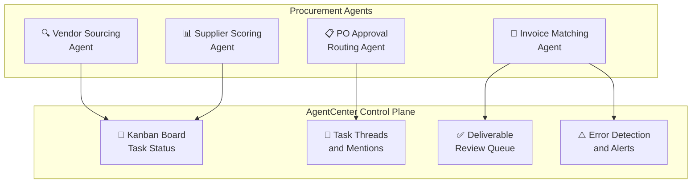

Procurement automation teams hit a wall around agent five or six. Not because the agents stop working. They keep running: pulling vendor data, routing approvals, matching invoices. The wall is visibility. Nobody knows where any of it stands until something goes wrong, and by then it's already late.

That's the actual daily problem: agents doing real work in the dark.

## What Breaks Without a Control Plane

The problems are specific. They're not framework problems or model quality problems. They're coordination problems.

**Vendor sourcing results land in a shared folder.** The agent finishes, writes its output, moves on. Someone on the team is supposed to check. Sometimes they do. Sometimes the folder sits unreviewed for two days while the sourcing window closes.

**PO approval routing stalls silently.** An approver is out. The agent flags the task as pending and waits. Nobody notices for three days. The purchase order expires. The vendor moves on. The team gets the blame, not the agent.

**Invoice matching fails on edge cases.** Currency format mismatch. Missing PO reference number. Wrong vendor ID. The agent logs the error. No alert fires. A finance team member finds it a week later while reconciling a statement.

None of this is the model's fault. The agents are doing exactly what they were built to do. What's missing is the layer between agents and the people who need to act on their work.

## How Procurement Teams Manage AI Agents with AgentCenter

### Kanban Board: Task Status That Doesn't Require Logging In Somewhere Else

Every agent task shows up on the [kanban board](/features/task-orchestration) the moment it starts. Vendor sourcing agent finishes a batch? It moves to Done. PO routing agent marks a task blocked? It shows up in the blocked column. You don't check folders. You look at the board.

This matters for procurement because the timing of decisions is tight. A sourcing window has a deadline. A PO approval has an expiry. Waiting two days to notice an agent finished (or stalled) costs money.

### @Mentions and Task Threads: Handoffs That Actually Happen

When the PO routing agent marks a task as blocked, it can create a thread on that task and mention the relevant approver. In AgentCenter, that fires a notification. The approver sees it, takes action, and the task moves forward.

No Slack ping that gets buried. No email that lands in the wrong folder. The handoff happens inside the same system where the task lives.

### Deliverable Review Queues: Humans on the Edge Cases

Invoice matching is high-volume work that's low-risk until it isn't. An agent can match 400 invoices a day with no issues. But invoice 401 has a currency conversion that doesn't match the contract rate, and if that goes unreviewed, it becomes an overpayment.

AgentCenter's deliverable review workflow puts outputs into a queue before they're committed. The agent handles the volume. A human reviews the flagged exceptions. That's the split that actually works in practice.

### Error Detection: See It Now, Not Next Week

[Agent monitoring](/features/agent-monitoring) in AgentCenter surfaces failures as they happen. When the invoice agent throws a malformed vendor ID error, the task gets flagged immediately on the board. You don't wait for the finance team to notice the discrepancy in a monthly reconciliation.

Faster error detection in procurement isn't just a developer concern. It's a cash flow concern.

## The Numbers

A mid-sized procurement automation team typically runs 8 to 15 agents: vendor sourcing, PO routing, supplier scoring, invoice matching, contract renewal tracking, spend analysis, and a few integration agents that pull from ERP systems.

That fits the [Pro plan](/pricing) at $29/month (up to 15 agents, 15 projects). What it replaces is a patchwork of Slack channels, shared spreadsheets, folder checks, and whoever-remembers-to-look-at-it monitoring. That patchwork works fine at two agents. It falls apart at ten.

## Before vs After

| | Without AgentCenter | With AgentCenter |
|---|---|---|
| Visibility | Manual folder checks | Real-time status on kanban |
| Task handoffs | Slack ping or nothing | @Mention in task thread |
| Error detection | Days later, sometimes never | Immediate flag on the board |
| Cost tracking | Estimated from billing statements | Per-agent, per-task breakdown |
| Time spent debugging | Hours of log-diving | Minutes with activity feed |

## Where to Start

Set up the kanban board for your invoice matching agent first. That's the one where errors cost real money: a wrong match can mean a duplicate payment or an undetected short-pay. Getting that agent's tasks visible on the board, with errors flagged automatically, gives you the clearest return in the shortest time.

Once that's running, add the PO routing agent. The blocked-task visibility and @Mention notifications fix the approval-stall problem within the first week.

Everything else follows from there.

---

*Procurement automation teams that add a control plane early spend less time firefighting later. [Start your 7-day free trial](/pricing).*
