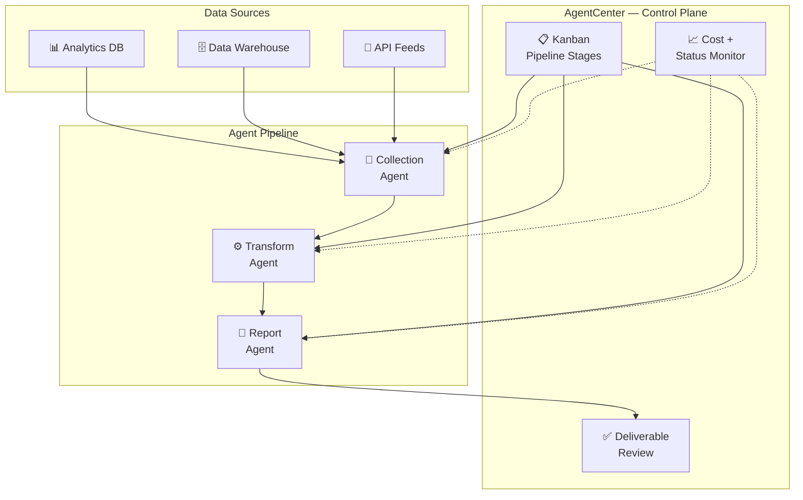

You're running eight agents across your analytics pipeline. One pulls event data from your warehouse, two clean and join it, three run metric calculations, and two generate the reports that go to stakeholders every Monday.

It worked fine at three agents. At eight, you don't know which one produced a bad number until someone in a meeting asks why DAU is down 40% from last week.

That's the core problem for product analytics teams managing AI agents: the pipelines keep growing, the agents keep multiplying, and the visibility hasn't kept up.

## The Bottleneck Isn't the Agents — It's the Gaps Between Them

Three things break when you scale a product analytics pipeline without a control plane.

**Bad data propagates silently.** A collection agent runs cleanly, logs no errors, and passes malformed data to the transform agent. The transform agent processes it fine. The report agent generates Monday's metrics on time. The number is wrong. Nobody knows until the business review on Wednesday.

**You can't trace which agent caused the problem.** You have one failed metric and eight agents. Tracing the bad value backwards through logs that don't share a common task ID takes most of a morning.

**Cost spikes without warning.** One misconfigured agent runs a full-table scan instead of an incremental query. You don't find out until the cloud bill arrives. By then, it's already run 15 times that week.

None of these are AI problems. They're coordination problems. You need to see what each agent did, when it did it, what it passed downstream, and what it cost.

## How AgentCenter Fits a Product Analytics Workflow

Here's how the features map to the real problems your team hits.

**Kanban board for pipeline stages.** Map your pipeline as task states: "queued," "collecting," "transforming," "reporting," "review." Each agent's task moves through these stages visibly. You can see which stage is blocked without digging through logs.

Concrete example: your report agent sits in "blocked" state. You open the task, see it's waiting on the transform agent, and find the transform agent threw a schema mismatch 40 minutes ago. You caught it before Monday's report runs.

**Real-time agent status.** AgentCenter shows each agent as online, working, idle, or blocked at any moment. When your collection agent goes from "working" to "idle" three hours before expected, you know to check — not when the downstream report comes back empty.

**Per-agent cost tracking.** The [agent monitoring dashboard](/features/agent-monitoring) breaks down cost per task, per agent, per day. When that full-table scan agent runs again, you see the spike the same day it happens.

**@Mentions and task threads.** When a metric looks wrong, you flag it directly in the task thread and mention whoever owns that agent. No context switching to Slack. The issue, the data, and the conversation are in one place.

**Deliverable review.** Before a generated report goes to stakeholders, you route it through an approval step. One person reviews, approves, and it ships. No more "which version of the weekly numbers did we send?" questions.

## The Numbers

A mid-sized product analytics team typically runs 8 to 20 agents: 3 to 5 for data collection, 2 to 4 for transformation, 2 to 4 for metric calculation, and 2 to 3 for report generation or alerting.

The [Pro plan](/pricing) at $29/month covers up to 15 agents and 15 projects. That fits most product analytics setups without restructuring anything. Teams running larger pipelines or multiple product lines move to Scale at $79/month for up to 50 agents.

What it replaces: scattered logs in three different tools, a shared doc tracking which agents are "on" or "off," and the weekly conversation about what the Monday report actually pulled.

## Before vs After AgentCenter

| | Without AgentCenter | With AgentCenter |
|---|---|---|
| **Visibility** | Logs per agent, no unified view | All agents visible by status and pipeline stage |
| **Task handoffs** | Agent completes, nothing downstream notified | Next agent triggered automatically, task state moves |
| **Error detection** | Noticed when a stakeholder flags a wrong number | Caught when agent shows "blocked" or cost spikes |
| **Cost tracking** | Monthly cloud bill, total spend only | Per-agent cost per day, visible immediately |
| **Debugging time** | 2+ hours tracing task IDs across log files | Under 20 minutes with full task history per agent |

## Where to Start

Set up the Kanban board first. Map your pipeline stages as task states and assign each agent to a column. You don't need to instrument anything yet — just seeing your agents in one place, moving through stages, tells you more than any log file.

Once you can see the full pipeline, you'll notice which stage is the bottleneck. Then add cost monitoring for that specific agent.

The [task orchestration feature](/features/task-orchestration) is where most analytics teams start, and it's where the most time gets recovered.

---

*Product analytics teams that add a control plane early spend less time firefighting later. [Start your 7-day free trial](/pricing).*
