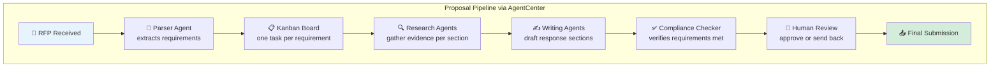

Proposal management teams live and die by deadlines. An enterprise contract RFP arrives — 180 pages of requirements, a 30-day response window, contributors needed from legal, technical, finance, and solutions teams. Before AI agents, this was a 20-person relay race. With AI agents, it can be a 10-person team and 15 agents. But only if you can see what those agents are doing.

Most teams can't.

## The Real Problem with RFP Agent Workflows

When an AI agent is parsing a 180-page RFP at 11pm before a submission deadline, you're not watching. You find out it got stuck on page 47 because your compliance checker agent can't start — it's waiting on output that never arrived.

This is the control plane problem. Not "can AI agents do proposal work?" They can. The question is whether you can manage 15 agents working across 150 requirements simultaneously without something falling through.

Three things break without a control plane:

**Section ownership disappears.** You have a research agent and a writing agent working on the same RFP section because nobody set up the dependency. Both submit drafts. Your human editor doesn't know which one to use and spends 45 minutes reconciling two versions of section 7.

**Stuck agents are invisible.** A parser agent hit a scanned PDF it couldn't process. It's been returning empty results for 3 hours. You find out when the writer agent's queue is empty and the deadline is 6 hours away.

**Cost tracking is guesswork.** You ran 12 agents for 6 days on a federal contract. The API invoice arrived and nobody can reconcile it to specific sections or proposals. Finance wants an estimate for next quarter's bid spend and you have nothing useful.

## How AgentCenter Fits an RFP Workflow

### Kanban Board for 150 Requirements

When a parser agent finishes extracting requirements from an RFP, each requirement becomes a task card in AgentCenter. You can see in one view: which sections are in progress, which are waiting on a dependency, which have a deliverable ready for human review.

Before this, teams used a shared spreadsheet that was out of date by Tuesday morning. With 150 requirements and 15 agents running in parallel, tracking who's working on what without a board becomes a full-time job by itself.

### Task Dependencies Stop Duplicate Work

AgentCenter lets you set task dependencies. Your writing agent's task doesn't unlock until the research agent marks its task complete. That eliminates the "two agents, same section" problem that wastes 4 hours of output nobody will use.

Dependencies also give you a clear picture of where the bottleneck is. If 40 writing tasks are waiting, it's because the research pipeline is slow — not because your writers are stuck. You know exactly where to look.

### Real-Time Status Catches Stuck Agents

When a research agent stops producing heartbeats, AgentCenter surfaces it immediately. You see the agent as blocked, not just quietly stopped. For proposal work under deadline, an agent stuck at 2pm on a 5pm submission is a different situation than one stuck at 2am — and AgentCenter shows you the difference in real time.

### Deliverable Review Before Handoff

When a writing agent submits a draft section, AgentCenter routes it through a review gate before it reaches your human editor. A lead orchestrator agent runs a compliance check: does this draft address every sub-requirement in the RFP clause? Only passing drafts advance to the editor queue.

This protects your editor's time. Reviewing 30 sections doesn't leave room to discover on section 18 that an agent misread the requirement and produced an off-topic draft. The [deliverable review features](/features/agent-monitoring) catch that earlier in the chain.

### Cost Tracking Per Task

API spend gets attributed to specific task cards. When you finish a proposal, you can pull a cost breakdown by section, by agent, by day. That's how you find out the technical specs section costs 3x more per page than the executive summary — and decide whether to adjust your prompting for the next bid.

You can also set budget limits per task so a single misbehaving agent can't run up a $500 tab on one section while you're not watching.

## The Numbers

A typical proposal management team running AI agents:

- **8-12 agents per proposal**: parser, domain researchers (2-4), section writers (2-4), compliance checker, formatter
- **Peak load**: 20-30 active agents when running 2-3 concurrent proposals
- **Plan fit**: Pro ($29/mo, 15 agents) for single-proposal teams; Scale ($79/mo, 50 agents) for teams handling concurrent bids
- **What it replaces**: Slack threads for status updates, a spreadsheet tracking section ownership, manual API cost estimates nobody trusts

See [pricing](/pricing) for a full plan comparison.

## Before vs After

| | Without AgentCenter | With AgentCenter |
|---|---|---|
| Visibility | "What's the status on Section 4?" — sent to a Slack channel | Kanban card shows: in-progress, research agent, estimated finish |
| Task handoffs | Writer starts when someone notices the output file in a shared folder | Dependency locks: writer's task unlocks when research task is marked complete |
| Error detection | Agent stuck for hours before anyone notices the queue is empty | Heartbeat monitoring flags blocked agents immediately |
| Cost tracking | Monthly API invoice with no breakdown by proposal or section | Per-task spend shows cost per RFP section and per agent |
| Debugging time | "Which draft did the agent submit? What prompt version?" | Full audit trail per task: agent ID, prompt, output, timestamp |

## Where to Start

Set up the Kanban board first, before any agents run.

Take your last completed RFP's requirement list and import it manually as task cards. Assign each card to an agent type. Run one small proposal through the full structure. You'll find the stuck points in two days of real operation — where handoffs fail, where agents wait too long, where you're missing a dependency that causes duplicate work.

Fix those issues on one small proposal before you're managing 20 agents on a $10M government bid.

[Agent monitoring](/features/agent-monitoring) is the second feature to wire in. Simple heartbeat visibility changes how you respond when something goes wrong under deadline.

---

*Proposal management teams that add a control plane early spend less time firefighting later. [Start your 7-day free trial](/pricing).*
